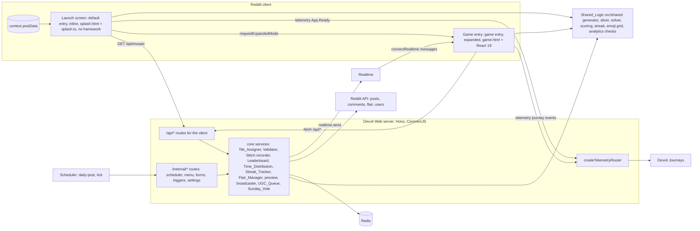
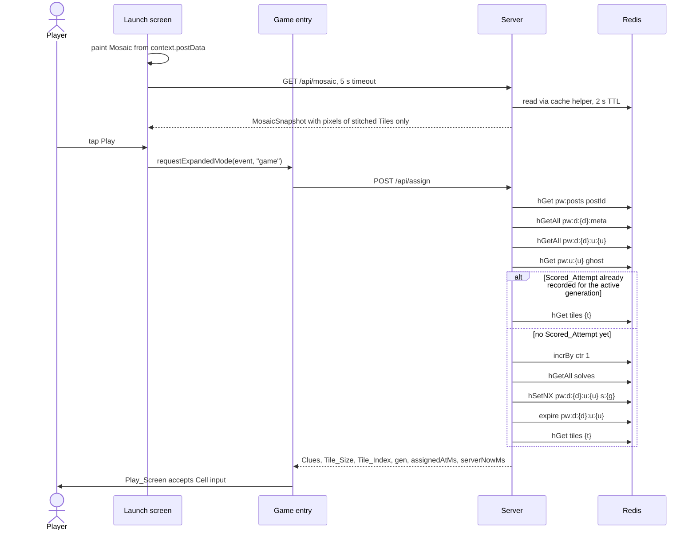
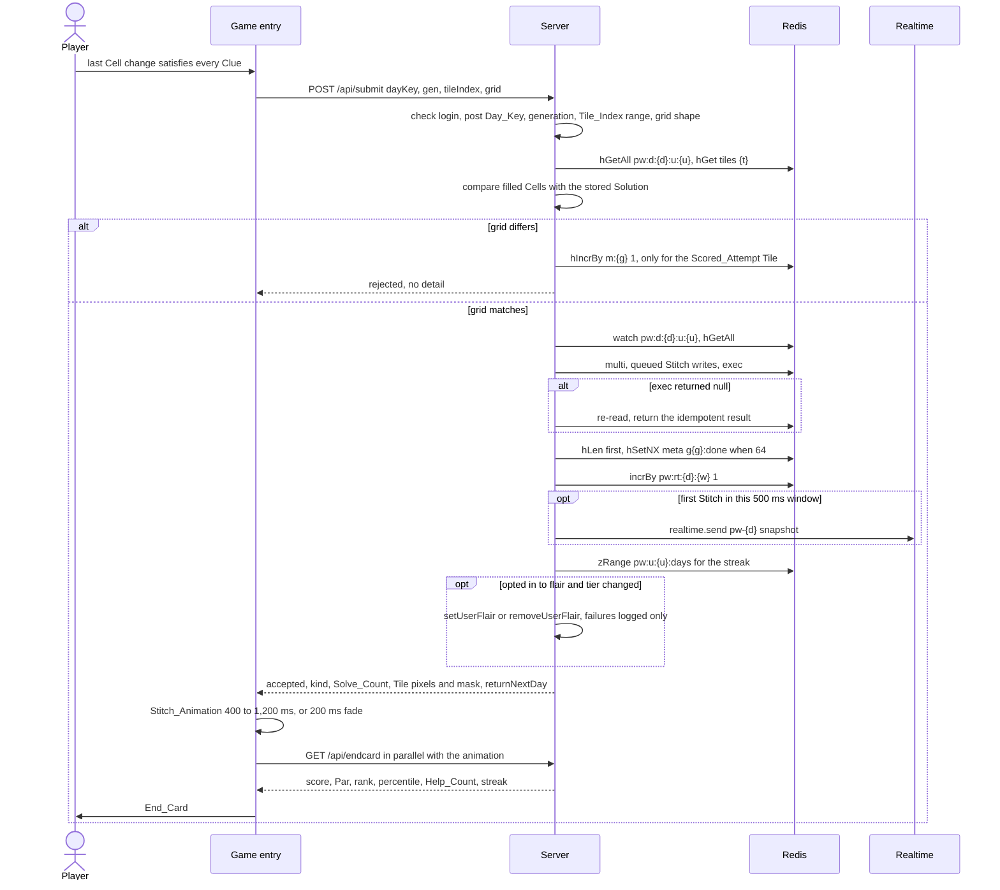
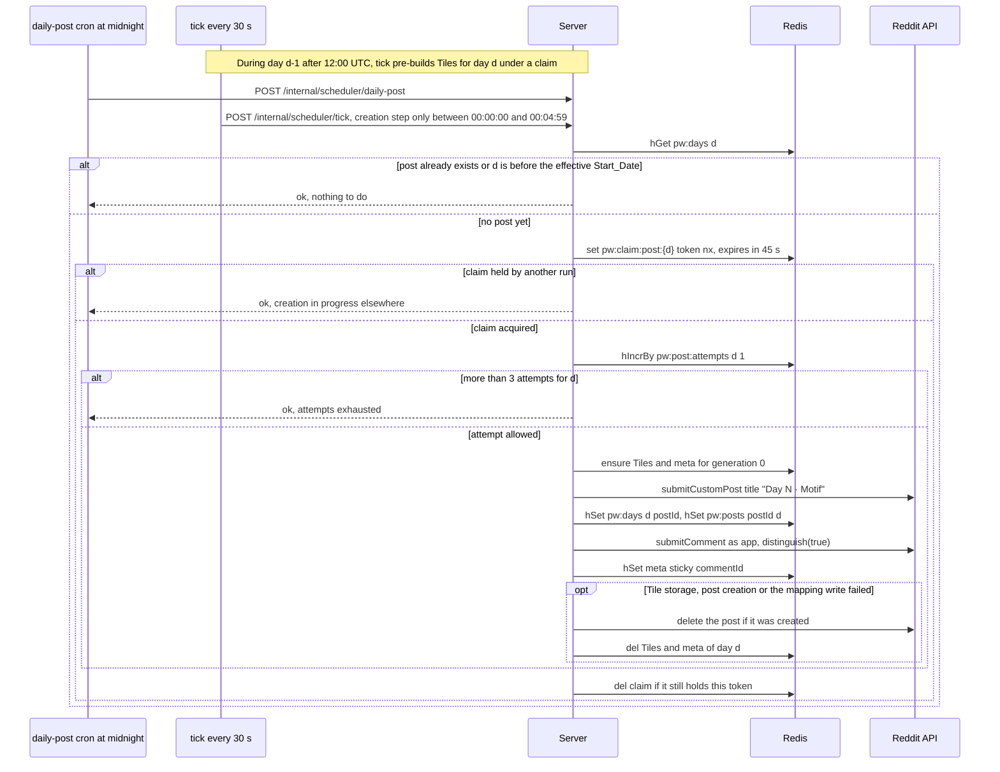
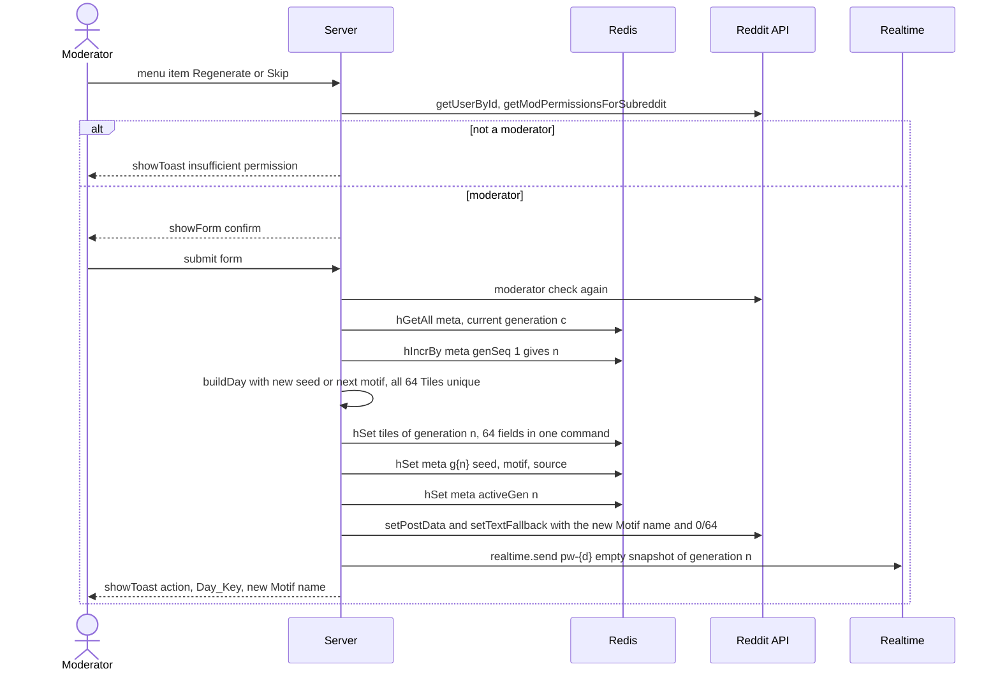
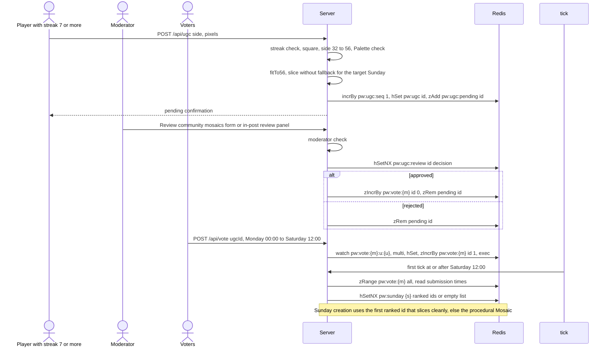

# Design Document

## Overview

Patchwork is a daily, asynchronous community nonogram game for Reddit, built as a Devvit Web Interactive Post from a fresh React-template project. Each UTC day the Scheduler posts one hidden Mosaic made of 8×8 Tiles. A player who opens the post receives one Tile (the Scored_Attempt), fills Cells from the row and column Clues, and the Server checks the submitted fill grid against the stored Solution before it records a Stitch. The shared Mosaic_View fills in as Stitches arrive. Once all 64 Tiles are stitched, later players reinforce Weak_Tiles, so a latecomer always gets a Tile whose Stitch counts.

Mosaic art is generated procedurally and deterministically from the Day_Key with a seeded integer PRNG. The one exception is a Sunday whose Sunday_Vote picked an approved UGC_Mosaic. No AI-generated image or text is used anywhere, and no paid or LLM API is called at build time or runtime (Req 1.8, Req 2.1).

### Scope of this design

This design covers Requirements 1 to 31 and resolves Open Questions OQ-1 to OQ-14 of requirements.md. This part of the document holds the Overview, Architecture, Components and Interfaces, and Data Models. Correctness Properties, Error Handling and the Testing Strategy follow after Data Models.

Conventions used below:

- "Req 9.2" means Requirement 9, acceptance criterion 2.
- All dates and times are UTC. A Day_Key is `yyyy-mm-dd`.
- Redis keys are written in `code` with placeholders: `{d}` Day_Key, `{g}` generation number, `{t}` Tile_Index, `{u}` Reddit user ID, `{m}` the Monday Day_Key of a vote week, `{s}` a Sunday Day_Key.
- "Generation" is this design's name for one stored Mosaic variant of a Day_Key. Generation 0 uses the default Regeneration_Seed. Regenerate and skip create a new generation (see Data Models (b) and the regenerate sequence in Architecture).
- Numbers in this document come from requirements.md, the Devvit documentation, a formula defined here, or a measurement whose source is named. Formula constants that work step 2 must calibrate are marked "initial value".

### Devvit platform facts used by this design

Every Devvit API named in this design was read in the Devvit documentation on 2026-11-15, either in the docs snapshot (https://developers.reddit.com/docs/llms-full.txt) or on the API reference page listed. Work step 2 still re-confirms each API against the docs and the installed type definitions before first use (Req 1.1, Req 1.2).

| # | Function or config key | What it does | Limit or rule that matters | Source |
|---|---|---|---|---|
| F1 | App creation: the wizard at developers.reddit.com/new (React template) or `npx devvit init [code] [--template <name>]` | Creates a new Devvit Web project. Both paths need a Reddit sign-in in the browser. Inside an uninitialised Devvit project the CLI initialises that directory. | Node.js 24.18.0 or later is required. | https://developers.reddit.com/docs/quickstart and https://developers.reddit.com/docs/guides/tools/devvit_cli |
| F2 | React template (`devvit-template-react`) | Hono server, React 19.3.1, Tailwind 4, Vite 8.3.7, TypeScript 6.0.3, `@devvit/web`, `@devvit/start` and `devvit` 0.15.3. Entry points `default` (inline `splash.html`) and `game` (`game.html`). | `engines.node` is ">=24.0.0"; script `launch` runs `npm run deploy && devvit publish`; ships `public/snoo.png`; `test:unit` uses `node --test`, not Vitest. | https://developers.reddit.com/docs/examples/template-library and https://github.com/reddit/devvit-template-react |
| F3 | `devvit.json`: `post.entrypoints`, `server`, `permissions`, `triggers`, `scheduler.tasks`, `menu.items`, `forms`, `settings` | App configuration. `entrypoints` must include `default`; each has `entry`, optional `inline` and `height`. | The server bundle must be CommonJS. Trigger, scheduler, menu and form endpoints must start with `/internal/`. | https://developers.reddit.com/docs/capabilities/devvit-web/devvit_web_configuration |
| F4 | `permissions.reddit` `{ enable, scope, asUser }`, `permissions.redis`, `permissions.realtime`, `permissions.journeys` | Turns capabilities on. `scope` is "user" (default) or "moderator"; `asUser` lists user actions such as `SUBMIT_COMMENT`. | The docs do not list which calls need `scope: "moderator"`. | https://developers.reddit.com/docs/capabilities/devvit-web/devvit_web_configuration |
| F5 | Devvit Web server requests | Hono routes under `/api/*` for the client and `/internal/*` for the platform. | 30 s per request, 4 MB request payload, 10 MB response, no websockets or streaming, no `fs` or native packages. | https://developers.reddit.com/docs/capabilities/devvit-web/devvit_web_overview and https://developers.reddit.com/docs/guides/faq |
| F6 | Browser storage in the web view | `localStorage` works but the iframe URL changes per app version. | `localStorage` is cleared on every app update, so it cannot hold per-account state. | https://developers.reddit.com/docs/guides/faq |
| F7 | Redis commands: `get`, `set`, `del`, `incrBy`, `expire`, `hGet`, `hSet`, `hSetNX`, `hIncrBy`, `hGetAll`, `hLen`, `hDel`, `zAdd`, `zIncrBy`, `zRange`, `zRank`, `zScore`, `zCard`, `zRem` | Strings, hashes, sorted sets. `incrBy(key, 1)` is the documented INCR. `hSetNX` sets a field only if it does not exist. | No plain sets or lists, no listing or scanning of all keys, no pipelining. `hMGet` "may be disabled for your app (allowlisted feature)", so this design does not use it. | https://developers.reddit.com/docs/capabilities/server/redis |
| F8 | Redis transactions: `watch(key)` returns a `TxClientLike`; `multi()`, `exec()`, `discard()`, `unwatch()` | `exec()` returns null when a watched key changed. An error before `exec` discards the transaction. The docs state the steps "happen together or none at all". | 20 concurrent transaction blocks per installation in the limits table and the `multi` row (the "Shared state" paragraph says 30; this design uses 20); 5 s execution timeout. Single `incrBy`, `hIncrBy`, `zIncrBy` need no transaction. | https://developers.reddit.com/docs/capabilities/server/redis and https://developers.reddit.com/docs/api/public-api/interfaces/TxClientLike |
| F9 | Redis platform limits | Per installation (per subreddit). | 40,000 commands per second; 5 MB request size; storage 100 MB for unpublished apps (5 GB published). Writes can fail when storage is full. | https://developers.reddit.com/docs/capabilities/server/redis |
| F10 | `ZRangeOptions` `{ by: 'score' \| 'lex' \| 'rank', limit?: { offset, count }, reverse?: boolean }` | Range reads on sorted sets, optionally reversed. | BYSCORE and BYLEX `limit.count` is capped at 1,000 per call. No `zCount` or `zRevRank` is documented. | https://developers.reddit.com/docs/api/public-api/type-aliases/ZRangeOptions and https://developers.reddit.com/docs/capabilities/server/redis |
| F11 | `SetOptions` `{ nx?: boolean, xx?: boolean, expiration?: Date }` for `set` | Set-if-absent with an expiry, used here for short-lived claims. | None stated. | https://developers.reddit.com/docs/api/public-api/type-aliases/SetOptions |
| F12 | `scheduler.tasks.<name>` `{ endpoint, cron, data? }`; handler receives `TaskRequest`, returns `TaskResponse`; `scheduler.runJob`, `cancelJob`, `listJobs` | Recurring cron tasks are rescheduled on install and upgrade. | 5-part or 6-part cron; sub-minute ("faster scheduler") is marked experimental; up to 10 live recurring actions per installation; `runJob` 60 creations and 60 deliveries per minute. The docs do not state the cron time zone. | https://developers.reddit.com/docs/capabilities/server/scheduler and https://developers.reddit.com/docs/capabilities/devvit-web/devvit_web_configuration |
| F13 | `reddit.submitCustomPost({ subredditName, title, entry, postData, textFallback, styles })` | Creates the Interactive Post. `styles.backgroundColor` and `backgroundColorDark` (`#RRGGBBAA`) show before the iframe loads; `styles.height` is TALL (512 px) or REGULAR (320 px). | `shareImageUrl` must be on i.redd.it via media upload; not used here. | https://developers.reddit.com/docs/capabilities/creating_custom_post |
| F14 | `postData`, `context.postData`, `post.setPostData(obj)` | Small JSON attached to the post, readable on client and server without a server call. | 2 KB per post; `setPostData` replaces the whole object; the data is sent to the client, so it must hold nothing secret; open views do not re-render on update. | https://developers.reddit.com/docs/capabilities/server/post-data and https://developers.reddit.com/docs/guides/faq |
| F15 | `textFallback` and `post.setTextFallback({ text })` | Markdown shown on old Reddit, third-party apps and in search. | Up to 40,000 characters. | https://developers.reddit.com/docs/capabilities/server/text_fallback |
| F16 | `Post` methods: `setPostData`, `setTextFallback`, `setCustomPostStyles`, `edit`, `delete`, `addComment` | `edit` replaces the body only. | There is no method that changes a post title. | https://developers.reddit.com/docs/api/redditapi/models/classes/Post |
| F17 | Inline launch screen and `requestExpandedMode(event, entry, { title })`, `getWebViewMode()` | The `default` entry renders inline in the feed; expanded mode opens another entry. `requestExpandedMode` must be called synchronously from a trusted click. | Inline: tap or click input only, no scroll traps, no zoom or pan interference, initial content in under 1 s, Lighthouse score above 80, expanded mode only on user action, no audio without interaction, a mute button, mute on `visibilitychange`. | https://developers.reddit.com/docs/capabilities/server/launch_screen_and_entry_points/launch_screen_customization and https://developers.reddit.com/docs/capabilities/server/launch_screen_and_entry_points/view_modes_entry_points |
| F18 | Realtime: client `connectRealtime({ channel, onConnect, onDisconnect, onMessage })` returning `disconnect()`; server `realtime.send(channel, msg)` | Server-to-client broadcast per channel. | Channel names cannot contain `:`; 1 MB per message; 100 messages per second per installation. | https://developers.reddit.com/docs/capabilities/realtime/overview and https://developers.reddit.com/docs/guides/faq |
| F19 | User actions: `permissions.reddit.asUser: ["SUBMIT_COMMENT"]`, `reddit.submitComment({ id, text, runAs: 'USER' })` | Comments on behalf of the user. `id` may be a post or a comment. | For unapproved or playtest app versions, `runAs: 'USER'` posts from the app account unless the app owner acts. Score comments must follow an explicit button, be posted by the user, and reply to a single stickied comment; commenting must stay separate from other actions and must not gate features. | https://developers.reddit.com/docs/capabilities/server/userActions and https://developers.reddit.com/docs/api/redditapi/RedditClient/classes/RedditClient |
| F20 | `comment.distinguish(makeSticky)` | Distinguishes the comment as a moderator and can sticky it. | None stated. | https://developers.reddit.com/docs/api/redditapi/models/classes/Comment and https://developers.reddit.com/docs/guides/migrate/public-api/basics |
| F21 | `reddit.setUserFlair({ subredditName, username, text, backgroundColor, textColor })`, `reddit.removeUserFlair(subredditName, username)` | Sets or removes a user's flair. `backgroundColor` is a hex code or 'transparent'; `textColor` is 'dark' or 'light'. | `setUserFlair` replaces existing flair. The `@devvit/test` harness does not support Flair, so tests mock it. | https://developers.reddit.com/docs/api/redditapi/RedditClient/classes/RedditClient, https://developers.reddit.com/docs/api/redditapi/models/type-aliases/SetFlairOptions, https://developers.reddit.com/docs/guides/faq and https://developers.reddit.com/docs/guides/tools/devvit_test |
| F22 | Moderator check: `reddit.getUserById(context.userId)` then `user.getModPermissionsForSubreddit(subredditName)` | Returns the caller's moderator permissions; the docs example accepts 'all' or a specific permission. | None stated. | https://developers.reddit.com/docs/capabilities/server/reddit-api |
| F23 | `menu.items` `{ label, description, forUserType, location, endpoint, postFilter }`; handler gets `MenuItemRequest`, returns `UiResponse` (`showToast`, `showForm`, `navigateTo`) | Moderator menu actions. `forUserType` defaults to "moderator". | A form opened from a moderator menu item must be completed within 10 minutes. | https://developers.reddit.com/docs/capabilities/client/menu-actions and https://developers.reddit.com/docs/capabilities/devvit-web/devvit_web_configuration |
| F24 | `forms` (form id to `/internal/` endpoint); client `showForm({ form, data })` from `@devvit/web/client` | Menu-response forms and in-app forms. | None stated. | https://developers.reddit.com/docs/capabilities/client/forms |
| F25 | `settings.subreddit.<name>` `{ type, label, helpText, defaultValue, validationEndpoint }`; `settings.get(name)` | Per-installation settings with server-side validation (`SettingsValidationRequest`, `SettingsValidationResponse`). | 2 KB per value. | https://developers.reddit.com/docs/capabilities/server/settings-and-secrets |
| F26 | Triggers `onAppInstall`, `onAppUpgrade` (payload `OnAppInstallRequest`, type "AppInstall") | POST JSON to an `/internal/` endpoint on lifecycle events. | None stated. | https://developers.reddit.com/docs/capabilities/server/triggers and https://developers.reddit.com/docs/capabilities/server/trigger-events |
| F27 | Devvit Journeys: `permissions.journeys: true`; client `telemetry` from `@devvit/analytics/client/reddit` (`startJourney`, `progress`, `interaction`, `endJourney`, `getActiveJourneyId`, `setJourneyId`); server `telemetry` and `createTelemetryRouter()` from `@devvit/analytics/server/reddit` | Events App.Ready, Journey.Start, Journey.Progress, Journey.Interaction `{ action, actionDetails }`, Journey.End `{ complete, game { win, score } }`. Every call returns a receipt. | Events are recorded only after the app is allowlisted in review; never start a journey on a view; fire on final commitment (release, not press); no PII in `action` or `actionDetails`. The client method name for App.Ready is not shown in the docs. | https://developers.reddit.com/docs/capabilities/analytics/devvit-journeys and https://developers.reddit.com/docs/capabilities/analytics/journeys-receipts |
| F28 | `createDevvitTest()` from `@devvit/test/server/vitest` | Vitest harness with per-test in-memory Redis (transactions supported), Scheduler, Settings, Realtime (`mocks.realtime.getSentMessagesForChannel`). | Reddit API only partly supported; Flair and Payments not supported. | https://developers.reddit.com/docs/guides/tools/devvit_test |
| F29 | Logged-out players: `context.userId` exists only when logged in; `showLoginPrompt()` | The guide recommends letting logged-out users start playing and prompting login at natural breakpoints; the login flow reloads the page. | The guide imports `showLoginPrompt` from `@devvit/client`; the Devvit Web export path must be confirmed in step 2. | https://developers.reddit.com/docs/guides/logged-out-users |
| F30 | `reddit.getCurrentUsername()`, `reddit.getUserById(id)` | Username of the caller; user lookup for credits. | `getUserById` returns undefined when the user is unavailable. | https://developers.reddit.com/docs/guides/faq and https://developers.reddit.com/docs/api/redditapi/RedditClient/classes/RedditClient |
| F31 | `cache(fn, { key, ttl })` from `@devvit/web/server` | Redis plus an in-memory write-through cache; one request refreshes, others read the cached value. | Server only; TTL in seconds; only for non-personalised data. | https://developers.reddit.com/docs/capabilities/server/cache-helper |
| F32 | Dark mode | Web views receive the Reddit app colour scheme through `prefers-color-scheme`. | None stated. | https://developers.reddit.com/docs/guides/tools/ui_simulator |
| F33 | Streak pattern (Syllo example) | One record per played day, day taken from the puzzle post's UTC date, streak computed by walking back. | None stated. | https://developers.reddit.com/docs/capabilities/notifications/adding-streaks |
| F34 | CLI: `devvit upload` (private build), `devvit playtest`, `devvit publish` | `publish` submits the app for review and is forbidden in this project (Req 1.5, Req 1.6). | None stated. | https://developers.reddit.com/docs/guides/tools/devvit_cli |
| F35 | `reddit.getModerators(...)` | Lists the subreddit's moderators. Used only to decide whether the game shows the "Review" control; every review action still runs the F22 permission check. | The options object was not read in detail; step 2 confirms it in the API reference and the installed types. | https://developers.reddit.com/docs/api/redditapi/RedditClient/classes/RedditClient |

### Where the docs change the requirements

Each row names a documented fact (or a logical consequence of the requirements) that contradicts or constrains a requirement, and how this design resolves it. Items marked "decision" are listed again for owner sign-off at the end of the design.

| ID | Finding | Affects | Resolution in this design |
|---|---|---|---|
| B1 | No API edits a post title (F16). | Req 8.5, Req 22.2, Req 22.4, OQ-5 | The title stays "Day N · <Motif name>" as created. Live progress "Day N · S/64 stitched" appears on the launch screen (rendered from `postData`, F14) and in the text fallback (F15). After a regenerate or skip, the title keeps the original Motif name; the launch screen, text fallback and moderator confirmation show the new Motif name. Decision D8. |
| B2 | The cron time zone is not documented (F12). | Req 7.1, Req 7.5, Req 7.6 | The `daily-post` task keeps the cron `0 0 * * *` that Req 7.5 asks for. The `tick` task (every 30 s) also runs the same idempotent creation step while the UTC clock reads 00:00:00 to 00:04:59 and today's post is missing, so creation does not depend on the cron time zone. The time zone is checked in playtest logs. Decision D21. |
| B3 | While the app is unapproved, which it stays because it is never published, `runAs: 'USER'` comments by anyone except the app owner post from the app account (F19). | Req 17.11, OQ-12 | The share comment uses `runAs: 'USER'` and always includes the player's username in the text, so attribution is correct under both behaviours. Decision D6. |
| B4 | Journeys exists, but records nothing until the app is allowlisted in review (F27). Views must not start journeys. | Req 24.3, Req 24.4, Req 30.2 | Journeys is used (the stub branch of Req 24.4 does not apply). README.md states that events are dropped with a "not allowlisted" receipt while the app is unpublished. `post_view` maps to App.Ready, never to Journey.Start. Decision D7. |
| B5 | The documented counter command is `incrBy(key, 1)`; transactions are capped at 20 concurrent blocks with a 5 s timeout; there is no pipelining (F7, F8). | Req 9.1, Req 9.7, Req 27.4 | The Assignment_Counter uses `incrBy(key, 1)`. The per-open assignment path has no transaction and runs 5 to 10 single commands. Only an accepted Stitch opens a transaction, and it watches one per-user key. |
| B6 | `@devvit/test` gives an in-memory Redis with transactions (F28). | Req 28.5, Req 28.6 | The "Redis test double with atomic semantics" is the `@devvit/test` Redis, not a hand-written double. |
| B7 | For UGC sides 32 to 56, 56 is an exact multiple only of 56 itself. | Req 20.8, OQ-4 | The nearest-neighbour branch is the identity for side 56. Every other side is centred on a 56×56 canvas (Data Models (d)). |
| B8 | The template declares `engines.node` ">=24.0.0", ships `public/snoo.png` and a `launch` script that runs `devvit publish` (F2). | Req 1.4, Req 1.5, Req 2.8 | Step 2 sets `engines.node` to ">=24.18.0", deletes the `launch` script and deletes `public/snoo.png` (Architecture, project placement). |
| B9 | Both documented creation methods need a browser sign-in, and `devvit init` inside an uninitialised Devvit project initialises that directory (F1). The workspace root is already a Devvit project. | Req 1.3, Req 1.7 | The owner creates the project in a scratch directory outside the workspace and moves it into `patchwork/`. Decision D3. |
| B10 | Realtime allows 100 messages per second per installation (F18). One message per Stitch at 5,000 players per minute (Req 27.4) would be about 83 per second for one day alone. | Req 18.4, Req 27.4 | Broadcasts are coalesced to at most 2 per second per Day_Key, and the Mosaic_View polls when no message arrived for 15 s (Data Models (h)). Decision D9. |
| B11 | Inline mode allows only tap or click input (F17). | Req 10.2 to Req 10.6 | Long-press and drag need expanded mode, so the Play_Screen lives in the `game` entry. The inline launch screen only renders the Mosaic and opens the game. |
| B12 | `localStorage` is cleared on every app version (F6). | Req 10.10 | The "Ghost_Hand already seen" flag is stored in Redis per account (`pw:u:{u}` field `ghost`). |
| B13 | The Flair service is not supported by `@devvit/test` (F21). | Req 23.7, Req 23.8, tests | Flair tests mock the Reddit client's flair methods. |
| B14 | Inline content must load in under 1 s and score above 80 in Lighthouse for approval and featuring (F17). | Req 27.1, Req 25.5 | The launch screen is framework-free TypeScript plus one canvas and renders from `postData` before any server call, under a separate launch-screen ceiling (Data Models (i)). |
| B15 | Score comments must reply to a single stickied comment (F19). | Req 17.11 | The Scheduler creates one app comment per post and stickies it with `distinguish(true)` (F20). Share comments reply to that comment, which is still a comment on the Day_Key post. |
| B16 | The Redis page gives both 20 and 30 as the concurrent transaction limit (F8). | Req 27.4, Req 27.8 | The design budgets for 20. |
| B17 | No `zCount` or `zRevRank` is documented, but `zRange` supports `reverse` and `limit` (F10). | Req 14.5 | The shared 1-based rank is computed with 4 commands (Data Models (f)). |
| B18 | `set` supports `nx` and `expiration` (F11). | Req 7.3, Req 27.7 | Post creation and Tile generation take a short-lived claim with `set(key, token, { nx: true, expiration })`, so a crashed run cannot block later runs. |
| B19 | Sub-minute cron is experimental; standard runs are once per minute (F12). | Req 8.5 | The `tick` task uses the 6-part cron `*/30 * * * * *`, so a preview update lands within 60 s of a change. If 6-part cron fails in playtest, the fallback is `* * * * *` and Req 8.5 is then met only when a run finishes within 60 s of the change. Decision D28. |
| B20 | `Post.delete()` exists (F16). | Req 7.7 | If a post was created but its Redis mapping could not be written after retries, the Scheduler deletes the post, so no visible post is left without data. |
| B21 | The logged-out guide recommends letting logged-out players start playing (F29). | Req 11.11 | Logged-out players get a read-only practice Tile; a Stitch needs login, and the Play_Screen offers the login prompt. Decision D11. |
| B22 | `permissions.reddit.scope` has a "moderator" value, but the docs do not list which calls need it (F4). | Req 17.11, Req 23.7 | The design requests `scope: "moderator"` because stickying a comment and setting user flair are moderator actions; playtest confirms both. Flair failures are already non-blocking (Req 23.8). Decision D34. |
| L1 | Logical: a uniquely solvable Tile has exactly one grid that satisfies all its Clues, and the Client auto-submits only when every line matches its Clues (Req 10.9). So an honest Client never submits a wrong grid. | Req 11.4, Req 13.3, OQ-2 | Under OQ-2 the Mistake count is 0 for every honest player; only a modified Client can produce Mistakes. The design keeps OQ-2 (Server-side Mistakes only) and still shows the mistake allowance on the End_Card. Decision D4. |
| L2 | Logical: Req 8.1, Req 18.2 and Req 19.1 show every stitched Tile's pixels to everyone. A Tile assigned with Solve_Count of 1 or more (Weak_Tiles after completion, Extra_Tiles) is therefore visible in the Mosaic_View before the player solves it. | Req 11.8, Req 13 | Req 11.8 is read as: the Server never sends pixels or the binary Solution of a Tile with Solve_Count 0, and sends the binary Solution mask only to the user who stitched it. The Play_Screen hides the Mosaic_View while a Tile is in play, but a determined player can copy a reinforcement Tile from the public image. Decision D19. |
| L3 | Logical: Req 22.9 says a user who "already had a Scored_Attempt receives only Extra_Tiles" after a regenerate, and Req 9.13 refuses Extra_Tiles until the Scored_Attempt Tile is stitched. A user assigned but not finished when the Mosaic changes would be stuck. | Req 22.8, Req 22.9, Req 9.13, OQ-8 | "Outstanding Tile assignments" (Req 22.8) includes an unstitched Scored_Attempt assignment. Such a user receives a fresh Scored_Attempt Tile from the new generation, timed from the new assignment. Users who already stitched their Scored_Attempt Tile keep their score and get only Extra_Tiles. Decision D5. |
| L4 | Logical: Req 8.7 asks for an all-blank grid when the live fetch fails, but the launch screen already holds a Server-written snapshot in `postData` (at most 60 s old). | Req 8.1, Req 8.3, Req 8.7 | The launch screen paints the `postData` snapshot at once and replaces it with `/api/mosaic` data when that returns within 5 s. If the fetch fails, the `postData` snapshot stays, because it is recorded Server data. The all-blank grid with "Day N" only is shown when `postData` has no snapshot. Decision D20. |
| L5 | Logical: Req 7.7 requires deleting all Tile data after 3 failed attempts, and Req 27.6 says generation runs at most once per Day_Key and Regeneration_Seed. | Req 7.7, Req 27.6 | Req 7.7 wins in that failure case: the cleaned Day_Key is generated again by the next creation run. |
| L6 | Logical: Req 31.6 forbids a score for a past Day_Key, and Req 9.4 returns the same Tile on reopen. A player assigned at 23:59 who submits at 00:01 sits on both rules. | Req 31.6, Req 9.4, Req 13.2 | A Scored_Attempt is scored only if the accepted submission arrives before the end of its Day_Key (`dayEndMs`). Later Stitches of that Tile still count as Stitches and toward Help_Count. Decision D17. |
| L7 | Logical: OQ-7 asks for a minimum Difficulty_Score, while Req 4.9 uses a structural rule (all Cells filled or all empty). | Req 4.9, OQ-7, Req 6.4 | The design applies the Req 4.9 rule only. A minimum-difficulty rule would push Monday's mean up and work against the weekly curve, and Req 4.9 is the encoded acceptance criterion. Decision D15. |

### Resolved open questions

| OQ | Decision used by this design | Change from the working assumption |
|---|---|---|
| OQ-1 Grace_Rule | A gap of 1 day continues the streak; a gap of 2 days continues it and records a Grace_Use if no Grace_Use falls on the 6 Day_Keys before the current one; anything else resets to 1. The missed day adds nothing. Streaks are replayed from the stored played days (Data Models (g)). | None. |
| OQ-2 Mistake | A Mistake is a Server-rejected submission for the user's Scored_Attempt Tile. | None, but see L1: honest players always have 0 Mistakes (D4). |
| OQ-3 Solve time | Server-measured from the Scored_Attempt assignment time to the accepted submission time, 1 ms resolution, 1 s floor, idle time included. | None. |
| OQ-4 UGC size | Sunday Tile_Size is always 7; a UGC_Mosaic of side 56 is used as is, every other side is centred on a 56×56 canvas filled with one Palette colour. | None; B7 notes the upscale branch is the identity. |
| OQ-5 Title progress | The title is fixed at creation as "Day N · <Motif name>"; progress is on the launch screen and in the text fallback. | Confirmed by the docs (B1). |
| OQ-6 Colours vs binary | Each Tile is a binary nonogram. The Slicer chooses, per Tile, which Palette colours count as filled (the foreground set), before any Perturbation. Colour is revealed on Stitch. | Refined: the foreground set is chosen per Tile (Decision D14). |
| OQ-7 Blank or full Tiles | Only all-filled and all-empty Tiles are perturbed (Req 4.9). | Narrowed (L7, Decision D15). |
| OQ-8 Regenerate or skip mid-day | A new generation becomes active; its Solve_Counts, First_Stitchers, Stitched_Total and Assignment_Counter start empty. Scores, Leaderboard entries, streaks and Help_Counts of the Day_Key are kept. Submissions for the old generation are rejected with an offer of a new Tile. | Clarified for unfinished Scored_Attempts (L3, Decision D5). |
| OQ-9 Sunday_Vote timing | Vote runs Monday 00:00 to Saturday 12:00 UTC with one in-app upvote per user per UGC_Mosaic; the `tick` task closes it at its first run at or after Saturday 12:00. Highest count wins, ties go to the earliest submission, an empty vote falls back to the procedural Mosaic. | None. |
| OQ-10 Abandoned assignments | No reservation or timeout. | None. |
| OQ-11 Project location | `patchwork/` under the workspace root (Architecture). | Decision D1. |
| OQ-12 Share comment identity | `runAs: 'USER'` with the username always in the text. | Refined by B3 (Decision D6). |
| OQ-13 Score formula | `score = max(0, floor(1000 × parMs / solveMs) − 100 × mistakes)` with `solveMs = max(1000, measured ms)` and `parMs = parSeconds × 1000`. | None; written in integer form (Data Models (e)). |
| OQ-14 Percentile threshold | 10 Scored_Attempts in the Time_Distribution. | None. |

## Architecture

### Project placement

The workspace root is not Patchwork. It holds the Foldline Daily project (root `devvit.json`, `package.json`, `src/`, `PLAN.md`, `AGENTS.md`, `README.md`, `.kiro/steering/`), `app/` holds a third project, and `.kiro/specs/daily-erosion-maze/` is a fourth spec. None of those paths is created, edited, moved or staged by Patchwork work. Patchwork therefore lives in its own subdirectory (OQ-11, Decision D1):

| Path (relative to the workspace root) | Contents |
|---|---|
| `patchwork/` | The Patchwork_App repository root: `devvit.json`, `package.json`, `src/`, `tools/`, plus `PLAN.md`, `AGENTS.md`, `.kiro/steering/product.md`, `.kiro/steering/tech.md` (Req 1.9, Req 29.1 to Req 29.6), and later `README.md`, `DEVPOST_STORY.md`, `VIDEO_SHOTLIST.md`, `SUBMISSION_CHECKLIST.md` (Req 30). |
| `.kiro/specs/patchwork-daily-mosaic/` | This spec (`requirements.md`, `design.md`, later `tasks.md`), kept where the Kiro spec workflow created it. |

Git: the only repository is the one at the workspace root, on branch `main`, shared with other agents. Patchwork commits stage explicit paths under `patchwork/` and `.kiro/specs/patchwork-daily-mosaic/` only, never `git add -A` or `git add .` (Decision D2). The commit required by Req 29.5 contains `patchwork/AGENTS.md` and `patchwork/.kiro/`.

Project creation (work step 2, before any application code, Req 1.3, Req 1.7, Decision D3):

1. If the CLI needs authentication, the agent stops and asks the owner to run `devvit login` in the owner's own terminal (Req 1.7).
2. The owner creates the app from the React template in a scratch directory outside the workspace, using the wizard at developers.reddit.com/new or `npx devvit init` (F1). Running it inside the workspace is unsafe because the workspace root is already a Devvit project and the CLI initialises the current Devvit project directory (B9). The owner chooses the app name.
3. The agent moves the generated files into `patchwork/` without overwriting `PLAN.md`, `AGENTS.md` or `.kiro/`. Useful guidance from the template's own `AGENTS.md` is merged into `patchwork/AGENTS.md`. No source code is copied from Foldline or `app/` (Req 1.3).
4. The agent applies the template changes below, then runs `npm test` and `npm run build` on Node 24.18 or later (Req 1.4, Req 1.11).

| Template file | Change | Requirement |
|---|---|---|
| `package.json` | Delete the `launch` script. Set `engines.node` to ">=24.18.0". Set `test` to `vitest --run`. Add devDependencies `vitest`, `@devvit/test`, `fast-check`; add dependency `@devvit/analytics`. Remove `tailwindcss` and `@tailwindcss/vite` (Decision D24). Set `build` to run `tsc --build`, `vite build` and `node tools/check-bundle.mjs` in that order, and add no separate `size` script (Decision D36). Keep `dev`, `build`, `deploy`, `login`. | Req 1.4, Req 1.5, Req 1.6, Req 27.3, Req 28.10 |
| `.nvmrc` | Add with `24`. `engines.node` carries the 24.18 minimum. | Req 1.4 |
| `public/snoo.png` | Delete, and remove every reference to it. | Req 2.8 |
| `src/client/splash.tsx` | Replace with framework-free `splash.ts`; `splash.html` loads it and inlines the launch-screen CSS. | Req 25.5, Req 27.1, B14 |
| `src/client/game.html`, `src/client/game.tsx` | Rewrite as the Patchwork game shell. | Req 10, Req 16, Req 17 |
| `src/client/index.css` | Replace with `tokens.css` (Palette tokens, one type scale, light and dark). | Req 25.1 to Req 25.3 |
| `vite.config.ts` | Remove the Tailwind plugin; keep the React plugin and the Devvit Vite plugin. | Req 27.3 |
| `src/server/index.ts`, `src/server/routes/*` | Replace with Patchwork routes; keep the documented server bootstrap pattern. | Req 7 to Req 24 |
| `src/shared/api.ts` | Replace with the Patchwork API types. | Req 28.2 |
| `tools/tsconfig.*.json` | Keep `strict: true` in every config; add `noUncheckedIndexedAccess` and `exactOptionalPropertyTypes`. | Req 28.1 |
| `devvit.json` | Rewrite as in "devvit.json plan" below. | Req 7.5, Req 21, Req 22, Req 24.3 |
| `vitest.config.ts`, `tools/check-bundle.mjs` | New. | Req 27.3, Req 28.3 to Req 28.10 |
| `README.md`, `AGENTS.md` | Replaced by Patchwork documents (Req 29, Req 30). | Req 29.1, Req 30.1 |

### Components



- The launch screen is the inline `default` entry. It renders the Mosaic from `postData` with no server call, then refreshes from `/api/mosaic`, and opens the `game` entry on a tap (F17, B11, B14).
- The game entry is the expanded `game` entry. It holds the Play_Screen, Stitch_Animation, End_Card, Mosaic_View, Credits_View, the weekly vote view, and the lazily loaded Pixel_Editor and moderator review panel.
- The Server owns every Redis and Reddit API call. `/api/*` serves the client; `/internal/*` serves the Scheduler, Mod_Menu, forms, triggers and settings validation (F3).
- Shared_Logic is pure TypeScript imported by both the Client and the Server and imports nothing from `src/client/`, `src/server/`, Redis or the Reddit API (Req 28.2).

### devvit.json plan

This is a configuration sketch for work step 2, not final code. Every key comes from F3, F4, F12, F23, F24, F25 and F26.

```json
{
  "name": "<chosen by the owner in the creation wizard>",
  "post": {
    "dir": "dist/client",
    "entrypoints": {
      "default": { "entry": "splash.html", "inline": true, "height": "tall" },
      "game": { "entry": "game.html" }
    }
  },
  "server": { "dir": "dist/server", "entry": "index.cjs" },
  "permissions": {
    "redis": true,
    "realtime": true,
    "journeys": true,
    "reddit": { "enable": true, "scope": "moderator", "asUser": ["SUBMIT_COMMENT"] }
  },
  "triggers": {
    "onAppInstall": "/internal/triggers/on-app-install",
    "onAppUpgrade": "/internal/triggers/on-app-upgrade"
  },
  "scheduler": {
    "tasks": {
      "daily-post": { "endpoint": "/internal/scheduler/daily-post", "cron": "0 0 * * *" },
      "tick": { "endpoint": "/internal/scheduler/tick", "cron": "*/30 * * * * *" }
    }
  },
  "menu": {
    "items": [
      { "label": "Regenerate today's mosaic", "description": "Replace today's Patchwork mosaic with a new variant", "location": "subreddit", "forUserType": "moderator", "endpoint": "/internal/menu/regenerate" },
      { "label": "Skip today's mosaic", "description": "Use the next motif for today's Patchwork mosaic", "location": "subreddit", "forUserType": "moderator", "endpoint": "/internal/menu/skip" },
      { "label": "Review community mosaics", "description": "Approve or reject pending Patchwork mosaics", "location": "subreddit", "forUserType": "moderator", "endpoint": "/internal/menu/review" }
    ]
  },
  "forms": {
    "regenerateConfirm": "/internal/form/regenerate",
    "skipConfirm": "/internal/form/skip",
    "reviewUgc": "/internal/form/review"
  },
  "settings": {
    "subreddit": {
      "startDate": {
        "type": "string",
        "label": "Start date (UTC, yyyy-mm-dd)",
        "helpText": "Day 1 of Patchwork. Leave empty to use the install date.",
        "validationEndpoint": "/internal/settings/validate-start-date"
      }
    }
  }
}
```

Notes:

- `height: "tall"` gives the launch screen room for the 8×8 Mosaic canvas plus one line of progress text. The config accepts lowercase named heights (F3).
- Two of the 10 recurring scheduler actions are used (F12). Vote close, preview updates, realtime trailing snapshots, completion-timestamp repair, sticky-comment repair and next-day Tile pre-building all run inside `tick`, so `runJob` is not needed.
- Regenerate and skip open a confirmation form because both reset the day's Solve_Counts (Req 22.8). The moderator has 10 minutes to submit it (F23).
- Every `/internal/menu/*` and `/internal/form/*` handler re-checks moderator permission on the Server (F22, Req 21.6, Req 22.5), because the menu's `forUserType` only hides the item.

### Sequence: open post and assign a Tile



### Sequence: submit a fill grid, validate, commit the Stitch



### Sequence: daily Scheduler run with retries



The run that fails leaves no post and no Tile data. The next run (the next `tick` inside the window) starts a fresh attempt. Three attempts at most start before 00:05:00 (Req 7.6). After the third failure the Day_Key stays clean (Req 7.7) and no automatic attempt runs after 00:05:00; a moderator's "Regenerate today's mosaic" on a Day_Key without a post performs the same creation sequence (Decision D21). The `onAppInstall` trigger also runs the sequence once for the current Day_Key, so a new installation is playable the same day (Decision D21). A sticky-comment failure after the post exists does not delete the post; `tick` creates the missing sticky comment later under the same claim pattern.

### Sequence: regenerate or skip (generation switch)



Generation c stays active until the single `hSet meta activeGen n` (Req 22.3). A failed build writes no `activeGen`, deletes the partial keys of generation n, and leaves generation c, its assignments and its Stitches unchanged (Req 22.4). The new generation's counter, Solve_Count hash and First_Stitcher hash are new keys, so they start empty with no deletes (Req 22.8). If two moderators act at the same time, each gets its own n and the last `activeGen` write wins. On a UGC_Mosaic Sunday, regenerate and skip both produce a procedural Mosaic for that Day_Key, because Req 22.1 and Req 22.2 define the replacement through the Mosaic_Generator's seed and Motif sequence; the post's credits then no longer name a UGC creator (Decision D33).

### Sequence: UGC submission, review, Sunday_Vote, Sunday Mosaic



### Platform limits and how each flow stays within them

| Limit (source) | Where it bites | How the design stays within it |
|---|---|---|
| 30 s per server request (F5) | Post creation and regenerate, which run the generator and Slicer. | `buildDay` tries at most 3 candidates; with the 5 s ceiling of Req 4.10 per candidate that is at most 15 s. The `tick` task pre-builds the next Day_Key's Tiles during the previous day after 12:00 UTC (after the Saturday vote close), so the midnight run usually only writes the post (Decision D32). Assignment and Stitch requests run 5 to about 30 single Redis commands. |
| 4 MB request payload (F5) | UGC submission. | 56 × 56 = 3,136 pixel characters plus JSON fields, a few KB. A fill grid is at most 49 characters. |
| 20 concurrent transaction blocks, 5 s timeout (F8) | Stitch commits and Sunday_Vote upvotes. | Only an accepted Stitch or an upvote opens a transaction; each watches one per-user key and queues at most 10 commands. Rejected and invalid submissions never open one. At the Req 27.4 load of 5,000 Stitch submissions in 60 s (about 83 per second), Little's law gives 83 × W open blocks for a block duration W, which stays under 20 while W is under 0.24 s. Each block is about 14 sequential Redis calls; the step 4 load test measures W. A rejected `exec` because the limit is reached is reported as "Stitch not saved, retry" (Req 12.8). |
| 40,000 Redis commands per second (F9) | Assignment and Stitch at peak. | About 10 commands per new assignment and about 23 per scored Stitch, up to 26 when the Stitch opens a realtime window and makes a flair call (Data Models (b) and (c)). At 83 assignments plus 83 Stitches per second that is at most 83 × 36 = 2,988 commands per second, about 7.5% of the limit. `/api/mosaic` reads go through the cache helper (F31). |
| 100 realtime messages per second, 1 MB per message (F18) | Live Mosaic_View updates. | At most one leading-edge message per 500 ms window per Day_Key channel, plus one trailing snapshot per `tick` for each Day_Key that changed. Reaching 100 per second would need 50 Day_Key posts receiving Stitches in every window. A snapshot is about 1.5 KB. |
| 2 KB `postData` (F14) | Launch-screen snapshot. | The largest snapshot (a complete 56×56 Mosaic) is 1,186 bytes as computed in Data Models (h); `wire.test.ts` prints the measured size. |
| 5 MB Redis request (F9) | Tile storage. | The largest single command is the 64-field Tile `hSet`, about 12 KB. |
| 10 recurring scheduler actions (F12) | Daily post and background work. | 2 used. |
| 100 MB storage for unpublished apps (F9) | Long-running daily data. | Per-user-day data, Leaderboards and helper sets expire after 14 days; the estimate is in Data Models (a) (Decision D12). |

## Components and Interfaces

All paths are inside `patchwork/`. Signatures are written in declaration-file style; they define contracts for work steps 2 to 7 and contain no implementation. Shared types are imported by name from the module that defines them.

### Shared_Logic (`src/shared/`)

Every module here is pure: no Devvit, DOM, Redis, Reddit API, `Math.random`, `Date` or locale imports, and no imports from `src/client/` or `src/server/` (Req 28.2). Integer arithmetic is used for every pixel decision, seed and score, so results are identical on the Client and the Server and in any host time zone (Req 3.2).

```ts
// src/shared/daykey.ts  (Req 3.2, Req 3.9, Req 6.1, Req 21.3, Req 22.6)
export type DayKey = string & { readonly __brand: 'DayKey' };
export type TileSize = 5 | 6 | 7;
export type Weekday = 0 | 1 | 2 | 3 | 4 | 5 | 6;               // UTC, 0 = Sunday
export declare class InvalidDayKeyError extends Error {}
export function parseDayKey(input: string): DayKey | null;      // strict yyyy-mm-dd, real Gregorian date
export function assertDayKey(input: string): DayKey;            // throws InvalidDayKeyError
export function dayKeyFromMs(utcMs: number): DayKey;
export function dayOrdinal(d: DayKey): number;                  // whole days since 1970-01-01
export function dayKeyFromOrdinal(ordinal: number): DayKey;
export function addDays(d: DayKey, days: number): DayKey;
export function utcWeekday(d: DayKey): Weekday;
export function tileSizeFor(d: DayKey): TileSize;               // 5 Mon to Wed, 6 Thu and Fri, 7 Sat and Sun
export function dayNumber(d: DayKey, startDate: DayKey): number; // (d - startDate) + 1
export function dayStartMs(d: DayKey): number;
export function dayEndMs(d: DayKey): number;                    // dayStartMs of the next Day_Key
export function voteWeekMonday(d: DayKey): DayKey;              // Monday of d's Monday-to-Sunday week
export function voteCloseMs(monday: DayKey): number;            // Saturday 12:00 UTC of that week
export function msUntilNextUtcMidnight(nowMs: number): number;
```

`parseDayKey` accepts only `^\d{4}-\d{2}-\d{2}$`, months 1 to 12, and days 1 to the month length under Gregorian leap-year rules; `2026-02-30`, `2026-1-5` and the empty string return null (Req 3.9). Ordinals use a civil-from-days integer conversion, never `Date` local time.

```ts
// src/shared/prng.ts  (Req 3.2, Req 4.2, Req 4.5)
export function fnv1a32(text: string): number;                  // FNV-1a 32-bit over the ASCII code units
export function seedFor(...parts: readonly (string | number)[]): number; // fnv1a32(parts.join('|'))
export interface Prng {
  nextU32(): number;                                            // mulberry32 step, Math.imul only
  int(maxExclusive: number): number;                            // unbiased by rejection sampling
  pick<T>(items: readonly T[]): T;
}
export function createPrng(seed: number): Prng;
```

```ts
// src/shared/palette.ts  (Req 3.5, Req 25.1, Req 25.7, Req 26.1, Req 26.2, Req 26.6)
export type PaletteId = 0 | 1 | 2 | 3;
export type Pattern = 'solid' | 'diagonal' | 'dots' | 'cross';
export type Hex = `#${string}`;
export interface PaletteEntry { readonly id: PaletteId; readonly name: string; readonly light: Hex; readonly dark: Hex; readonly pattern: Pattern; }
export declare const PALETTE: readonly [PaletteEntry, PaletteEntry, PaletteEntry, PaletteEntry];
export interface ThemeTokens { readonly paper: Hex; readonly ink: Hex; readonly inkMuted: Hex; readonly emptyCell: Hex; readonly gridLine: Hex; readonly focus: Hex; readonly focusHalo: Hex; readonly placeholder: Hex; }
export declare const THEME: { readonly light: ThemeTokens; readonly dark: ThemeTokens };
export type ColourMode = 'light' | 'dark';
export type CvdKind = 'protan' | 'deutan' | 'tritan';
export function relativeLuminance(hex: Hex): number;            // WCAG 2.x relative luminance
export function contrastRatio(a: Hex, b: Hex): number;          // (L1 + 0.05) / (L2 + 0.05)
export function simulateCvd(hex: Hex, kind: CvdKind): Hex;      // Machado, Oliveira and Fernandes (2009) matrices, severity 1.0, applied in linear RGB
export interface ThemeCheck { readonly ok: boolean; readonly failures: readonly string[] }
export function checkPalette(mode: ColourMode, palette?: readonly PaletteEntry[], theme?: ThemeTokens): ThemeCheck;   // optional args let a test feed a bad palette
export function checkTextContrast(mode: ColourMode, palette?: readonly PaletteEntry[], theme?: ThemeTokens): ThemeCheck;
```

The Palette is one set of 4 entries. Each entry has a light-mode and a dark-mode value because the empty-Cell background differs between modes and Req 26.2 asks for 3:1 against it in both (Decision D31). `checkPalette(mode)` fails unless, for that mode: every pair of entries has a contrast ratio of at least 1.5:1 unsimulated and after each of the three `simulateCvd` kinds, and every entry has at least 3:1 against `emptyCell` (Req 26.2). `checkTextContrast(mode)` fails unless `ink` and `inkMuted` reach 4.5:1 against `paper` and `emptyCell` (Req 25.7), and the two-band focus ring (`focus` inside `focusHalo`) has bands at 3:1 against each other and at least one band at 3:1 against `paper`, `emptyCell` and every Palette value (Req 26.6). The four patterns differ in shape, so a greyscale render still separates the entries (Req 26.1). The frozen values (Decision D31), found by a contrast search in step 2 and passing both checks in both modes (Property 66): Navy `#0e192f` / `#a8bde6` (solid), Rust `#ce7955` / `#a65430` (diagonal), Teal `#15473b` / `#b6f7ee` (dots), Ochre `#826026` / `#c18215` (cross).

```ts
// src/shared/motifs.ts  (Req 3.4, Req 3.6, Req 6.6, Req 22.2)
export type MotifFamily = 'quilt' | 'tessellation' | 'glyph';
export type Axis = 'vertical' | 'horizontal' | 'diagonal' | 'antidiagonal';
export type Density = 1 | 2 | 3 | 4 | 5 | 6 | 7;
export interface MotifDef { readonly id: string; readonly family: MotifFamily; readonly noun: string; readonly symmetry: Symmetry; readonly axes: readonly Axis[]; }
export declare const MOTIFS: readonly MotifDef[];               // 6 quilt, 5 tessellation, 2 glyph
export function densityFor(weekday: Weekday): Density;          // Monday 1 up to Sunday 7
export function motifOrder(dayKey: DayKey): readonly number[];  // seeded permutation of MOTIFS indexes
export function drawMotif(def: MotifDef, side: MosaicSide, density: Density, paper: PaletteId, prng: Prng, opts?: DrawOptions): Uint8Array;
export function motifName(def: MotifDef, prng: Prng): string;   // "<Adjective> <Noun>" from a fixed word list
export function isValidMotifName(name: string): boolean;        // /^[A-Za-z0-9 -]{1,40}$/, not only spaces
export function symmetryAxes(pixels: Uint8Array, side: number): readonly Axis[];
```

```ts
// src/shared/mosaic.ts  (Req 2.1, Req 2.2, Req 3.1 to Req 3.9, Req 6.4 to Req 6.7, Req 22.1, Req 22.2)
export type MosaicSide = 40 | 48 | 56;
export type MosaicSource =
  | { readonly kind: 'procedural'; readonly seed: number; readonly motifIndex: number; readonly motifId: string; readonly variant: number }
  | { readonly kind: 'ugc'; readonly ugcId: number; readonly creatorId: string; readonly originalSide: number };
export interface Mosaic {
  readonly dayKey: DayKey; readonly side: MosaicSide; readonly tileSize: TileSize;
  readonly pixels: Uint8Array;                                  // PaletteId per pixel, row-major, side × side
  readonly paper: PaletteId; readonly motifName: string; readonly family: MotifFamily | 'ugc'; readonly source: MosaicSource;
}
export interface GenerateOptions { readonly seed?: number; readonly motifIndex?: number; readonly ugc?: UgcMosaicInput; }
export interface BuiltDay { readonly mosaic: Mosaic; readonly slice: SliceOk; readonly difficultySum: number; readonly meanDifficulty: number; }
export function generateMosaic(dayKey: string, opts?: GenerateOptions): Mosaic; // throws InvalidDayKeyError
export function buildDay(dayKey: string, opts?: GenerateOptions): BuiltDay;     // generateMosaic plus its accepted slice
export function postTitle(dayNumber: number, motifName: string): string;        // "Day N · <Motif name>" (Req 7.2)
export interface CandidateSetting { readonly coarse: boolean; readonly speckle: number; } // half-resolution drawing; speckle per mille
export declare const CANDIDATE_SETTINGS: readonly CandidateSetting[];           // 5 settings, frozen after calibration (D29)
export declare const CANDIDATES_PER_DAY: 5;
export function buildCandidate(d: DayKey, seed: number, motifIndex: number, variant: number, setting: CandidateSetting): BuiltDay;
export function previousDaySum(d: DayKey): number | null;                       // generation-0 sum of the day before, memoised
```

`generateMosaic` and `buildDay` share one candidate search, so `buildDay(d, o).mosaic` equals `generateMosaic(d, o)` and `buildDay(d, o).slice` equals `sliceToTiles(generateMosaic(d, o), d)`. The Server stores `buildDay` output and never slices twice. `UgcMosaicInput` is `{ ugcId, creatorId, art: UgcArt }` from `ugc.ts`; it is accepted only when the Day_Key is a Sunday.

```ts
// src/shared/clues.ts  (Req 4.1, Req 4.3, Req 10.8, Req 10.9)
export type Clue = readonly number[];                           // run lengths; [] for an empty line
export interface Clues { readonly size: TileSize; readonly rows: readonly Clue[]; readonly cols: readonly Clue[]; }
export interface RawClues { readonly size: number; readonly rows: readonly (readonly number[])[]; readonly cols: readonly (readonly number[])[]; }
export function lineClue(cells: ArrayLike<number>): Clue;       // 1 means filled
export function deriveClues(solution: Uint8Array, size: TileSize): Clues;
export function lineMatches(states: ArrayLike<CellState>, clue: Clue): boolean; // marked-X counts as unfilled
export function gridMatchesClues(states: ArrayLike<CellState>, clues: Clues): boolean;
export function cluesEqual(a: Clues, b: Clues): boolean;
```

```ts
// src/shared/solver.ts and src/shared/difficulty.ts  (Req 4.4, Req 5.1 to Req 5.3, Req 5.5, Req 5.6, Req 5.8)
export interface SolveTrace { readonly rounds: number; readonly firstRoundResolved: number; readonly branchNodes: number; }
export type SolveResult =
  | { readonly kind: 'unique'; readonly solution: Uint8Array; readonly difficulty: number; readonly trace: SolveTrace }
  | { readonly kind: 'multiple'; readonly witnesses: readonly [Uint8Array, Uint8Array] }
  | { readonly kind: 'unsolvable' }
  | { readonly kind: 'invalid'; readonly reason: 'size' | 'clue-count' | 'run-length' };
export function solveNonogram(clues: RawClues): SolveResult;    // never throws
export function difficultyScore(size: TileSize, trace: SolveTrace): number; // integer 1 to 100
```

```ts
// src/shared/slicer.ts  (Req 4.1 to Req 4.10, Req 20.9, Req 20.10)
export type PerturbationKind = 'unchanged' | 'perturbed' | 'fallback';
export interface PerturbationRecord {
  readonly kind: PerturbationKind;
  readonly foreground: number;                                  // 4-bit mask of PaletteIds counted as filled
  readonly attempts: number;                                    // 0 when unchanged
  readonly changedCells: readonly number[];                     // Cell indexes changed from the sliced pixels
  readonly fallbackIndex: number | null;
}
export interface Tile {
  readonly index: number; readonly size: TileSize; readonly clues: Clues;
  readonly solution: Uint8Array;                                // 0 or 1 per Cell, row-major
  readonly pixels: Uint8Array;                                  // final PaletteId per Cell, matches solution via foreground
  readonly difficulty: number; readonly par: Par; readonly perturbation: PerturbationRecord;
}
export interface SliceOk { readonly ok: true; readonly tiles: readonly Tile[]; }          // 64 Tiles, index order
export interface SliceUnresolved { readonly ok: false; readonly reason: 'not-unique'; readonly tileIndexes: readonly number[]; }
export declare class InvalidMosaicError extends Error { readonly kind: 'dimensions' | 'content'; }
export interface SliceOptions { readonly allowFallback?: boolean; }                   // default true; false for UGC
export function sliceToTiles(mosaic: Mosaic, dayKey: string, opts?: SliceOptions): SliceOk | SliceUnresolved;
export function tileOrigin(index: number, size: TileSize): { readonly row0: number; readonly col0: number };
export declare const FALLBACK_PATTERNS: Readonly<Record<TileSize, readonly Uint8Array[]>>;
```

With `allowFallback` true (procedural Mosaics) the result is always `SliceOk` (Req 4.6). `InvalidMosaicError` covers a side other than 8 × Tile_Size for the Day_Key and any pixel value outside 0 to 3 (Req 4.8).

```ts
// src/shared/score.ts  (Req 5.4, Req 5.7, Req 13.1, Req 13.2, Req 13.9 to Req 13.11)
export interface Par { readonly seconds: number; readonly mistakeAllowance: number; }
export function parFor(difficulty: number, size: TileSize): Par;
export function solveMsFrom(assignedAtMs: number, acceptedAtMs: number): number;   // at least 1,000
export function computeScore(input: { readonly solveMs: number; readonly mistakes: number; readonly parSeconds: number }): number;

// src/shared/timedist.ts  (Req 2.7, Req 14.2, Req 14.4, Req 14.6, OQ-14)
export declare const TIME_BUCKETS: 51;                          // 0 to 49 plus overflow 50
export declare const PERCENTILE_MIN_ENTRIES: 10;
export function bucketFor(solveMs: number, parSeconds: number): number;
export function percentileFor(counts: readonly number[], userBucket: number): number | null; // null below 10 entries

// src/shared/assignment.ts  (Req 9.2, Req 9.3, Req 9.5)
export function candidateFrom(counterValue: number): number;    // (value - 1) mod 64
export function pickTile(solveCounts: readonly number[], candidate: number, excluded?: (tile: number) => boolean): number | null;

// src/shared/streak.ts  (Req 15.1 to Req 15.8, OQ-1)
export interface StreakState { readonly current: number; readonly best: number; readonly graceDays: readonly DayKey[]; readonly lastDay: DayKey | null; }
export function computeStreak(playedDays: readonly DayKey[]): StreakState;           // sorts and de-duplicates first
export function playedPreviousDay(playedDays: readonly DayKey[], today: DayKey): boolean;

// src/shared/flair.ts  (Req 23.1, Req 23.2)
export type FlairTier = 'Thread' | 'Quilter' | 'Weaver';
export function flairTierFor(currentStreak: number): FlairTier | null;               // 3 to 6, 7 to 29, 30 or more
export function flairStyle(tier: FlairTier): { readonly text: string; readonly backgroundColor: Hex; readonly textColor: 'dark' | 'light' };

// src/shared/heat.ts  (Req 18.7)
export type HeatBand = 0 | 1 | 2 | 3 | 4;
export declare const HEAT_BANDS: readonly { readonly band: HeatBand; readonly label: string; readonly min: number; readonly max: number | null; readonly pattern: Pattern | 'none' }[];
export function heatBand(solveCount: number): HeatBand;          // 0, 1, 2 to 3, 4 to 7, 8 or more
```

```ts
// src/shared/emoji.ts  (Req 17.11, Req 17.14, Req 28.9)
export interface EmojiGridInput {
  readonly dayNumber: number; readonly tileSize: TileSize;
  readonly solveSeconds: number | null; readonly parSeconds: number | null;
  readonly mistakes: number | null; readonly mistakeAllowance: number | null;
  readonly helpCount: number; readonly streak: number;
  readonly stitchedMask: string;                                // 16 hex chars, one bit per Tile, no Cell data
  readonly myTiles: readonly number[];                          // Tile_Indexes the user stitched
}
export function buildEmojiGrid(input: EmojiGridInput): string;
export function composeShareComment(username: string, grid: string): string;
```

`EmojiGridInput` has no field that can carry Solution, pixel or fill-grid data, so the type itself keeps Cell-level information out (Req 17.14). The grid is an 8×8 map of Tiles (your Tiles, other stitched Tiles, unstitched Tiles) plus one line with time against Par, Mistakes against the allowance, Help_Count and streak.

```ts
// src/shared/analytics.ts  (Req 24.1, Req 24.2, Req 24.6, Req 24.7)
export declare const ANALYTICS_EVENTS: readonly ['post_view', 'first_interaction', 'tile_assigned', 'tile_solved', 'extra_tile_solved', 'share_comment', 'return_next_day'];
export type AnalyticsEvent = (typeof ANALYTICS_EVENTS)[number];
export interface AnalyticsProps {
  readonly dayKey?: string; readonly dayNumber?: number; readonly tileIndex?: number; readonly tileSize?: number;
  readonly solveSeconds?: number; readonly mistakes?: number; readonly isExtra?: boolean;
}
export function validateEvent(name: string, props: Readonly<Record<string, unknown>>): { readonly name: AnalyticsEvent; readonly props: AnalyticsProps } | null;
```

`validateEvent` returns null (the event is discarded) when the name is not in `ANALYTICS_EVENTS`, when there are more than 10 properties, when any string value is longer than 64 characters, or when any key is outside `AnalyticsProps` (Req 24.6, Req 24.7). Usernames, user IDs, comment text, Solutions and fill grids have no key to travel in.

```ts
// src/shared/ugc.ts  (Req 3.7, Req 20.4, Req 20.5, Req 20.7, Req 20.8)
export interface UgcArt { readonly side: number; readonly pixels: Uint8Array; }      // PaletteId per pixel
export type UgcCheck = { readonly ok: true; readonly art: UgcArt } | { readonly ok: false; readonly check: 'square' | 'size' | 'palette' };
export interface UgcMosaicInput { readonly ugcId: number; readonly creatorId: string; readonly art: UgcArt; }
export function validateUgc(input: { readonly width: number; readonly height: number; readonly pixels: string }): UgcCheck;
export function fitTo56(art: UgcArt): { readonly pixels: Uint8Array; readonly method: 'identity' | 'centre'; readonly fill: PaletteId; readonly offset: number };
export function packPixels(pixels: Uint8Array): string;         // 2 bits per pixel, base64
export function unpackPixels(packed: string, count: number): Uint8Array | null;

// src/shared/grid.ts and src/shared/play.ts  (Req 10.2 to Req 10.6, Req 10.9, Req 10.12, Req 11.6, Req 26.3, Req 26.4)
export type CellState = 0 | 1 | 2;                              // empty, filled, marked-X
export function encodeGrid(states: ArrayLike<CellState>): string;                     // '0', '1', '2', row-major
export function decodeGrid(text: string, size: TileSize): Uint8Array | null;          // null on wrong length or character
export function filledMask(states: ArrayLike<CellState>): Uint8Array;                 // marked-X and empty both become 0
export function tapResult(current: CellState, markMode: boolean): CellState;
export type Direction = 'up' | 'down' | 'left' | 'right';
export function moveFocus(cell: number, direction: Direction, size: TileSize): number;   // stays put at the Tile edge (Req 26.3)
export type PlayAction =
  | { readonly type: 'press'; readonly cell: number }          // pointer down; arms the tap or the drag
  | { readonly type: 'tap'; readonly cell: number }            // a clean tap reported by the client, no press first
  | { readonly type: 'longPress'; readonly cell: number }
  | { readonly type: 'dragTo'; readonly cell: number }
  | { readonly type: 'release' }
  | { readonly type: 'key'; readonly key: 'Space' | 'KeyX' | 'Backspace' | 'Delete'; readonly cell: number }
  | { readonly type: 'markMode'; readonly on: boolean }
  | { readonly type: 'reset'; readonly cells: Uint8Array };
export interface PlayState {
  readonly size: TileSize; readonly cells: Uint8Array; readonly markMode: boolean; readonly locked: boolean;
  readonly submit: boolean;                                    // set once, on the first state in which every line matches (Req 10.8)
  readonly drag: { readonly start: number; readonly axis: 'row' | 'col' | null; readonly paint: CellState; readonly longPressed: boolean; readonly before: Uint8Array } | null;
}
export function initialPlayState(size: TileSize, cells?: Uint8Array, markMode?: boolean): PlayState;
export function playReducer(state: PlayState, action: PlayAction, clues?: Clues): PlayState;

// src/shared/ghost.ts  (Req 10.10, Req 10.11)
export interface GhostPlan { readonly row: number; readonly cells: readonly number[]; }
export function planGhostRow(clues: Clues): GhostPlan;
```

The reducer refines the design's action list in two documented ways: a `press` action arms the tap-or-drag (the design's "tap" is a press and release on one Cell, applied on release, Req 10.5), and an optional `clues` argument lets the reducer set `submit` exactly once on the first state in which every line matches (Req 10.8); that state also sets `locked`, so later Cell input is ignored (Req 10.9, Req 16.4) until `reset`. During a drag the reducer repaints from `before` on every `dragTo`, so Cells left behind return to their state before the drag (Req 10.6). A long-press sets the start Cell to marked-X at the 400 ms mark and the release applies no tap rule (Req 10.4).

`planGhostRow` uses only the Clues: for each row it computes the Cells forced by the row Clue alone (the overlap of the leftmost and rightmost placements), takes the row with the most forced Cells (ties go to the lowest row), and returns those Cells. If no row has a forced Cell, it returns row 0 with no Cells and the animation shows a tap that fills and clears the first Cell without leaving a state. The Ghost_Hand therefore never needs the Solution.

```ts
// src/shared/wire.ts  (Req 8.1 to Req 8.3, Req 18.3, Req 18.9)
export interface PostWire {
  readonly v: 1; readonly d: string; readonly n: number; readonly m: string; readonly z: TileSize;
  readonly g: number; readonly s: number; readonly k: string; readonly p: string; readonly c: 0 | 1;
}
export interface MosaicSnapshot {
  readonly dayKey: string; readonly dayNumber: number; readonly gen: number; readonly tileSize: TileSize; readonly motifName: string;
  readonly stitchedTotal: number; readonly stitchedMask: string; readonly solveCounts: readonly number[];
  readonly pixels: string; readonly complete: boolean; readonly completeAtMs: number | null; readonly version: number;
}
export function packStitchedPixels(tiles: readonly (Uint8Array | null)[], size: TileSize): { readonly mask: string; readonly pixels: string };
export function unpackStitchedPixels(mask: string, pixels: string, size: TileSize): readonly (Uint8Array | null)[];
export function encodePostWire(snapshot: MosaicSnapshot): PostWire;
export function decodePostWire(value: unknown): PostWire | null;

// src/shared/api.ts: request and response types for every route below, plus:
export type ErrorCode =
  | 'AUTH_REQUIRED' | 'NOT_A_PATCHWORK_POST' | 'DAY_NOT_READY' | 'DAY_MISMATCH' | 'MOSAIC_CHANGED'
  | 'TILE_NOT_ASSIGNED' | 'INVALID_GRID' | 'STITCH_NOT_SAVED' | 'ASSIGN_FAILED' | 'SCORED_FIRST'
  | 'NO_RESULT' | 'SHARE_FAILED' | 'STREAK_REQUIRED' | 'UGC_INVALID' | 'UGC_UNSOLVABLE'
  | 'VOTE_CLOSED' | 'ALREADY_VOTED' | 'NOT_IN_VOTE' | 'NOT_COMPLETE' | 'CREDITS_FAILED'
  | 'MOD_REQUIRED' | 'ALREADY_REVIEWED' | 'UGC_NOT_FOUND' | 'MOSAIC_UNAVAILABLE';
export type ApiError = { readonly ok: false; readonly code: ErrorCode; readonly message: string; readonly retry: boolean; readonly tileIndex?: number; readonly check?: 'square' | 'size' | 'palette' };
export type ApiResult<T> = ({ readonly ok: true } & T) | ApiError;
export interface TileWire { readonly gen: number; readonly index: number; readonly size: TileSize; readonly rowClues: readonly Clue[]; readonly colClues: readonly Clue[]; }
```

`TileWire` is the only Tile shape sent before a Stitch: Clues, Tile_Size, Tile_Index and the generation number, never Solution or pixel data (Req 9.9).

### Server (`src/server/`)

`src/server/index.ts` builds the Hono app, mounts `createTelemetryRouter()` (F27) and the route modules, and starts the server with the template's documented bootstrap. Routes are thin: they parse input, call one core service, and map its outcome to an HTTP status and an `ApiResult`.

#### Routes

Requests without a logged-in user carry no `context.userId` (F29). The Day_Key of a request is always the one recorded for `context.postId` in `pw:posts` (Req 11.12, Req 31.6); only `/api/submit` also carries a client `dayKey`, which must match it.

| Route | Request body | Success response | Error codes (HTTP status) | Requirements |
|---|---|---|---|---|
| `POST /api/assign` | none | `{ kind: 'scored' \| 'late' \| 'practice', tile: TileWire, assignedAtMs, serverNowMs, dayNumber, firstInteraction, showGhost, showReview }` or `{ kind: 'scored-done', tileIndex, gen, showReview }` | `NOT_A_PATCHWORK_POST` (404), `DAY_NOT_READY` (409), `ASSIGN_FAILED` (503) | Req 9.1 to Req 9.4, Req 9.9, Req 9.10, Req 9.12, Req 10.10, Req 31.5, Req 31.6 |
| `POST /api/extra` | none | `{ kind: 'extra' \| 'late', tile: TileWire, assignedAtMs, serverNowMs }` or `{ kind: 'complete' }` | `AUTH_REQUIRED` (401), `SCORED_FIRST` with `tileIndex` (409), `ASSIGN_FAILED` (503) | Req 9.5, Req 9.6, Req 9.13, Req 17.9, Req 17.10 |
| `POST /api/submit` | `{ dayKey, gen, tileIndex, grid }` (`grid` is `encodeGrid` output) | `{ result: 'accepted', kind: 'scored' \| 'extra' \| 'late', solveCount, tilePixels, solutionMask, score: ResultWire \| null, scoreNote: 'ok' \| 'day-ended' \| 'unavailable', returnNextDay, alreadyStitched }` or `{ result: 'rejected' }` | `AUTH_REQUIRED` (401), `DAY_MISMATCH` (409), `MOSAIC_CHANGED` (409), `TILE_NOT_ASSIGNED` (403), `INVALID_GRID` (400), `STITCH_NOT_SAVED` (503) | Req 11, Req 12, Req 13, Req 14.1 to Req 14.3, Req 15, Req 22.10, Req 31.6 |
| `GET /api/mosaic` | none | `MosaicSnapshot` | `NOT_A_PATCHWORK_POST` (404), `MOSAIC_UNAVAILABLE` (503) | Req 8.1, Req 8.2, Req 18.1 to Req 18.4, Req 18.9 |
| `GET /api/endcard` | none | `EndCardResponse` (each part carries its own availability) | `AUTH_REQUIRED` (401), `NO_RESULT` (409) | Req 2.4, Req 2.7, Req 14.4 to Req 14.7, Req 17.2 to Req 17.8, Req 20.1 |
| `POST /api/share` | `{ nonce }` | `{ commentId }` | `AUTH_REQUIRED` (401), `NO_RESULT` (409), `SHARE_FAILED` (503) | Req 17.11 to Req 17.15 |
| `POST /api/flair` | `{ optIn: boolean }` | `{ optIn }` (flair API failures are logged, never returned) | `AUTH_REQUIRED` (401) | Req 23.3 to Req 23.8 |
| `POST /api/ghost-seen` | none | `{}` | `AUTH_REQUIRED` (401) | Req 10.10 |
| `POST /api/ugc` | `{ width, height, pixels }` (`pixels` is one character '0' to '3' per pixel, row-major) | `{ id, status: 'pending' }` | `AUTH_REQUIRED` (401), `STREAK_REQUIRED` (403), `UGC_INVALID` with `check` (400), `UGC_UNSOLVABLE` (400) | Req 20.3, Req 20.5 to Req 20.10 |
| `GET /api/vote` | none | `{ open, closesAtMs, entries: { id, side, pixels, upvotes, myVote }[] }` | none | Req 21.3 |
| `POST /api/vote` | `{ ugcId }` | `{ upvotes }` | `AUTH_REQUIRED` (401), `VOTE_CLOSED` (409), `ALREADY_VOTED` (409), `NOT_IN_VOTE` (404) | Req 21.3, Req 21.7 |
| `GET /api/credits` | none | `{ firstStitchers: { tile, name \| null }[64], topHelpers: { rank, name \| null, helpCount }[], helpersExpired, creator: { name \| null } \| null }` | `NOT_COMPLETE` (409), `CREDITS_FAILED` (503) | Req 19.2 to Req 19.7 |
| `GET /api/mod/pending` | none | `{ items: { id, side, pixels, submittedAtMs, creatorName \| null }[] }` | `MOD_REQUIRED` (403) | Req 21.1, Req 21.6, D16 |
| `POST /api/mod/review` | `{ ugcId, decision: 'approve' \| 'reject' }` | `{ status }` | `MOD_REQUIRED` (403), `ALREADY_REVIEWED` (409), `UGC_NOT_FOUND` (404) | Req 21.1, Req 21.2, Req 21.8, Req 21.9 |
| `POST /internal/scheduler/daily-post` | `TaskRequest` | `TaskResponse` | logged only | Req 7.1 to Req 7.8 |
| `POST /internal/scheduler/tick` | `TaskRequest` | `TaskResponse` | logged only | Req 7.1, Req 7.6, Req 8.5, Req 8.6, Req 12.5, Req 18.4, Req 21.4, Req 21.5 |
| `POST /internal/menu/regenerate`, `/internal/menu/skip` | `MenuItemRequest` | `UiResponse` with `showForm` (confirm) or `showToast` (permission error) | none | Req 22.1, Req 22.2, Req 22.5 |
| `POST /internal/menu/review` | `MenuItemRequest` | `UiResponse` with `showForm` (select of up to 20 oldest pending entries plus approve or reject) or `showToast` | none | Req 21.1, Req 21.2, Req 21.6, Req 21.8 |
| `POST /internal/form/regenerate`, `/internal/form/skip`, `/internal/form/review` | form values | `UiResponse` with `showToast` (action, Day_Key, new Motif name, or the error) | none | Req 21.9, Req 22.3, Req 22.4 |
| `POST /internal/triggers/on-app-install` | `OnAppInstallRequest` | `{}` | logged only | Req 22.7, D21 |
| `POST /internal/triggers/on-app-upgrade` | trigger payload | `{}` | logged only | Req 22.7 |
| `POST /internal/settings/validate-start-date` | `SettingsValidationRequest` | `SettingsValidationResponse` (error text "Use a real date as yyyy-mm-dd") | none | Req 22.6 |

`kind: 'practice'` is returned to logged-out users: a read-only Tile chosen by the same `pickTile` rule from the current counter value without incrementing it, so nothing is written (Decision D11). A practice solve ends with the login prompt; submitting it returns `AUTH_REQUIRED` with zero Stitches and zero Mistakes (Req 11.11).

#### Core services

```ts
// src/server/core/keys.ts: one builder per key in Data Models (a); no other module writes key strings.
// src/server/core/redisx.ts  (Req 9.12, Req 12.8, Req 27.9)
export function withTimeout<T>(work: Promise<T>, ms?: number): Promise<T>;   // default 2,000 ms, rejects with RedisTimeout
export function claim(key: string, ttlSeconds: number): Promise<string | null>; // set nx with expiration, then get; returns the token if held
export function release(key: string, token: string): Promise<void>;          // deletes only if the stored token matches

// src/server/core/day.ts
export interface DayMeta { readonly dayKey: DayKey; readonly dayNumber: number; readonly tileSize: TileSize; readonly activeGen: number; readonly motifName: string; readonly source: string; readonly completeAtMs: number | null; readonly stickyCommentId: string | null; }
export function resolvePostDay(postId: string): Promise<DayKey | null>;
export function readMeta(d: DayKey): Promise<DayMeta | null>;
export function effectiveStartDate(nowMs: number): Promise<DayKey>;          // Req 22.6, Req 22.7

// src/server/core/generation.ts  (Req 22.1 to Req 22.4, Req 22.8, Req 27.6, Req 27.7)
export function ensureTiles(d: DayKey, gen: number, opts: GenerateOptions): Promise<'present' | 'stored' | 'busy'>;
export function prebuildNextDay(nowMs: number): Promise<void>;
export function switchGeneration(mod: { readonly userId: string }, d: DayKey, mode: 'regenerate' | 'skip'): Promise<{ readonly gen: number; readonly motifName: string }>;

// src/server/core/assign.ts  (Tile_Assigner)
export type AssignResult =
  | { readonly kind: 'scored' | 'late' | 'practice'; readonly tile: TileWire; readonly assignedAtMs: number; readonly firstInteraction: boolean; readonly showGhost: boolean; readonly showReview: boolean }
  | { readonly kind: 'scored-done'; readonly tileIndex: number; readonly gen: number; readonly showReview: boolean };
export function assignForOpen(userId: string | undefined, d: DayKey, nowMs: number): Promise<AssignResult>;
export function assignExtra(userId: string, d: DayKey, nowMs: number): Promise<{ readonly kind: 'extra' | 'late'; readonly tile: TileWire; readonly assignedAtMs: number } | { readonly kind: 'complete' }>;

// src/server/core/validate.ts  (Validator)
export type ValidationOutcome =
  | { readonly status: 'accepted'; readonly assignment: 'scored' | 'extra' | 'late' | 'already-stitched'; readonly tile: StoredTile; readonly gen: number }
  | { readonly status: 'rejected'; readonly countedMistake: boolean }
  | { readonly status: 'error'; readonly code: ErrorCode };
export function validateSubmission(userId: string | undefined, postDay: DayKey | null, body: unknown, nowMs: number): Promise<ValidationOutcome>;

// src/server/core/stitch.ts  (Stitch recorder; uses Score_Engine functions from src/shared/score.ts)
export type StitchOutcome =
  | { readonly status: 'recorded' | 'already-stitched'; readonly solveCount: number; readonly stitchedTotal: number; readonly score: ResultWire | null; readonly scoreNote: 'ok' | 'day-ended' | 'unavailable' | 'not-scored'; readonly returnNextDay: boolean; readonly streak: StreakState | null }
  | { readonly status: 'not-saved' };
export function commitStitch(userId: string, d: DayKey, v: Extract<ValidationOutcome, { status: 'accepted' }>, nowMs: number): Promise<StitchOutcome>;

// src/server/core/leaderboard.ts, timedist.ts, streak.ts  (Leaderboard, Time_Distribution, Streak_Tracker)
export function sharedRank(d: DayKey, userId: string): Promise<{ readonly position: number; readonly total: number } | null>;
export function readPercentile(userBucket: number): Promise<{ readonly status: 'ok'; readonly value: number; readonly counts: readonly number[] } | { readonly status: 'too-few' | 'unavailable' }>;
export function readStreak(userId: string): Promise<StreakState>;

// src/server/core/flair.ts  (Flair_Manager)
export function applyFlairAfterStreak(userId: string, streak: StreakState): Promise<void>; // at most 1 flair API call
export function setFlairOptIn(userId: string, optIn: boolean): Promise<void>;

// src/server/core/preview.ts, broadcast.ts  (preview updater, realtime broadcaster)
export function snapshot(d: DayKey): Promise<MosaicSnapshot>;                  // stitched pixels only, cached 2 s
export function refreshPreview(d: DayKey): Promise<'updated' | 'unchanged' | 'failed'>;
export function broadcastAfterStitch(d: DayKey, nowMs: number): Promise<void>;
export function sendTrailingSnapshots(nowMs: number): Promise<void>;

// src/server/core/daily.ts  (Scheduler post creation and tick)
export type DailyOutcome = 'exists' | 'created' | 'before-start' | 'window-closed' | 'attempts-exhausted' | 'in-progress' | 'failed';
export function ensureDailyPost(d: DayKey, origin: 'cron' | 'tick' | 'install' | 'moderator', nowMs: number): Promise<DailyOutcome>;
export function runTick(nowMs: number): Promise<void>;

// src/server/core/ugc.ts, vote.ts  (UGC_Queue, Sunday_Vote)
export function submitUgc(userId: string, body: unknown, nowMs: number): Promise<{ readonly status: 'pending'; readonly id: number } | { readonly status: 'error'; readonly code: ErrorCode; readonly check?: 'square' | 'size' | 'palette' }>;
export function listPending(limit: number): Promise<readonly PendingUgc[]>;
export function reviewUgc(moderatorId: string, id: number, decision: 'approve' | 'reject', nowMs: number): Promise<'approved' | 'rejected' | 'already-reviewed' | 'not-found'>;
export function castUpvote(userId: string, id: number, nowMs: number): Promise<{ readonly upvotes: number } | { readonly code: 'VOTE_CLOSED' | 'ALREADY_VOTED' | 'NOT_IN_VOTE' }>;
export function closeVoteIfDue(nowMs: number): Promise<void>;
export function sundaySource(s: DayKey): Promise<GenerateOptions>;

// src/server/core/mod.ts, credits.ts, share.ts, endcard.ts
export function isModerator(userId: string | undefined): Promise<boolean>;    // permissions include 'all' or 'posts' (Decision D23)
export function readCredits(d: DayKey): Promise<CreditsResponse>;            // usernames via getUserById, cached 60 s
export function shareResult(userId: string, d: DayKey, nonce: string): Promise<{ readonly commentId: string } | { readonly code: 'NO_RESULT' | 'SHARE_FAILED' }>;
export function readEndCard(userId: string, d: DayKey, nowMs: number): Promise<EndCardResponse>;
```

Service notes:

- Tile_Assigner and Validator follow the algorithms in Data Models (b) and (c). Every Redis call is wrapped in `withTimeout` (2 s, Req 9.12).
- The Score_Engine is pure (`src/shared/score.ts`); `commitStitch` calls it with Server-recorded times only and ignores any time, Mistake or score field in the request body (Req 13.7).
- Flair_Manager calls `reddit.getCurrentUsername()` and then `setUserFlair` or `removeUserFlair` (F21). It calls the API only when the tier differs from the last applied tier (`ft`) or the previous call failed (`fe`), so there is at most 1 call per streak update (Req 23.9). It removes flair only when Patchwork set it earlier, so non-Patchwork flair of a user whose streak is below 3 is left alone (Req 23.2, Req 23.5). Every failure is logged and swallowed (Req 23.8).
- Preview updater: `refreshPreview` reads the snapshot, and when Stitched_Total or the generation differs from `meta.previewS`, calls `reddit.getPostById(postId)`, then `setPostData(encodePostWire(...))` and `setTextFallback({ text })` (F14, F15). A failure leaves `previewS` unchanged, so the next `tick` retries (Req 8.6).
- Realtime broadcaster: channel `pw-{d}` (hyphens, no colon, F18). Data Models (h) gives the message and the coalescing rule.
- `readCredits` resolves at most 74 user IDs (64 First_Stitchers and 10 top helpers) with `getUserById` through the cache helper; an undefined user becomes `name: null`, shown as "Unavailable user" (Req 19.6, F30, F31).
- `shareResult` replies to the stickied app comment with `submitComment({ id: stickyCommentId, text, runAs: 'USER' })` (F19, B15). The `nonce` is claimed with `hSetNX` on the user-day hash, so one tap posts at most one comment even if the request is repeated (Req 17.12).

### Client (`src/client/`)

```ts
// src/client/splash.html + splash.ts: framework-free launch screen (Splash_Screen)
export function bootLaunch(): void;   // paint from postData, fetch /api/mosaic with a 5 s timeout, wire the Play button

// src/client/lib/mosaic-canvas.ts: canvas renderer shared by the launch screen and the game (Mosaic_View, Heat_Overlay)
export interface MosaicRenderInput {
  readonly tileSize: TileSize; readonly tiles: readonly (Uint8Array | null)[];   // null = unstitched placeholder
  readonly solveCounts: readonly number[] | null; readonly heat: boolean;
  readonly highlight: readonly number[]; readonly mode: ColourMode;
}
export function drawMosaic(canvas: HTMLCanvasElement, input: MosaicRenderInput): void;
export function tileRectInPage(canvas: HTMLCanvasElement, tileIndex: number): DOMRect;

// src/client/game.html + game.tsx + app/App.tsx: React 19 shell with one screen state machine
export type Screen = 'loading' | 'play' | 'stitching' | 'end' | 'mosaic' | 'credits' | 'vote' | 'editor' | 'review' | 'error';

// src/client/play/PlayScreen.tsx, play/useCellInput.ts, play/GhostHand.tsx
export function useCellInput(size: TileSize, dispatch: (a: PlayAction) => void): { readonly gridProps: object; readonly focusCell: number };

// src/client/stitch/stitch-animation.ts (Stitch_Animation)
export function playStitch(from: DOMRect, to: DOMRect, tileImage: HTMLCanvasElement, opts: { readonly reducedMotion: boolean; readonly sound: SoundPlayer }): Promise<void>;

// src/client/lib/sound.ts
export interface SoundPlayer { readonly enabled: boolean; setEnabled(on: boolean): void; playStitch(): void; }
export function createSoundPlayer(): SoundPlayer;   // WebAudio oscillators, no audio files, off at every open

// src/client/lib/theme.ts
export function currentMode(): ColourMode;
export function watchMode(onChange: (mode: ColourMode) => void): () => void;   // matchMedia change listener
export function prefersReducedMotion(): boolean;
export function watchReducedMotion(onChange: (reduced: boolean) => void): () => void;

// src/client/lib/live.ts: realtime plus fallback polling for the Mosaic_View
export function watchMosaic(dayKey: string, onSnapshot: (s: MosaicSnapshot) => void, onStale: (stale: boolean) => void): () => void;

// src/client/lib/api.ts
export function apiGet<T>(path: string, timeoutMs: number): Promise<ApiResult<T>>;
export function apiPost<T>(path: string, body: unknown, timeoutMs: number): Promise<ApiResult<T>>;

// src/client/lib/track.ts (Analytics_Tracker)
export function track(eventName: string, properties: Readonly<Record<string, unknown>>): void;

// Lazy chunks loaded with import(): src/client/editor/PixelEditor.tsx (Pixel_Editor), src/client/mod/ReviewPanel.tsx
```

Rendering and theme rules:

- One CSS file `tokens.css` defines the Palette values, the theme tokens and one type scale of at most 5 sizes and at most 2 font families, used by every screen (Req 25.2). Light and dark values switch with `@media (prefers-color-scheme: dark)` (F32, Req 25.3). Canvases re-render on `watchMode` changes without touching React state, so Cell states and the solve timer survive a switch (Req 25.6).
- `drawMosaic` draws every stitched Tile pixel in its Palette colour with that colour's pattern, and every unstitched Tile as one uniform placeholder (theme `placeholder` plus a fixed hatch) that carries no Solution information (Req 18.1, Req 18.2, Req 26.1). The Heat_Overlay draws each Tile's band shade and band pattern from `HEAT_BANDS` and shows a legend; turning it off redraws from the data already in memory (Req 18.7, Req 18.8). Highlighted Tiles get a 2 px outline plus a corner notch that no other Tile shows (Req 17.5).
- `track()` is the only analytics call site (Req 24.1). It runs `validateEvent`, maps the event to Journeys as in the analytics table below, races the call against a 2 s timer, and swallows every error (Req 24.5).
- Sound is off at every open; the toggle shows its state, and the player mutes on `visibilitychange` to hidden (Req 16.7 to Req 16.9, F17).
- Reduced motion: when `prefers-reduced-motion` reports reduce, CSS turns off every animation longer than 200 ms, the Stitch_Animation becomes a fade of 200 ms or less, the Ghost_Hand becomes a static image, and canvas code checks `prefersReducedMotion()`; game state is identical either way (Req 16.3, Req 26.8, Req 26.9).
- Keyboard and focus: every control is a native button or input in DOM order, so Tab and Shift+Tab follow a fixed order and Enter activates (Req 26.5). The focus ring is 2 px in the `focus` token (Req 26.6). Every control is at least 44×44 CSS px (Req 26.7).
- First input within 3 s (Req 10.1, Req 27.2): the `game` entry's first module starts `POST /api/assign` before the React chunk is evaluated, and the Play_Screen is the first screen React renders, so the Clues are usually in memory when React mounts.
- The "Review" control appears only when `/api/assign` returns `showReview: true`, computed from the subreddit moderator list (`reddit.getModerators`, F35) cached with the cache helper. It is only a hint: `/api/mod/*` runs the full permission check on every call (F22, Decision D16).

#### Play_Screen input model

| Input | Rule | Requirement |
|---|---|---|
| Tap (pointer down and up on the same Cell, under 400 ms, no move off the Cell) | Empty becomes filled, or marked-X while the mark-X toggle is on; filled becomes empty; marked-X becomes empty. Applied on release within 100 ms. | Req 10.2, Req 10.3, Req 10.5, Req 10.12 |
| Long-press (pointer held on the same Cell for 400 ms) | The Cell becomes marked-X at the 400 ms mark; the release then applies no tap rule. | Req 10.4 |
| Drag (pointer moves into an adjacent Cell of the start Cell's row or column) | The first move fixes the axis. The start Cell's resulting state (from the tap rule, or marked-X after a long-press) is painted on every Cell between the start and the current Cell on that axis; Cells left behind when the pointer moves back return to their state before the drag; Cells off the axis are ignored until release. | Req 10.6 |
| Arrow keys | Focus moves one Cell; it stays put at the Tile edge. | Req 26.3 |
| Space, X, Backspace or Delete | The focused Cell becomes filled, marked-X, or empty; focus does not move. | Req 26.4 |
| Tab, Shift+Tab, Enter | The grid is one tab stop (roving focus); then the mark-X toggle, sound toggle and other controls in a fixed order; Enter activates the focused control. | Req 26.5 |
| Any input during the Ghost_Hand | Stops the animation within 100 ms, removes the states it showed, then applies the input. | Req 10.11 |
| Any input while submitting or during the Stitch_Animation | Ignored. | Req 10.9, Req 16.4 |

The grid uses `touch-action: none` (allowed in expanded mode only, F17). At 360 CSS px a 7×7 grid of 44 px Cells takes 308 px, leaving 52 px for row Clues and margins; row Clues use the smallest step of the type scale and at most 4 numbers per row for Tile_Size 7 (Req 10.7). This is the tightest layout in the app and is checked in work step 3.

#### Screens

Every empty state below shows its invitation text and no placeholder rows, sample names or zero-filled entries (Req 2.6). Any statistic whose data could not be read shows "Unavailable" in its place while the rest of the screen stays usable (Req 2.4).

| Screen | Purpose and elements | Empty states (exact text) | Error states (exact text) | Requirements |
|---|---|---|---|---|
| Splash_Screen (launch screen, inline) | Mosaic canvas (stitched Tiles in art, others as placeholders); "Day N · S/64 stitched"; Motif name; a Play button that opens the game; complete state shows the full image with "Day N · 64/64 stitched". | Stitched_Total 0: all 64 placeholders, "Day N · 0/64 stitched" and "Be the first stitch today". | Live fetch fails and no `postData` snapshot: all-blank grid and "Day N" with the Play button still active (L4). | Req 8.1 to Req 8.4, Req 8.7, Req 19.1, Req 25.5, Req 25.8 |
| Play_Screen | Row Clues left, column Clues above, the grid, the mark-X toggle, the sound toggle, the solve timer, the Ghost_Hand on first view per account (a static hand image under reduced motion). No instructional text. | None. | "Could not get a tile." with "Retry" (Req 9.12, Req 27.9). "Your solve did not go through." with "Retry", Cells unchanged (Req 10.13). "Today's mosaic changed." with "Get a new tile" (Req 22.10). Rejected grid: a short shake (no motion under reduced motion) and "Not the stored answer yet.", Cells unchanged (Req 11.3, Req 16.6). Logged out after a practice solve: "Log in to stitch this tile." with "Log in" (Req 11.11). | Req 10, Req 11.3, Req 16.6 to Req 16.8, Req 26.3 to Req 26.8 |
| Stitch_Animation | The solved Tile image moves from the grid to its slot in the Mosaic_View in 800 ms (inside the 400 to 1,200 ms range), or fades in 200 ms or less with no movement under reduced motion; optional synthesised sound when enabled. | None. | None (only shown after an accepted Stitch). | Req 16.1 to Req 16.5, Req 16.9, Req 26.9 |
| End_Card | Score; solve time next to Par time; Mistakes next to the allowance; percentile chart (51 buckets, your bucket marked, the percentile number); rank "#position of total"; Mosaic_View with your Tile highlighted; Help_Count; current streak; "Share as comment"; countdown HH:MM:SS to 00:00 UTC; "Help another tile"; flair opt-in toggle; "Draw a mosaic" when the streak is 7 or more; "Credits" when complete; "Vote" while a Sunday_Vote is open. | Fewer than 10 Scored_Attempts: "Not enough solves yet to compare. Check back later." and no percentile number (Req 14.6, Req 2.7). | Distribution unreadable: "Percentile not available yet." (Req 17.4). Leaderboard or distribution slower than 3 s: own score and time with "Ranking is temporarily unavailable." (Req 14.7). Extra failure: "No extra tile could be assigned. Try again." with the button still enabled (Req 17.10). Share: button disabled while pending, "Comment posted." on success, "Comment not posted. Try again." on failure (Req 17.13, Req 17.15). Score not computed: "Score could not be computed for this solve." (Req 13.8). Past the Day_Key: "This day ended before your solve, so it was not scored." (L6). Countdown at zero: "A new puzzle is ready." (Req 17.8). | Req 14, Req 17, Req 20.1, Req 20.2, Req 23.4, Req 23.5 |
| Mosaic_View with Heat_Overlay | Canvas Mosaic, "S/64", heat toggle, legend with bands "0", "1", "2 to 3", "4 to 7", "8 or more". Live via realtime plus fallback polling. | Stitched_Total 0: placeholders and "Be the first stitch today". | After 3 failed refreshes: non-blocking "Mosaic may be out of date" until the next success (Req 18.6). | Req 18.1 to Req 18.8 |
| Credits_View (complete Day_Keys only) | 64 rows (Tile_Index and First_Stitcher), up to 10 top helpers with Help_Count, UGC creator labelled "Mosaic art by". The finished Mosaic stays above the list. | None: a Complete_Mosaic always has 64 First_Stitchers. Expired helper data: "Helper ranking has expired for this day." (Decision D12). | "Unavailable user" in place of a missing name (Req 19.6). "Credits could not be loaded." with "Retry" (Req 19.7). | Req 19.2 to Req 19.7 |
| Weekly vote view | Approved UGC_Mosaics as canvases with upvote counts and one upvote button each; closing time. | "No community mosaics in this week's vote yet." | "Upvote not counted." (Req 21.7), with "You already upvoted this mosaic." or "Voting is closed." as the reason. | Req 21.3, Req 21.7 |
| Pixel_Editor (lazy chunk) | Side stepper 32 to 56, 4 Palette swatches with patterns, tap to set, drag to paint a path, zoom toggle, arrow-key cursor with Space or Enter to paint, Submit. | Blank canvas filled with Palette entry 0. | "The image must be square." / "The side must be 32 to 56 pixels." / "Use only the 4 palette colours." (Req 20.7); "This art cannot be made into solvable puzzles. Try changing a few pixels." (Req 20.10); "A 7-day streak is needed to submit a mosaic." (Req 20.3). The drawing stays in the editor after every error. "Submitted for review." on success. | Req 20.1 to Req 20.12 |
| Moderator review panel (lazy chunk, moderators only) | Pending UGC_Mosaics as canvases with Approve and Reject. | "No mosaics waiting for review." | "Moderator permission is required." (Req 21.8); "This mosaic has already been reviewed." (Req 21.9). | Req 21.1, Req 21.2, Req 21.6, Req 21.8, Req 21.9 |
| Mod_Menu forms and toasts | Confirm forms for regenerate and skip; review form with a pending-entry select and a decision select; toasts with the action, Day_Key and Motif name. | Review form with no pending entries: toast "No mosaics waiting for review." | "Moderator permission is required." (Req 22.5); "Regenerate failed. Today's mosaic is unchanged." (Req 22.4). | Req 21, Req 22 |

#### Analytics events

| Event | Trigger point | Fires in | Journeys call (F27) | Allowed properties |
|---|---|---|---|---|
| `post_view` | The launch screen's first render in a page load. | Launch screen | App.Ready (client method name read from the installed package types in step 2) | `dayKey`, `dayNumber` |
| `first_interaction` | The open tap. `/api/assign` claims field `fi` with `hSetNX` and returns `firstInteraction: true` once per user per Day_Key; logged-out users dedupe in `sessionStorage`. | Game entry, on the assign response | `startJourney()` | `dayKey`, `dayNumber` |
| `tile_assigned` | `/api/assign` or `/api/extra` returns a Tile. | Game entry | `interaction({ action: 'tile_assigned', actionDetails })` | `dayKey`, `dayNumber`, `tileIndex`, `tileSize`, `isExtra` |
| `return_next_day` | `/api/submit` returns `returnNextDay: true` (only the response that recorded the score). Sent before `tile_solved`. | Game entry | `interaction({ action: 'return_next_day', actionDetails })` | `dayKey`, `dayNumber` |
| `tile_solved` | `/api/submit` accepted with `kind: 'scored'`. | Game entry | `endJourney({ complete: true, game: { win: true } })`; no score is sent because Req 24.6 limits the properties | `dayKey`, `dayNumber`, `tileIndex`, `tileSize`, `solveSeconds`, `mistakes` |
| `extra_tile_solved` | `/api/submit` accepted with `kind: 'extra'` or `'late'` (Decision D26). | Game entry | `interaction({ action: 'extra_tile_solved', actionDetails })` | `dayKey`, `dayNumber`, `tileIndex`, `tileSize`, `solveSeconds`, `isExtra` |
| `share_comment` | `/api/share` succeeded. | Game entry | `interaction({ action: 'share_comment', actionDetails })` | `dayKey`, `dayNumber` |

`actionDetails` carries the validated properties as compact text; its accepted type and length are confirmed from the package types in step 2. While the app is unpublished every call returns a "not allowlisted" receipt and nothing is recorded (B4). Each trigger fires at most once because the Server returns each flag exactly once and the client sends on that response only (Req 24.2).

## Data Models

### (a) Redis key schema

Rules that every key below follows:

- No key scans. Every key name is built from a Day_Key, generation number, user ID, vote Monday or UGC id that the code already knows; collections of records are hashes or sorted sets (F7).
- No plain sets or lists (F7). A set-like collection is a hash of flags or a sorted set.
- Shared values change only through single atomic commands (`incrBy`, `hIncrBy`, `zIncrBy`, `hSetNX`, `zAdd` of the caller's own member) or inside a transaction. No shared value is read and then written outside a transaction (Req 9.7, Req 27.4).
- Transactions WATCH only per-user keys (`pw:d:{d}:u:{u}` and `pw:vote:{m}:u:{u}`), so two different users never conflict.
- `hMGet` is not used because it may be disabled (F7).

| Key pattern | Type | Fields or members | Written by (command) | Read by | TTL or retention | Requirements |
|---|---|---|---|---|---|---|
| `pw:install` | hash | `date` (Day_Key of installation) | `onAppInstall`, `onAppUpgrade` and the first Scheduler run (`hSetNX`) | `effectiveStartDate` | kept | Req 22.7 |
| `pw:days` | hash | Day_Key to postId | `ensureDailyPost` after `submitCustomPost` (`hSet`) | Scheduler, `tick` | kept | Req 7.3 |
| `pw:posts` | hash | postId to Day_Key | `ensureDailyPost` (`hSet`) | every `/api/*` route | kept | Req 11.12, Req 31.6 |
| `pw:claim:post:{d}` | string | random token | `claim` (`set` with `nx` and `expiration`, then `get`) | Scheduler | 45 s expiration | Req 7.3 |
| `pw:post:attempts` | hash | Day_Key to attempt count | `ensureDailyPost` (`hIncrBy`) | Scheduler | kept (one small field per day) | Req 7.6 |
| `pw:d:{d}:meta` | hash | `postId`, `dayNumber`, `tileSize`, `startDate`, `activeGen`, `genSeq`, `g{n}:seed`, `g{n}:motifIndex`, `g{n}:variant`, `g{n}:motif`, `g{n}:source` (`procedural` or `ugc:{id}`), `g{n}:done` (completion ms), `sticky` (comment id), `previewS` (`{g}:{S}` last pushed) | creation and regenerate (`hSet`), allocator (`hIncrBy genSeq`), completion (`hSetNX g{n}:done`), preview (`hSet previewS`) | all services | kept | Req 7.4, Req 12.5, Req 12.6, Req 22.1, Req 22.2 |
| `pw:claim:gen:{d}:{g}` | string | random token | `ensureTiles`, `prebuildNextDay` (`set` nx with expiration) | same | 45 s expiration | Req 27.7 |
| `pw:d:{d}:g:{g}:tiles` | hash | `0` to `63` to the Tile record JSON (h) | one `hSet` with all 64 fields, before the generation becomes active | Tile_Assigner, Validator, snapshot | kept | Req 7.4, Req 27.6, Req 27.7 |
| `pw:d:{d}:g:{g}:ctr` | string | Assignment_Counter | Tile_Assigner (`incrBy(key, 1)`) | Tile_Assigner, practice path (`get`) | kept | Req 9.1, Req 27.5 |
| `pw:d:{d}:g:{g}:solves` | hash | Tile_Index to Solve_Count | Stitch transaction (`hIncrBy`) | Tile_Assigner, snapshot, Heat_Overlay | kept | Req 12.1, Req 12.7 |
| `pw:d:{d}:g:{g}:first` | hash | Tile_Index to First_Stitcher user ID | Stitch transaction (`hSetNX`) | Credits_View; `hLen` gives Stitched_Total | kept | Req 12.2, Req 12.4, Req 12.7, Req 19.2 |
| `pw:d:{d}:u:{u}` | hash | user-day fields, table below | Tile_Assigner, Validator, Stitch transaction, share | the same user's requests | 14 days, set when the first assignment of the day is recorded (Decision D12) | Req 9.4, Req 11.4, Req 11.10, Req 13.4, Req 17.12 |
| `pw:d:{d}:lb` | sorted set | user ID, score = Score_Engine score | Stitch transaction (`zAdd` of the caller's own member, then `expire`) | `sharedRank` | 14 days from the last score | Req 14.1, Req 14.5 |
| `pw:d:{d}:helpers` | sorted set | user ID, score = Help_Count × 1,000,000 + tie part (c) | Stitch transaction (`zIncrBy`, then `expire` on the user's first Stitch of the day) | Credits_View | 14 days from the last first-Stitch | Req 19.3 |
| `pw:timedist` | hash | bucket `0` to `50` to count | Stitch transaction (`hIncrBy`) | `readPercentile` | kept | Req 14.2, Req 14.4 |
| `pw:u:{u}` | hash | `flair` (`1` or `0`), `ft` (last tier Patchwork applied), `fe` (`1` after a failed flair call), `ghost` (`1` once the Ghost_Hand was seen) | `/api/flair`, Flair_Manager, `/api/ghost-seen` (`hSet`, written only by that user's requests) | Tile_Assigner, Flair_Manager, End_Card | kept | Req 10.10, Req 23.3, Req 23.6, Req 23.9 |
| `pw:u:{u}:days` | sorted set | Day_Keys with a recorded score, score = `dayOrdinal` | Stitch transaction (`zAdd`, idempotent) | Streak_Tracker, `return_next_day` | kept | Req 15.1 to Req 15.8 |
| `pw:dirty` | hash | Day_Key to last Stitch ms | after each commit (`hSet`) | `tick` (then `hDel` once processed) | entries removed by `tick` | Req 8.5, Req 18.4 |
| `pw:rt:{d}:{w}` | string | count of Stitches in 500 ms window `w` | after each commit (`incrBy`, `expire` 5 s on the first) | broadcaster | 5 s | Req 18.4 |
| `pw:ugc:seq` | string | last UGC id | `submitUgc` (`incrBy(key, 1)`) | none | kept | Req 20.6 |
| `pw:ugc` | hash | UGC id to UGC record JSON (h) | `submitUgc` (`hSet` of a new id) | review, vote, credits, Sunday creation | kept | Req 20.6, Req 19.4 |
| `pw:ugc:review` | hash | UGC id to `{ st, by, at, m }` | `reviewUgc` (`hSetNX`, first review wins) | status reads | kept | Req 21.1, Req 21.2, Req 21.9 |
| `pw:ugc:pending` | sorted set | UGC id, score = submission ms | `submitUgc` (`zAdd`), `reviewUgc` (`zRem` after its follow-up step) | review list, oldest first | members removed on review | Req 20.6, Req 21.1, Req 21.2 |
| `pw:vote:{m}` | sorted set | approved UGC id, score = upvotes | approval (`zIncrBy(key, id, 0)`, which adds the member without touching an existing score), upvote transaction (`zIncrBy` 1) | vote view, vote close | kept | Req 21.1, Req 21.3, Req 21.4 |
| `pw:vote:{m}:u:{u}` | hash | UGC id to `1` | upvote transaction (`hSet` under WATCH, then `expire`) | upvote check | 14 days | Req 21.3, Req 21.7 |
| `pw:sunday` | hash | Sunday Day_Key to JSON array of ranked UGC ids (`[]` means procedural) | vote close (`hSetNX`) | Sunday creation | kept | Req 21.4, Req 21.5 |

User-day hash `pw:d:{d}:u:{u}` fields:

| Field | Value | Written by | Meaning |
|---|---|---|---|
| `s:{g}` | `{"t":12,"at":1765065600123}` | `hSetNX` at assignment | Scored_Attempt Tile of generation g and the Server assignment time |
| `x:{g}` | `{"t":40,"at":1765070000000,"k":"extra"}` (`k` is `extra` or `late`) | `hSet` (only this user writes it) | current Extra_Tile or late Tile of generation g |
| `st:{g}:{t}` | `1` | Stitch transaction | this user stitched Tile t of generation g |
| `sd` | `{"g":0,"t":12}` | Stitch transaction | the Scored_Attempt Tile has been stitched |
| `m:{g}` | integer | `hIncrBy` | Mistakes on the Scored_Attempt Tile of generation g |
| `r` | ResultWire JSON (h) | Stitch transaction | the one recorded Scored_Attempt score of the Day_Key |
| `h` | integer | `hIncrBy` in the Stitch transaction | Help_Count for the Day_Key, across generations (Decision D22) |
| `f` | ms | Stitch transaction, when `h` was 0 | time of the user's first Stitch on the Day_Key |
| `fi` | `1` | `hSetNX` on the first assignment request | `first_interaction` dedupe |
| `sh:{nonce}` | `1`, then the comment id | `hSetNX`, then `hSet` | one share comment per tap |

Storage estimate against the 100 MB unpublished cap (F9). This is an estimate, not a measurement. Byte sizes are raw payload sizes from the formats in (h), and a factor of 2 is assumed for Redis key and field overhead:

| Item | Raw bytes (assumption) | With ×2 overhead | Retention |
|---|---|---|---|
| Tile records of one generation: 64 × about 180 B | 11,520 | 23,040 | kept |
| `meta` (about 600 B), `solves` (64 × 8 B), `first` (64 × 20 B) | 2,392 | 4,784 | kept |
| Fixed cost per Day_Key with one generation | about 14,000 | about 28,000 | kept |
| Per player per Day_Key: user-day hash about 250 B, Leaderboard member about 25 B, helpers member about 25 B | 300 | 600 | 14 days |
| Per player per Day_Key: `pw:u:{u}:days` member | 25 | 50 | kept |
| Per player once: `pw:u:{u}` | 60 | 120 | kept |

For P players a day, the same P players every day, over D days:

`storage ≈ 28,000 × D + 600 × P × min(D, 14) + 50 × P × D + 120 × P` bytes.

- P = 1,000, D = 120: 3.36 MB + 8.4 MB + 6 MB + 0.12 MB ≈ 17.9 MB.
- P = 5,000, D = 120: 3.36 MB + 42 MB + 30 MB + 0.6 MB ≈ 76 MB.

Without the 14-day expiry the second case would grow by 600 × 5,000 × 106 bytes, about 318 MB more, which is why the expiry exists. UGC records (about 1.1 KB raw each) and vote data are small next to these lines. Work step 4 replaces the assumptions with sizes measured in playtest.

### (b) Tile assignment algorithm

`pickTile` is pure (`src/shared/assignment.ts`) and implements Req 9.2, Req 9.3 and Req 9.5 with one rule: the lowest Solve_Count wins, and among equal counts the first Tile met when counting up from the candidate wins.

```
pickTile(solves[0..63], candidate, excluded):
  best := null, bestCount := +infinity
  for i in 0..63:
    t := (candidate + i) mod 64
    if excluded(t): continue
    if solves[t] < bestCount: best := t, bestCount := solves[t]     // strict, so the first tie wins
  return best                                                        // null only when every Tile is excluded
```

While Stitched_Total is below 64 some Tile has Solve_Count 0, so the minimum is 0 and the result is the first unstitched Tile from the candidate (Req 9.2). On a Complete_Mosaic the result is the first Weak_Tile from the candidate (Req 9.3). With `excluded` = "already stitched by this user" it is the Extra_Tile rule (Req 9.5).

Open the post (`POST /api/assign`). Numbers in brackets are Redis commands.

```
assignForOpen(u, d, now):
  0. d := hGet pw:posts postId                                     [1]  (route)
  1. meta := hGetAll pw:d:{d}:meta                                 [1]
     if meta or meta.activeGen is missing: return DAY_NOT_READY
     g := meta.activeGen
  2. if u is undefined (logged out, practice):
       c := get ctr(d, g)                                          [1]  (no increment)
       solves := hGetAll solves(d, g)                              [1]
       t := pickTile(solves, candidateFrom(c + 1), none)
       return practice Tile t                                      [1]  hGet tiles
  3. ud := hGetAll pw:d:{d}:u:{u}                                  [1]
     ghostSeen := hGet pw:u:{u} ghost                              [1]
     showReview := getCurrentUsername() is in the cached moderator list   // cache helper read, F31, F35
  4. firstInteraction := false
     if ud.fi is absent: firstInteraction := (hSetNX ud fi 1 = 1)  [1]
  5. if ud.sd is present:                                          // Scored_Attempt already stitched
       return { kind: 'scored-done', tileIndex: ud.sd.t, gen: ud.sd.g }          (Req 9.4)
  6. if ud["s:" + g] is present:                                   // reopen, same Tile, no increment
       return scored Tile ud["s:" + g].t                           [1]  hGet tiles  (Req 9.4)
  7. isPast := now >= dayEndMs(d)
     if isPast and ud["x:" + g] is present and ud has no "st:{g}:{x.t}":
       return late Tile ud["x:" + g].t                             [1]  hGet tiles
  8. c := incrBy ctr(d, g) 1                                       [1]  (Req 9.1)
     candidate := (c - 1) mod 64
  9. solves := hGetAll solves(d, g)                                [1]
 10. t := pickTile(solves, candidate, none)
 11. if not isPast:                                                // Scored_Attempt
       won := hSetNX pw:d:{d}:u:{u} "s:" + g {"t": t, "at": now}   [1]
       if won = 0:                                                 // a parallel request of the same user won
         a := hGet pw:d:{d}:u:{u} "s:" + g                         [1]
         t := a.t, now := a.at
       else:
         expire pw:d:{d}:u:{u} 1,209,600                           [1]  (14 days)
     else:                                                         // past Day_Key, no Scored_Attempt (Req 31.6)
       hSet pw:d:{d}:u:{u} "x:" + g {"t": t, "at": now, "k": "late"}            [1]
       expire pw:d:{d}:u:{u} 1,209,600                             [1]
 12. rec := hGet tiles(d, g) t                                     [1]
     if rec is missing: ensureTiles(d, g) then read it again        // defensive path (Req 27.7)
 13. return { kind: isPast ? 'late' : 'scored', tile: TileWire(rec), assignedAtMs: now,
              firstInteraction, showGhost: ghostSeen is absent, showReview }   // Clues only (Req 9.9)
```

"Help another tile" (`POST /api/extra`):

```
assignExtra(u, d, now):
  1. d, meta, ud as above                                          [3]
  2. isPast := now >= dayEndMs(d)
     if not isPast and ud.sd is absent:
       return SCORED_FIRST with tileIndex ud["s:" + g].t if present             (Req 9.13)
  3. stitched := { t : ud has "st:{g}:{t}" }
     if |stitched| = 64: return { kind: 'complete' }               // no increment, no writes (Req 9.6)
  4. c := incrBy ctr(d, g) 1; candidate := (c - 1) mod 64          [1]
  5. solves := hGetAll solves(d, g)                                [1]
  6. t := pickTile(solves, candidate, t in stitched)               (Req 9.5)
  7. hSet pw:d:{d}:u:{u} "x:" + g {"t": t, "at": now, "k": isPast ? "late" : "extra"}  [1]
  8. return Tile t                                                 [1]  hGet tiles
```

Regenerated generations: `g` is always the active generation read in step 1. A user with `sd` set keeps the old score and `scored-done`, and "Help another tile" draws from the new generation because their `st:{g}` set there is empty (Req 22.9). A user with only an old `s:{g'}` and no `sd` falls through to step 8 and gets a fresh Scored_Attempt in the new generation, timed from the new assignment (L3, Decision D5). Old `x:{g'}` and `s:{g'}` fields are ignored.

Redis failure or timeout (Req 9.12, Req 27.9): every command runs under `withTimeout` with 2 s. Any failure returns `ASSIGN_FAILED` with `retry: true`, and the Client shows "Could not get a tile." with "Retry". Assignment never writes Solve_Count, First_Stitcher, Stitched_Total, the Leaderboard or Help_Count, so those stay unchanged. Two cases need care. If `incrBy` succeeded and a later command failed, the counter has advanced once with no recorded assignment: one candidate value is skipped and nothing else changes. Undoing it would need a transaction on every open (Decision D18). If the `hSetNX` timed out but was applied, the retry finds `s:{g}` in step 6 and returns the same Tile, so the user still has exactly one Scored_Attempt.

Command count per request: new Scored_Attempt 10 (`hGet` posts, `hGetAll` meta, `hGetAll` user-day, `hGet` ghost, `hSetNX` fi, `incrBy`, `hGetAll` solves, `hSetNX` s, `expire`, `hGet` tile); reopen 5; practice 5; Extra_Tile 7; completion state 3. Logged-in opens add one cache-helper read for `showReview`. No transaction is used on any of these paths.

Why this meets the concurrency requirements:

- Req 9.7 and Req 27.4: the only shared write is `incrBy` on the counter, which is atomic. Every other write targets the caller's own user-day hash. `solves` is read but never written by assignment, so no shared value is read and then written.
- Req 9.8: a Scored_Attempt exists only where `hSetNX s:{g}` returned 1, and that happens once per user and generation; a parallel request of the same user reads the winner's value. For N distinct users, the first 64 `incrBy` results are 1 to 64, so the candidates are 0 to 63. With no Stitch between them every Solve_Count is 0, so `pickTile` returns the candidate itself and the 64 Tiles are distinct.
- Req 27.5: every assignment request other than a reopen or the completion state calls `incrBy` exactly once, and Redis returns a distinct value to each concurrent caller, so N requests give N increments and N distinct values.
- Req 9.10: there is no reservation and no timeout; an abandoned Tile keeps its Solve_Count and stays eligible.
- Req 9.11: 10 sequential single commands with no locks or transactions; the step 4 load test measures the 95th percentile.

### (c) Validation and Stitch commit

Validator (`POST /api/submit`), before any transaction:

```
V1. if u is undefined: return AUTH_REQUIRED                       // zero Stitches, zero Mistakes (Req 11.11)
V2. d := hGet pw:posts postId                                     [1]
    if body.dayKey != d: return DAY_MISMATCH                      (Req 11.12)
V3. meta := hGetAll meta(d)                                       [1]
    if body.gen != meta.activeGen: return MOSAIC_CHANGED          (Req 22.10)
V4. if body.tileIndex is not an integer from 0 to 63: return TILE_NOT_ASSIGNED   (Req 11.5)
V5. cells := decodeGrid(body.grid, meta.tileSize)
    if cells is null: return INVALID_GRID                         (Req 11.6)
V6. ud := hGetAll pw:d:{d}:u:{u}                                  [1]
    role := 'scored'           if ud["s:" + g].t = t
            ud["x:" + g].k     if ud["x:" + g].t = t
            'already-stitched' if ud has "st:{g}:{t}"
    otherwise return TILE_NOT_ASSIGNED                            (Req 11.5)
V7. rec := hGet tiles(d, g) t                                     [1]
V8. if filledMask(cells) differs from rec.solution at any Cell:   // marked-X equals empty (Req 11.1, Req 11.7)
      if role = 'scored' and ud.sd and ud.r are absent:
        hIncrBy pw:d:{d}:u:{u} "m:" + g 1                         [1]  (Req 11.4)
      return { result: 'rejected' }                               // no Cell, row, column or count detail (Req 11.3)
V9. accepted: commitStitch(u, d, g, t, role, rec, now)
```

Every rejection above records zero Stitches and leaves Solve_Count, Help_Count and First_Stitcher unchanged; only V8 for the Scored_Attempt Tile changes the Mistake count (Req 11.3 to Req 11.6). Client-supplied times, Mistakes or scores are not read (Req 13.7).

Stitch commit, one transaction per accepted Stitch:

```
C1. tx := watch pw:d:{d}:u:{u}                                    [1]
C2. ud := tx.hGetAll pw:d:{d}:u:{u}                               [1]
C3. if ud has "st:{g}:{t}":                                       // already stitched, idempotent (Req 11.10)
      tx.unwatch()                                                [1]
      return already-stitched with hGet solves(d, g) t            [1]
C4. scoredTile := (role = 'scored') and ud.sd is absent
    scoreable  := scoredTile and ud.r is absent and now < dayEndMs(d)
                  and ud["s:" + g].at is present and rec.par is present
    helpBefore := integer(ud.h or 0)
    if scoreable:
      solveMs  := solveMsFrom(ud["s:" + g].at, now)              // 1 s floor (Req 13.2)
      mistakes := integer(ud["m:" + g] or 0)                      (Req 13.3)
      score    := computeScore(solveMs, mistakes, rec.par.seconds)  (Req 13.1)
      bucket   := bucketFor(solveMs, rec.par.seconds)             (Req 14.2)
    tiePart     := 999,999 - min(999,999, floor((now - dayStartMs(d)) / 1,000))
    helperDelta := helpBefore = 0 ? 1,000,000 + tiePart : 1,000,000
C5. tx.multi()                                                    [1]
    tx.hSet pw:d:{d}:u:{u} { "st:{g}:{t}": 1,
                             sd: {g, t}     if scoredTile,
                             f: now         if helpBefore = 0,
                             r: ResultWire  if scoreable }        [1]
    tx.hIncrBy pw:d:{d}:u:{u} h 1                                 [1]  Help_Count (Req 12.3, Req 13.6)
    tx.hIncrBy solves(d, g) t 1                                   [1]  Solve_Count (Req 12.1)
    tx.hSetNX first(d, g) t u                                     [1]  First_Stitcher (Req 12.2)
    tx.zIncrBy helpers(d) u helperDelta                           [1]  top helpers (Req 19.3)
    if helpBefore = 0: tx.expire helpers(d) 1,209,600             [1]
    if scoreable:
      tx.zAdd lb(d) { member: u, score }                          [1]  (Req 14.1)
      tx.expire lb(d) 1,209,600                                   [1]
      tx.hIncrBy pw:timedist bucket 1                             [1]  (Req 14.2)
      tx.zAdd pw:u:{u}:days { member: d, score: dayOrdinal(d) }   [1]  streak day (Req 15.1, Req 15.6, Req 15.7)
C6. res := tx.exec()                                              [1]
    if res is null:                                               // the same user's other request changed the hash
      go back to C1 once; if "st:{g}:{t}" is now present return already-stitched
      after a second null, return STITCH_NOT_SAVED (retry: true)
    if exec throws or times out: return STITCH_NOT_SAVED (retry: true)              (Req 12.8, Req 27.9)
C7. after exec:
    solveCount := the hIncrBy solves result inside res
    total := hLen first(d, g)                                     [1]  Stitched_Total (Req 12.4)
    if total = 64: hSetNX meta "g{g}:done" now                    [1]  completion time, first write wins (Req 12.5, Req 12.6)
    hSet pw:dirty d now                                           [1]
    broadcastAfterStitch(d, now)                                  [1 to 3]
    if scoreable:
      days := zRange pw:u:{u}:days 0 -1 { by: 'rank' }            [1]
      streak := computeStreak(days); returnNextDay := playedPreviousDay(days, d)
      applyFlairAfterStreak(u, streak)                            [1 or 2] (Req 23.1, Req 23.2)
    return recorded with solveCount, total, score or the score note, returnNextDay, streak
```

Rules this commit enforces:

- Idempotency (Req 11.10): the user-day hash is the only watched key, and `st:{g}:{t}` is written in the same transaction as every counter. Two simultaneous matching submissions from one user both watch the same key; one `exec` succeeds, the other returns null, re-reads, sees `st:{g}:{t}`, and returns success without a second Stitch.
- One score (Req 13.4, Req 13.5, Req 14.3, Req 15.8): `r` is written only when it is absent under the watch, so the Leaderboard, the Time_Distribution and the streak day are written at most once per user and Day_Key. Extra_Tiles and late Tiles never set `scoreable`.
- First_Stitcher (Req 12.2, Req 12.7): `hSetNX` keeps the first writer. Concurrent Stitches of one Tile by different users watch different keys, never abort each other, and each adds exactly 1 through `hIncrBy`, so Solve_Count equals the number of accepted Stitches.
- Stitched_Total (Req 12.4, Req 27.5): it is never stored separately. It is `hLen` of the First_Stitcher hash, which gains a field exactly when a Tile's Solve_Count goes from 0 to 1, because both writes are in the same transaction.
- Completion (Req 12.5, Req 12.6): `hSetNX` on `g{g}:done` keeps the first timestamp (milliseconds, UTC). If the process stops between `exec` and that write, `tick` finds `hLen first = 64` without `g{g}:done` and writes the time it detects it.
- Failure (Req 12.8): the docs state that queued commands run together or not at all, and that an error before `exec` discards the transaction (F8). A failed `exec` therefore leaves Solve_Count, First_Stitcher, Help_Count, Stitched_Total and completion unchanged. A timeout on `exec` may hide a success; the Client's retry then hits C3 and gets the recorded result, so a Stitch is never counted twice.
- Score unavailable (Req 13.8): if the assignment time or Par is missing, the Stitch is still recorded with `sd`, no `r` is written, and the response carries `scoreNote: 'unavailable'`.
- Past Day_Key (Req 31.6, L6): `now >= dayEndMs(d)` turns off `scoreable`, so the Stitch counts toward Solve_Count and Help_Count only, with `scoreNote: 'day-ended'`.
- Top helpers (Req 19.3): the helpers score is Help_Count × 1,000,000 + tiePart, where tiePart is 999,999 minus the whole seconds from the Day_Key start to the user's first Stitch (capped at 999,999). Both parts are added by commutative `zIncrBy` calls, the tie part only once per user and Day_Key because `helpBefore = 0` is read under the watch. `zRange(helpers, 0, 9, { by: 'rank', reverse: true })` returns the top 10; a larger tie part means an earlier first Stitch. Help_Count is `floor(score / 1,000,000)`. Scores stay far below 2^53.

Command count: about 23 for a scored Stitch (4 for V2 to V7, 14 for the transaction with 10 queued commands, 5 after), plus 2 when the Stitch opens a realtime window and 1 when a flair call is made; about 16 to 18 for an Extra_Tile.

### (d) Mosaic_Generator design

Seeding and PRNG (Req 3.2, Req 22.1, Req 22.2):

- `createPrng(seedFor('pw', dayKey, seed, motifIndex))`, where `seedFor` is FNV-1a 32-bit over the parts joined with `|` and the PRNG is mulberry32 (32-bit integer state, `Math.imul` only). All difficulty candidates of one day share this drawing seed, so the search changes difficulty without changing the Motif; the speckle layer has its own stream, `createPrng(seedFor('pw-speckle', dayKey, seed, motifIndex))`, so a larger speckle count adds pixels to the same positions instead of reshuffling them. No `Math.random`, no `Date`, no locale, no floating-point accumulation in pixel decisions.
- Generation 0 uses the default Regeneration_Seed 0 and motif index 0. "Regenerate" creates generation n with seed n and the same motif index. "Skip" creates generation n with the same seed and motif index + 1, the next Motif in the Day_Key's sequence. Both values are stored as `g{n}:seed` and `g{n}:motifIndex` in `meta`, so rerunning with them reproduces the same Mosaic, Tiles, Clues and Solutions.
- Motif sequence: `motifOrder(dayKey)` is a Fisher-Yates shuffle of the `MOTIFS` indexes with `createPrng(seedFor('pw-order', dayKey))`, constrained so that its first entry comes from family `dayOrdinal mod 3`. Consecutive days therefore start from different families. Motif index i uses `motifOrder(dayKey)[i mod MOTIFS.length]`.
- Paper colour: a procedural Mosaic's background colour is `paper = dayOrdinal(dayKey) mod 4`, and every Motif keeps pixel (0, 0) at the paper colour. Two consecutive Day_Keys therefore differ at least at pixel (0, 0) (Req 3.3). The guarantee covers procedural Mosaics; a UGC_Mosaic Sunday uses the creator's pixels.

Motif families and symmetry (Req 3.4, Req 3.5):

| Family | Motifs (initial set) | Construction |
|---|---|---|
| quilt | pinwheel, nine-patch, Ohio star, log cabin, flying geese, churn dash | The Mosaic is a grid of 8 × 8 pixel blocks (8 divides 40, 48 and 56). Each block template uses 2 or 3 Palette colours plus paper; block placement and rotation are chosen in the fundamental region and mirrored. |
| tessellation | chevron, herringbone, interlocking L, offset bricks, basketweave | Repeating stripes or bricks whose width comes from the density; colours cycle through 2 to 4 Palette entries. |
| glyph | mirrored pixel glyph | Seeded strokes and blobs in one quarter (side / 2 square), mirrored into 2-fold or 4-fold symmetry. |

Every Motif draws a function only over its fundamental region (left half for a vertical axis, top half for a horizontal axis, one triangle for a diagonal axis, one quarter for both axes) and the generator mirrors it. `symmetryAxes(pixels)` is tested to contain every axis the Motif declares, and every pixel value is 0 to 3 (Req 3.5).

Weekday density (Req 6.6): `densityFor` maps UTC Monday to 1 and Sunday to 7. Density sets the feature width (`max(1, 4 - floor(density / 2))` pixels, frozen after the step 2 calibration) and the share of seeded detail pixels added in the fundamental region before mirroring (`10 × density` per thousand pixels, frozen likewise), each replaced by a colour of a neighbouring pixel. Wider features give longer runs and easier Tiles; more detail gives shorter runs and harder Tiles.

Weekly difficulty candidate rule (Req 6.4, Req 6.5), calibrated in step 2 (D29). The earlier plan used a per-weekday band table (`DIFFICULTY_BANDS`, 3 candidates). Calibration showed that a fixed band per weekday cannot track the curve, because the same density produces very different difficulty sums on different Motifs; the frozen rule instead chains each day's target to the day before it:

- `CANDIDATE_SETTINGS` in `src/shared/mosaic.ts` holds 5 settings, easiest to hardest on measured data: half-resolution drawing, plain drawing, half-resolution plus 150‰ mirrored speckle, plain plus 150‰, plain plus 300‰. All 5 share the day's Motif, drawing seed and paper colour, so a candidate change never changes which Motif the day shows.
- `previousDaySum(d)` is the generation-0 difficulty sum of the day before `d` (null on a Monday), memoised per process. Regenerations of the previous day use a different seed or motif index, so they never move a later day's target, and every Day_Key keeps one fixed target.
- Monday takes its easiest candidate. Every later day takes the easiest candidate whose sum is at least the previous day's sum, strictly more on Thursday; when no candidate reaches the target the hardest is used and the 120-day test (Req 28.4) reports the miss.

```
buildDay(d, opts):
  if opts.ugc is present: return the UGC path below
  prev := previousDaySum(d); strict := utcWeekday(d) = Thursday
  for v in 0 .. CANDIDATES_PER_DAY - 1:                          // 5 candidates
    def := MOTIFS[motifOrder(d)[motifIndex mod MOTIFS.length]]
    prng := createPrng(seedFor('pw', d, seed, motifIndex))
    pixels := drawMotif(def, 8 × tileSizeFor(d), densityFor(utcWeekday(d)), paper, prng, CANDIDATE_SETTINGS[v])
    name := motifName(def, prng)
    slice := sliceToTiles(mosaic, d)
    sum := sum of the 64 Difficulty_Scores                         // integers, no division
  return the easiest candidate with sum >= prev (sum > prev when strict), else the hardest
```

The rule gives Req 6.4 and Req 6.5 directly: every day after Monday is at least 100% of the day before it (stronger than the required 95%), and the strict Thursday link makes the whole week strictly increasing from Monday to Sunday, so Sunday is always above Monday. A unit test (`mosaic.test.ts`, "picks candidates by the calibrated weekly rule") checks the rule itself against the 5 candidate sums; Property 18 checks the curve on the 120-day window. Calibration measured 0 curve failures on the 17 complete weeks of the window and on 104 weeks from 2025-01-06, with mean per-Tile difficulty rising Monday to Sunday from about 16 to about 41. The Tile_Size term of the Difficulty_Score (e) reinforces the Wednesday (5) to Thursday (6) and Monday to Sunday (7) steps.

Motif names (Req 3.6): `<Adjective> <Noun>`, where the noun belongs to the Motif (for example "Pinwheel", "Herringbone", "Glyph") and the adjective is picked by the PRNG from a fixed word list. Names contain only ASCII letters, digits, spaces and hyphens and are 1 to 40 characters; a unit test runs `isValidMotifName` over every adjective and noun pair. The Scheduler builds the title `Day ${dayNumber} · ${motifName}` (Req 7.2).

UGC Sunday path (Req 3.7, Req 6.7, Req 20.8, B7):

- `fitTo56(art)`: for side 56 the pixels are used unchanged (`identity`; 56 is the only side from 32 to 56 that divides 56, so the nearest-neighbour branch never scales). For any other side the art is placed at offset `floor((56 - side) / 2)` on both axes of a 56×56 canvas filled with one Palette colour: the most frequent colour among the art's border pixels, ties to the lowest id (`centre`). Both branches are deterministic.
- The Motif name is `Community Mosaic {id}` (valid under Req 3.6); the paper colour is the fill colour; Tile_Size stays 7; the Day_Key is excluded from the curve checks (Req 6.7).
- Slicing uses `sliceToTiles(mosaic, sundayKey, { allowFallback: false })`, because a fallback pattern would replace the creator's art. Perturbation is seeded by the Sunday Day_Key the art would be played on (Req 4.5). At submission that is the Sunday of the vote the entry would join if approved now; Sunday creation slices again with the real Sunday Day_Key and uses the first ranked entry that slices cleanly, otherwise the procedural Mosaic (Decision D27).

### (e) Slicer and Solver design

Tile geometry (Req 4.1): Tile i covers rows `floor(i / 8) × n` to `floor(i / 8) × n + n - 1` and columns `(i mod 8) × n` to `(i mod 8) × n + n - 1` of the Mosaic, where n is the Tile_Size; Tiles are returned in index order 0 to 63.

Binary split per Tile (OQ-6, Decision D14). Let C be the set of Palette colours present in the Tile, and b the Tile background: the paper colour if it is in C, otherwise the most frequent colour of the Tile (ties to the lowest id).

1. Split F1: foreground = C minus b.
2. Split F2, only when C has 3 or more colours: foreground = the single most frequent colour of C minus b (ties to the lowest id).
3. The first split whose derived Clues the Solver reports as unique is used and the Tile is `unchanged`. Each split is a non-empty proper subset of C, so the Tile has at least one filled and one empty Cell.
4. If C has one colour (a uniform Tile), there is no split: the Tile is all empty (b is paper) or all filled, and Req 4.9 applies.

A split changes which colours count as filled; it never changes a pixel, so most Tiles keep the art exactly.

Targeted Perturbation (Req 4.5, Req 4.9), starting from split F1:

```
for a in 1..8:
  prng := createPrng(seedFor('pw-pert', dayKey, tileIndex, a))     // seeded only by Day_Key and Tile_Index (and the attempt count)
  pool := Cells where the two witnesses of the F1 'multiple' result differ; all Cells for a uniform Tile
  k := 1 + prng.int(3); if |pool| < k: pool := all Cells
  flip k distinct Cells picked from pool, relative to the original sliced Tile   // 1 to 3 Cells changed (Req 4.5)
  recolour each flipped Cell:
    now filled: the most frequent foreground colour among its 4 neighbours in the Tile, else in the Tile,
                else the lowest id other than b (added to the foreground set)
    now empty:  b
  if the Solver reports unique and the Tile has at least 1 filled and 1 empty Cell: stop, record 'perturbed'
```

Fallback (Req 4.6): `FALLBACK_PATTERNS[n]` holds hand-authored binary grids (initial value: at least 8 per Tile_Size), each with at least one filled and one empty Cell, each proven unique by a unit test. The index is `seedFor('pw-fb', dayKey, tileIndex) mod count`. Filled Cells take the most frequent non-background colour of the Tile (or the lowest id other than b), empty Cells take b. The Solver checks the result again before it is accepted. With `allowFallback: false` (UGC) the Tile is reported in `SliceUnresolved` instead (Req 20.10).

Perturbation record (Req 4.7): `{ kind, foreground, attempts, changedCells, fallbackIndex }` per Tile, plus the final pixels and Solution, so the Mosaic_View draws exactly the final Solution colours.

Solver (Req 5.1, Req 5.2, Req 5.6, Req 5.8):

```
solveNonogram(clues):
  validate: size in {5, 6, 7}; rows.length = cols.length = size; every run is an integer >= 1
            otherwise return { kind: 'invalid', reason }               // never throws (Req 5.8)
  line tables: for each n in {5, 6, 7}, all 2^n line masks grouped by lineClue(mask),
               built once per process (32, 64 and 128 masks)
  a line whose Clue has no mask (runs plus gaps longer than n) means 'unsolvable'
  state: candidate masks per line; each Cell known filled, known empty, or unknown
  propagate:
    round := 0
    repeat:
      round := round + 1
      for each row, then each column, touched since its last filter:
        keep the candidates that agree with the known Cells; none left means contradiction
        Cells set in every candidate become filled; Cells clear in every candidate become empty
      if round = 1: firstRoundResolved := number of known Cells
    until a round changes nothing
  search, only while unknown Cells remain:
    pick the line with the fewest candidates above 1 (rows before columns, then the lowest index)
    for each candidate in ascending mask order: copy the state, fix the line, propagate, recurse
    branchNodes := branchNodes + 1 per node; stop as soon as 2 full solutions exist
  return 0 solutions: unsolvable; 1: unique with solution, difficulty and trace; 2: multiple with both witnesses
```

All iteration orders are fixed and nothing is random, so identical Clues give the identical result, Solution and Difficulty_Score (Req 5.6). The clue round-trip (Req 4.3, Req 5.3) holds because the Clues are derived from the final Solution and a unique result returns the only grid that satisfies them.

Difficulty_Score (Req 5.2), integers only, with the trace from the solve that proved uniqueness:

```
C := n × n
difficulty := clamp(1, 100,
    10 × (n - 4)                                                    // Tile_Size base: 10, 20, 30
  + floor((40 × (C - firstRoundResolved) + floor(C / 2)) / C)       // share left after the first round: 0 to 40
  + 6 × (rounds - 1)                                                // extra propagation rounds
  + min(20, 5 × branchNodes))                                       // search needed
```

The coefficients 10, 40, 6, 5 and 20 are frozen after the step 2 calibration (Decision D30).

Par and mistake allowance (Req 5.4, Req 5.7):

```
parSeconds       := clamp(10, 600, BASE[n] + 2 × difficulty)        BASE = { 5: 20, 6: 35, 7: 50 } (frozen after step 2)
mistakeAllowance := clamp(0, 5, floor(difficulty / 25) + (n - 5))
```

For equal Tile_Size a higher Difficulty_Score never lowers `parSeconds` (the 2 × difficulty term), and for equal Difficulty_Score a larger Tile_Size never lowers it (BASE increases with n), which is Req 5.7. The range is 22 to 250 seconds, inside 10 to 600.

Score (Req 13.1, Req 13.2, Req 13.9 to Req 13.11, OQ-13):

```
solveMs := max(1,000, acceptedAtMs - assignedAtMs)                   // Server times, 1 ms resolution
score   := max(0, floor(1,000 × parSeconds × 1,000 / solveMs) - 100 × mistakes)
```

The score depends on time only through `parSeconds × 1,000 / solveMs`, so equal solve-time-to-Par ratios give equal scores on every Tile_Size (difference 0, inside the 1 point of Req 13.11). A shorter time or fewer Mistakes never lowers the score (Req 13.9, Req 13.10). The largest product, 1,000 × 600 × 1,000, is far below 2^53.

Performance argument (Req 4.10, Req 5.5):

- A line Clue with k runs summing to s has C(n - s + 1, k) placements; for n = 7 the largest count is 15 (k = 2, s = 2). One round filters at most 14 lines × 15 masks = 210 masks, and a propagation needs at most 49 rounds, because a round that fixes no Cell ends it: at most about 10,000 mask tests.
- Each search node fixes a whole line, so the depth is at most 7 and each node runs one propagation. The theoretical node bound (15^7) is large, so the 50 ms limit is a measured property: the 120-day test records the longest single `solveNonogram` call and the longest `sliceToTiles` call of each day and fails above 50 ms or 5 s.
- The Slicer calls the Solver at most 11 times per Tile (2 splits, 8 Perturbations, 1 fallback check). If every call hit the 50 ms cap, 64 Tiles would take 35 s, so the 5 s target relies on most Tiles being unique at the first split; the timing test above is the check, and calibration in work step 2 adjusts density if it fails.
- `buildDay` runs 5 slices (one per `CANDIDATE_SETTINGS` entry) plus, for the previous-day target, up to 6 memoised generation-0 days per process; at the measured slice times this stays far inside the 30 s request limit (F5).

### (f) Time_Distribution and rank

Bucketing (Req 14.2), integers only:

```
bucket := min(50, floor(solveMs / (parSeconds × 100)))
```

This equals `floor(10 × solveMs / (parSeconds × 1,000))`. Bucket b for b from 0 to 49 holds ratios from b/10 up to but not including (b+1)/10 of Par; bucket 50 holds every ratio of 5.0 Par or more. Only scored Stitches write it (Req 14.3).

Percentile (Req 14.4, Req 14.6). Let N be the total count, S the sum of counts in buckets above the user's bucket b (slower), and E the count in bucket b, which includes the user's own entry:

```
if N < 10: no percentile                                             (Req 2.7, Req 14.6, OQ-14)
percentile := round(100 × (S + (E - 1) / 2) / N), halves rounding up
            = floor((100 × (2S + E - 1) + N) / (2N))                 // integer form
```

Worked example: N = 20, the user is in bucket 7, buckets 8 to 50 hold 12 entries and bucket 7 holds 3. Then `floor((100 × (24 + 3 - 1) + 20) / 40) = floor(2,620 / 40) = 65`, which matches `100 × (12 + 1) / 20 = 65`. The value is at most 100 because `S + (E - 1) / 2 <= N - 1`.

Shared rank (Req 14.5) with 4 commands and no scan. The Leaderboard stores the score itself (higher is better); Redis orders members ascending by score:

```
s     := zScore lb(d) u                                              // null: no entry
last  := zRange lb(d) s s { by: 'score', reverse: true, limit: { offset: 0, count: 1 } }
r     := zRank lb(d) last.member                                     // 0-based ascending rank of the last member at score s
total := zCard lb(d)
position := total - r
```

Worked example: scores 900, 850, 850 and 700. Ascending ranks are 700 at 0, the two 850s at 1 and 2, and 900 at 3. For either 850 player the last member at 850 has rank 2, so the position is 4 - 2 = 2; the 700 player gets 4 - 0 = 4 and the 900 player 4 - 3 = 1. The positions 1, 2, 2, 4 share ties as required. Because the docs do not spell out the order of `reverse` with `by: 'score'`, a `@devvit/test` case checks this exact example in work step 4. The rank and percentile reads share a 3 s timeout; on timeout the End_Card shows the user's own result with "Ranking is temporarily unavailable." (Req 14.7).

### (g) Streak model and Grace_Rule replay

Data: `pw:u:{u}:days` holds every Day_Key on which the user recorded a score, written once inside the Stitch transaction with `zAdd` (the same member and score each time, so a repeat changes nothing). No streak counter is stored. Current streak, best streak and Grace_Uses are recomputed from this append-only list on every read, so concurrent requests cannot double-count and a failed transaction leaves nothing half-written (Req 15.2, F33).

```
computeStreak(days):
  sort by dayOrdinal ascending and drop duplicates
  current := 0, best := 0, graceDays := [], prev := null
  for d in days:
    if prev is null: current := 1                                    // first Scored_Attempt (Req 15.7)
    else:
      gap := dayOrdinal(d) - dayOrdinal(prev)
      if gap = 1: current := current + 1                             (Req 15.1)
      else if gap = 2 and no g in graceDays has dayOrdinal(d) - 6 <= dayOrdinal(g) <= dayOrdinal(d) - 1:
        current := current + 1; graceDays.push(d)                    // the missed day adds nothing (Req 15.6)
      else: current := 1                                             (Req 15.7)
    best := max(best, current); prev := d
  return { current, best, graceDays, lastDay: prev }
```

`best >= current >= 1` holds after every Scored_Attempt (Req 15.3). The streak shown is the value after the most recent recorded Scored_Attempt; a missed day changes it only at the next Scored_Attempt (Decision D25). `return_next_day` is `playedPreviousDay(days, d)`, true when `addDays(d, -1)` is in the list, and it is returned only by the response that recorded d's score (Req 15.5, Req 24.2).

Worked example 1, a streak that continues through a missed day:

| Day_Key | UTC weekday | Gap | Grace_Use check (6 previous Day_Keys) | Effect | Current | Best |
|---|---|---|---|---|---|---|
| 2026-11-30 | Monday | none | none | first Scored_Attempt | 1 | 1 |
| 2026-12-01 | Tuesday | 1 | not needed | continues | 2 | 2 |
| 2026-12-03 | Thursday | 2 | 2026-11-27 to 2026-12-02: no Grace_Use | continues, Grace_Use recorded on 2026-12-03 | 3 | 3 |
| 2026-12-04 | Friday | 1 | not needed | continues | 4 | 4 |

Worked example 2, the same player, a streak that resets:

| Day_Key | UTC weekday | Gap | Grace_Use check (6 previous Day_Keys) | Effect | Current | Best |
|---|---|---|---|---|---|---|
| 2026-12-06 | Sunday | 2 | 2026-11-30 to 2026-12-05: Grace_Use on 2026-12-03 | resets | 1 | 4 |
| 2026-12-07 | Monday | 1 | not needed | continues | 2 | 4 |
| 2026-12-10 | Thursday | 3 | not checked, gap above 2 | resets | 1 | 4 |

Flair tiers follow `flairTierFor(current)`: Thread for 3 to 6, Quilter for 7 to 29, Weaver for 30 or more, none below 3 (Req 23.1, Req 23.2). The Pixel_Editor control is shown when `current >= 7` (Req 20.1, Req 20.2), and `/api/ugc` checks the same value on the Server (Req 20.3).

### (h) Wire formats

`postData` (`PostWire`, F14). Short keys keep the largest case under the 2 KB limit:

| Key | Meaning | Largest serialised size in bytes |
|---|---|---|
| `v` | schema version, 1 | 5 (`"v":1`) |
| `d` | Day_Key | 16 |
| `n` | Day_Number (budgeted to 5 digits) | 9 |
| `m` | Motif name, at most 40 ASCII characters | 46 |
| `z` | Tile_Size | 5 |
| `g` | active generation (budgeted to 3 digits) | 7 |
| `s` | Stitched_Total, 0 to 64 | 6 |
| `k` | stitched mask, 16 hex characters (one bit per Tile) | 22 |
| `p` | pixels of stitched Tiles only, in Tile_Index order, 2 bits per pixel, base64 | 1,054 |
| `c` | Complete_Mosaic flag, 0 or 1 | 5 |
| braces and 9 commas | | 11 |
| Total | | 1,186 |

The `p` size comes from the largest case, a complete 56×56 Mosaic: 3,136 pixels × 2 bits = 784 bytes, which is 1,048 base64 characters plus 6 bytes of key and quotes. Complete 40×40 and 48×48 Mosaics need 400 and 576 bytes before base64. Unstitched Tiles contribute no pixels, so no Solution of an unstitched Tile reaches the Client (Req 8.2). The `tick` task rewrites `postData` and the text fallback (`**Day N · S/64 stitched**` plus a short line saying the puzzle plays in the Reddit app and on new Reddit) when `{g}:{S}` differs from `meta.previewS` (Req 8.5, Req 8.6).

`MosaicSnapshot` (returned by `/api/mosaic`) has the same content in long field names plus the 64 Solve_Counts, Day_Number, completion time and a version number. Unstitched Tiles appear only through their Tile_Index position in the mask and a Solve_Count of 0 (Req 18.9).

Realtime message on channel `pw-{d}`:

```json
{ "t": "mosaic", "d": "2026-12-07", "g": 0, "v": 137, "s": 41,
  "k": "ffffffffff010000", "p": "<base64 stitched pixels>",
  "n": [3, 1, 0, 2], "c": false }
```

`n` carries all 64 Solve_Counts (shortened above). `v` is the sum of the generation's Solve_Counts, which only grows within a generation. A client keeps an incoming message only if `(g, v)` is greater than what it holds, comparing g first, so late or repeated messages are ignored. The largest message is about 1.5 KB, far below 1 MB (F18).

Coalescing rule (Req 18.4, Req 18.5, Req 18.6, B10):

1. After each commit, `w := floor(now / 500)` and `incrBy pw:rt:{d}:{w} 1`. Only the call that gets 1 sets `expire` 5 s and sends a fresh snapshot, so each Day_Key channel gets at most 2 messages per second.
2. Each `tick` (every 30 s) sends one trailing snapshot for every Day_Key in `pw:dirty` that changed since the previous tick.
3. While the Mosaic_View is visible the client stays connected. If no message arrived for 15 s it fetches `/api/mosaic` (10 s timeout; the Server answers through the cache helper with a 2 s TTL). A Stitch therefore reaches a visible client within 15 s + 10 s + 2 s = 27 s at worst, inside the 30 s of Req 18.4.
4. When the page becomes hidden the client disconnects and stops polling (Req 18.5); when it becomes visible again it reconnects and fetches once. After 3 consecutive failed fetches it shows "Mosaic may be out of date" until the next success (Req 18.6).

Tile record (field `{t}` of `pw:d:{d}:g:{g}:tiles`):

```json
{ "r": [[2], [1, 1], [3], [1], [5]], "c": [[3, 1], [1, 3], [2, 1], [1], [1]],
  "s": "c5388f8", "p": "<base64, n × n × 2 bits>", "f": 6,
  "d": 37, "t": 94, "a": 1,
  "x": { "k": "p", "n": 2, "c": [7, 13], "b": null } }
```

`r` and `c` are the row and column Clues (`[]` for an empty line); `s` is the Solution as hex, n × n bits row-major, padded with zero bits to a whole hex digit; `p` the final pixels; `f` the foreground colour mask; `d` the Difficulty_Score; `t` Par seconds; `a` the mistake allowance; `x` the perturbation record (`k` is `u`, `p` or `f` for unchanged, perturbed or fallback; `n` attempts; `c` changed Cells; `b` fallback index). Only `r`, `c` and the Tile_Index leave the Server before a Stitch (Req 9.9, Req 11.8); after the user's own Stitch the response adds `p` and the Solution mask for that user only.

API payloads (TypeScript shapes in `src/shared/api.ts`):

```ts
interface SubmitRequest { dayKey: string; gen: number; tileIndex: number; grid: string; }   // grid: n × n characters '0', '1', '2'
interface ResultWire { score: number; solveMs: number; mistakes: number; parSeconds: number; mistakeAllowance: number; tileIndex: number; gen: number; tileSize: TileSize; bucket: number; }
interface EndCardResponse {
  result: ResultWire | null; scoreNote: 'ok' | 'day-ended' | 'unavailable';
  rank: { status: 'ok'; position: number; total: number } | { status: 'unavailable' };
  percentile: { status: 'ok'; value: number; bucket: number; counts: number[] } | { status: 'too-few' | 'unavailable' };
  helpCount: number | null; streak: { current: number; best: number } | null;
  myTiles: number[]; serverNowMs: number; nextDayAtMs: number;
  flairOptIn: boolean; editorUnlocked: boolean; complete: boolean; voteOpen: boolean;
}
interface UgcSubmitRequest { width: number; height: number; pixels: string; }              // width × height characters '0' to '3'
```

`serverNowMs` and `nextDayAtMs` let the End_Card countdown run from the Server clock offset rather than the device clock (Req 17.7, Req 17.8).

UGC record (field `{id}` of `pw:ugc`) and its review entry:

```json
{ "id": 17, "by": "t2_abc123", "w": 48, "px": "<base64, 48 × 48 × 2 bits>", "at": 1765065600123, "sun": "2026-12-13" }
{ "st": "approved", "by": "t2_mod456", "at": 1765152000000, "m": "2026-12-07" }
```

`sun` is the Sunday used for the submission-time solvability check; `m` is the vote Monday the approved entry joined. The pixel string sent by the Pixel_Editor is at most 3,136 characters (56 × 56), well under the 4 MB request limit (F5).

### (i) Client bundle budget

Req 27.3 budget: 130 KB gzipped (133,120 bytes), measured as the sum of the `gzip -9` sizes of every `.js` file in `dist/client/` after `npm run build`, covering both entries and every chunk, lazy ones included. `tools/check-bundle.mjs`, which runs at the end of `npm run build` (Decision D36), fails above it, and README.md records the measured value (Req 27.3, Decision D10).

Arithmetic, from measurements taken on 2026-11-15 in this workspace with `gzip -9` on other projects' existing 0.15.3 builds (Patchwork has no build yet):

- The shared vendor chunk of a React-template build (`app/dist/client/jsx-runtime.js`: React, react-dom and `@devvit/web/client`) is 67,692 bytes.
- A Devvit Journeys client chunk from another Devvit app's build (`dist/client/track.js` at the workspace root) is 7,573 bytes.
- Together that is 75,265 bytes of fixed cost, leaving 57,855 bytes (about 56 KB) for Patchwork's own client code: the game shell and screens, the canvas renderer, the client-side Shared_Logic (Clues, play reducer, Ghost_Hand planner, wire decoding, heat bands, analytics checks), and the lazy Pixel_Editor and review chunks. The Solver, Slicer and generator run only on the Server.

Launch-screen ceiling: 15 KB gzipped (15,360 bytes) for the JavaScript that `splash.html` loads, with no React. The same workspace's framework-free launch screen measures 1,423 bytes (`dist/client/default.js`) plus the 7,573-byte telemetry chunk it imports, so a launch screen with the canvas renderer, `PostWire` decoding, `requestExpandedMode` and App.Ready fits with room to spare. The launch-screen files count toward the 130 KB total as well. Neither number is a claim about Patchwork's size; step 3 measures Patchwork's own build and records it.

## Correctness Properties

A property is a statement that must hold for every input in a stated domain. Each property below is checked by exactly one test that runs in `vitest --run`. Where the domain is generated, the test is a fast-check property test with at least 100 generated cases. Where the domain is a fixed table or the fixed 120-day window, the test checks every member of it. Properties that need Redis run against the `@devvit/test` in-memory Redis with transactions (F28, B6), with the Reddit API calls mocked where the harness does not support them. The Testing Strategy gives the generators, the tag format and the test file of each property.

Notation: n is a Tile_Size, d a Day_Key, g a generation, u a user. "Recorded state" means the Redis keys of Data Models (a) for that Day_Key.

### Property 1: Day_Key validation

*For any* string s, `parseDayKey(s)` returns a Day_Key exactly when s is a real Gregorian date written as a 4-digit year, a 2-digit month and a 2-digit day joined by hyphens. For every other string (for example `2026-02-30`, `2026-1-5` or the empty string) it returns null, and `generateMosaic(s)` throws `InvalidDayKeyError` and returns no Mosaic and no Motif name. For any day ordinal o in the generated range, `dayOrdinal(parseDayKey(dayKeyFromOrdinal(o)))` equals o.

**Validates: Requirements 3.9, 22.6, 22.7**

### Property 2: Tile_Size and Mosaic side follow the UTC weekday only

*For any* Day_Key d and any host time-zone setting, `tileSizeFor(d)` is 5 for a UTC Monday, Tuesday or Wednesday, 6 for a UTC Thursday or Friday and 7 for a UTC Saturday or Sunday, and `generateMosaic(d)` returns a square Mosaic of side 8 × `tileSizeFor(d)`. The output is identical under every time zone the test sets.

**Validates: Requirements 3.1, 3.2, 6.1, 6.2**

### Property 3: Generation is deterministic

*For any* Day_Key d and any generation options (Regeneration_Seed and motif index), two calls of `generateMosaic(d, opts)` return pixel-identical Mosaics with the same Motif name, and two calls of `buildDay(d, opts)` return equal Mosaics, Tiles and mean Difficulty_Scores. The functions read no clock, no random source and no input other than their arguments.

**Validates: Requirements 2.1, 2.2, 3.2, 6.6, 22.1, 28.8**

### Property 4: Every pixel is a Palette colour

*For any* Day_Key and generation options, and for any valid UGC art passed through `fitTo56`, every pixel of the resulting Mosaic and every final Tile pixel is a Palette id from 0 to 3.

**Validates: Requirements 3.5, 25.1**

### Property 5: Procedural Motifs are symmetric

*For any* Day_Key and generation options that produce a procedural Mosaic, the Motif declares at least one axis, and `symmetryAxes(pixels)` contains every axis the Motif declares, so the generated Mosaic is identical under reflection across that axis. The Motif's family is quilt, tessellation or glyph, and `MOTIFS` contains at least one Motif of each family.

**Validates: Requirements 3.4**

### Property 6: Consecutive days differ

*For any* Day_Key d for which d and `addDays(d, 1)` both use procedural Mosaics, the two Mosaics differ in at least one pixel: their sides differ, or pixel (0, 0) differs because the paper colour is `dayOrdinal mod 4`.

**Validates: Requirements 3.3**

### Property 7: Motif names and post titles

*For any* Day_Key, generation options and effective Start_Date not later than the Day_Key, the Motif name passes `isValidMotifName` (1 to 40 characters of ASCII letters, digits, spaces and hyphens), and the title built by the Scheduler equals `Day `, then the Day_Number in base 10 without leading zeros, then ` · `, then the Motif name.

**Validates: Requirements 3.6, 7.2**

### Property 8: Tile geometry and final pixels

*For any* valid Mosaic and Day_Key, `sliceToTiles` returns 64 Tiles with Tile_Index 0 to 63 in order, each with n × n Cells, n row Clues and n column Clues. A Tile recorded as unchanged has exactly the Mosaic pixels of rows `floor(i / 8) × n` to `floor(i / 8) × n + n - 1` and columns `(i mod 8) × n` to `(i mod 8) × n + n - 1`. For every Tile, the Cells whose final pixel colour is in the recorded foreground set are exactly the filled Cells of its Solution.

**Validates: Requirements 4.1, 4.7**

### Property 9: Slicing is deterministic

*For any* valid Mosaic and Day_Key, two calls of `sliceToTiles` return Tiles, Clues, Solutions, final pixels and perturbation records that are equal value for value. A Vitest snapshot of the slice digests of a fixed list of Day_Keys, written by the first run and reviewed in step 2, must match on every later run, so the result also holds across process restarts.

**Validates: Requirements 4.2, 28.8**

### Property 10: Every Tile is unique and its Clues round-trip

*For any* Tile returned by `sliceToTiles` with fallback allowed, a fresh call of `solveNonogram(tile.clues)` returns unique, the returned Solution equals the stored Solution Cell for Cell, and `deriveClues` of the returned Solution equals the stored row and column Clues.

**Validates: Requirements 4.3, 4.4, 4.6, 5.3, 28.3, 28.9**

### Property 11: No uniform Tiles

*For any* Tile returned by `sliceToTiles`, procedural or UGC and after any Perturbation or fallback, the Solution has at least 1 filled Cell and at least 1 empty Cell.

**Validates: Requirements 4.9**

### Property 12: Perturbation stays within its bounds

*For any* Tile recorded as perturbed, the attempt count is from 1 to 8, and the final pixels differ from the sliced Mosaic pixels in exactly the recorded changed Cells, which number 1 to 3. A Tile recorded as fallback used all 8 attempts and has a fallback index inside `FALLBACK_PATTERNS[n]`. For any two Mosaics with the same paper colour and equal pixels in Tile_Index i, sliced with the same Day_Key, Tile i gets the same record and the same final pixels, so Perturbation depends only on the Tile's pixels, the Day_Key and the Tile_Index.

**Validates: Requirements 4.5, 4.6, 4.7**

### Property 13: Invalid Mosaics are rejected

*For any* Day_Key and any Mosaic whose side differs from 8 × `tileSizeFor(d)` or that contains a pixel value outside 0 to 3, `sliceToTiles` throws `InvalidMosaicError` with kind `dimensions` or `content` and returns no Tiles.

**Validates: Requirements 4.8**

### Property 14: Solver results are correct

*For any* n from 5 to 7 and any n × n binary grid G, `solveNonogram(deriveClues(G))` returns unique or multiple, never unsolvable or invalid. A unique result's Solution satisfies every Clue and is the only grid found by an independent row-by-row backtracking solver written in the test file. A multiple result's two witnesses differ and both satisfy every Clue. For any well-formed Clues that no grid satisfies (for example a line whose runs plus gaps exceed n, or rows and columns whose filled totals differ), the result is unsolvable.

**Validates: Requirements 4.4, 5.1**

### Property 15: Solver determinism and Difficulty_Score range

*For any* well-formed Clues, two calls of `solveNonogram` return the same result kind, the same Solution and the same Difficulty_Score. A unique result carries an integer Difficulty_Score from 1 to 100, and multiple and unsolvable results carry none.

**Validates: Requirements 5.2, 5.6**

### Property 16: Malformed Clues are rejected without throwing

*For any* raw clue input whose size is outside 5 to 7, whose row or column count differs from the size, or that contains a run length that is zero, negative or not an integer, `solveNonogram` returns `invalid` with no Solution and no Difficulty_Score, and it does not throw.

**Validates: Requirements 5.8**

### Property 17: Par range and monotonicity

*For any* Difficulty_Score from 1 to 100 and Tile_Size from 5 to 7, `parFor` returns an integer target time from 10 to 600 seconds and an integer mistake allowance from 0 to 5. For two Difficulty_Scores at the same Tile_Size, the higher one never gets a lower target time. For two Tile_Sizes at the same Difficulty_Score, the larger one never gets a lower target time.

**Validates: Requirements 5.4, 5.7**

### Property 18: Weekly difficulty curve

*For any* complete Monday-to-Sunday week in the fixed 120-day test window, each procedural day's Difficulty_Score sum over its 64 final Tiles satisfies `20 × sum[day] >= 19 × sum[previous day]` within the week (at least 95% of the previous day's mean), Sunday's sum is greater than Monday's, and Thursday's sum is greater than Wednesday's. A Sunday that uses a UGC_Mosaic is left out of these checks. The window is 120 consecutive Day_Keys from the UTC Monday 2026-11-30 to the UTC Monday 2027-03-29, which is 17 complete weeks plus 1 trailing Monday.

**Validates: Requirements 6.3, 6.4, 6.5, 6.7, 28.4**

### Property 19: Tile choice rule

*For any* 64 Solve_Counts, candidate Tile_Index from 0 to 63 and set of excluded Tiles, `pickTile` returns null exactly when every Tile is excluded. Otherwise it returns the first Tile, counting up from the candidate and wrapping from 63 to 0, whose Solve_Count is the minimum over the Tiles that are not excluded.

**Validates: Requirements 9.2, 9.3, 9.5**

### Property 20: Concurrent Scored_Attempt assignment

*For any* number N from 1 to 1,000 of distinct users, any number of repeated open requests per user and any interleaving of their Redis calls, after every `assignForOpen` call finishes: each user holds exactly one Scored_Attempt Tile, and every response to that user named that Tile_Index; the Assignment_Counter rose by exactly the number of requests that reached the increment step, and those requests saw pairwise distinct counter values; no Solve_Count changed. With exactly one open request per user and no Stitch in between, the first 64 assignments cover 64 distinct Tile_Indexes.

**Validates: Requirements 9.1, 9.4, 9.7, 9.8, 9.10, 27.4, 27.5, 28.5**

### Property 21: Extra_Tile assignment

*For any* user state on a Day_Key that has not ended, `assignExtra` returns `SCORED_FIRST` with the user's Scored_Attempt Tile_Index while that Tile is not stitched. When the user has stitched all 64 Tiles of the active generation, it returns the completion state, leaves the Assignment_Counter unchanged and writes nothing. Otherwise it returns a Tile the user has not stitched, equal to `pickTile` over the current Solve_Counts with the user's stitched Tiles excluded.

**Validates: Requirements 9.5, 9.6, 9.13, 17.9**

### Property 22: Clues only before a Stitch

*For any* recorded state and any user, the responses of `/api/assign`, `/api/extra` and `/api/mosaic`, every realtime message and every `postData` written by the Server contain no pixel or Solution data of a Tile whose Solve_Count is 0. A Tile's Solution mask appears only in the `/api/submit` response that recorded the requesting user's Stitch of that Tile, or in a later repeat of that submission by the same user. The test checks the decoded payloads and also that no unstitched Tile's Solution hex or packed pixel string occurs as a substring of any serialised response.

**Validates: Requirements 8.2, 9.9, 11.8, 18.2, 18.9**

### Property 23: The Validator accepts exactly the stored Solution

*For any* Tile and any n × n grid of Cell states, the Validator accepts the grid exactly when its filled Cells equal the Solution's filled Cells, with marked-X and empty treated as the same. Every rejection response is the same body, `{ result: 'rejected' }`, whichever Cells differ and however many.

**Validates: Requirements 11.1, 11.2, 11.3, 11.7, 11.9, 28.7**

### Property 24: Rejected submissions record nothing

*For any* submission that is rejected or refused (wrong Cells, wrong dimensions, a Cell value outside the three states, a Tile_Index outside 0 to 63 or not assigned to the user, a Day_Key other than the post's, a generation other than the active one, or no logged-in user), the Solve_Counts, First_Stitchers, Stitched_Total, Help_Count, Leaderboard and Time_Distribution are unchanged. The user's Mistake count rises by exactly 1 only for a wrong-Cells rejection of the user's unstitched Scored_Attempt Tile, and is unchanged in every other case.

**Validates: Requirements 11.3, 11.4, 11.5, 11.6, 11.11, 11.12, 13.3, 22.10, 28.7**

### Property 25: Repeated matching submissions record one Stitch

*For any* number k from 1 to 20 of matching submissions by one user for one Tile, sent concurrently or in sequence in any interleaving, every response is a success, and the Tile's Solve_Count and the user's Help_Count each rose by exactly 1.

**Validates: Requirements 11.10, 12.1, 12.3**

### Property 26: Concurrent Stitches of one Tile by different users

*For any* number m from 2 to 100 of distinct users who each hold the same Tile and submit its Solution concurrently in any interleaving, the Tile's Solve_Count rose by exactly m, exactly one First_Stitcher is recorded and it is one of the m users, and Stitched_Total rose by 1 if the Tile's Solve_Count was 0 before and by 0 otherwise.

**Validates: Requirements 12.1, 12.2, 12.4, 12.7, 28.6**

### Property 27: Counters agree after any sequence of Stitches

*For any* sequence of accepted Stitches by any users on any Tiles of a Day_Key, each Tile's Solve_Count equals the number of Stitches recorded for it, Stitched_Total equals the number of Tiles of the active generation with a Solve_Count of at least 1, the count shown by `/api/mosaic` equals the number of Tiles it sends pixels for, and the sum of all users' Help_Counts for the Day_Key equals the sum of the Solve_Counts of all its generations.

**Validates: Requirements 2.3, 12.3, 12.4, 18.3, 27.5, 31.5**

### Property 28: The completion time is written once

*For any* sequence of Stitches that brings a generation's Stitched_Total to 64, the completion time `g{g}:done` is a UTC millisecond time not earlier than the Stitch of the 64th distinct Tile, and it stays unchanged through every later Stitch and every later `tick`.

**Validates: Requirements 12.5, 12.6**

### Property 29: Credits

*For any* Complete_Mosaic state, `/api/credits` returns 64 First_Stitcher entries in Tile_Index order 0 to 63 and at most 10 top helpers ordered by Help_Count descending, ties going to the earlier first Stitch on the Day_Key. Each entry's name is the username returned by the user lookup, or null (shown as "Unavailable user") when the lookup returns no user or fails, with its rank and Tile_Index unchanged.

**Validates: Requirements 19.2, 19.3, 19.6**

### Property 30: A failed Redis call changes nothing

*For any* assignment request or accepted submission and any single injected Redis failure (an error on one command, a delay past the 2 s timeout on one command, a null `exec` twice, or an `exec` that throws), the response is `ASSIGN_FAILED` or `STITCH_NOT_SAVED` with `retry: true`. Solve_Counts, First_Stitchers, Stitched_Total, Help_Count, the Leaderboard, the Time_Distribution and the completion time equal their values before the request. A failed assignment records no Scored_Attempt when the failure hits the Scored_Attempt `hSetNX` or a command before it (the later window is Decision D41).

**Validates: Requirements 9.12, 12.8, 27.9**

### Property 31: Score bounds and monotonicity

*For any* measured solve time, Mistake count of 0 or more and Par target from 10 to 600 seconds, the score is an integer of at least 0, computed with the solve time floored at 1,000 ms. For two attempts with equal Par and equal Mistakes, the shorter solve time never scores lower. For two attempts with equal Par and equal solve time, fewer Mistakes never score lower.

**Validates: Requirements 13.1, 13.2, 13.9, 13.10**

### Property 32: Scores compare across Tile_Sizes

*For any* two attempts on any Tile_Sizes with equal Mistake counts, solve times of at least 1,000 ms and equal ratios of solve time to Par time (solveMs1 × par2 = solveMs2 × par1), `computeScore` returns scores that differ by at most 1 point, and for any single input it returns the same score on every call.

**Validates: Requirements 13.11**

### Property 33: One score per user per Day_Key

*For any* sequence of requests by one user on one Day_Key (repeated and concurrent Scored_Attempt submissions, Extra_Tiles, late Tiles, and regenerate or skip between them), at most one result `r` is recorded and it never changes after it is written; the user has at most one Leaderboard entry and its score equals the score in `r`; the Time_Distribution total rose by at most 1; the user's played days gained at most one member; and each Extra_Tile Stitch raised Help_Count by exactly 1 without touching `r` or the Leaderboard.

**Validates: Requirements 13.4, 13.5, 13.6, 14.1, 14.3, 15.8, 22.9**

### Property 34: Scores use Server data only

*For any* accepted Scored_Attempt submission, adding fields for solve time, Mistakes, score or correctness with any values to the request body leaves the recorded result and the response identical to the same submission without them. The recorded solve time equals the Server acceptance time minus the recorded assignment time, floored at 1,000 ms, and the recorded Mistakes equal the Server count of rejected submissions for that Tile.

**Validates: Requirements 11.1, 11.4, 13.2, 13.3, 13.7**

### Property 35: Nothing is scored after the Day_Key ends

*For any* open request that the Server receives at or after `dayEndMs(d)` of the post's Day_Key, the Tile_Assigner returns a late Tile under the Requirement 9 rules and records no Scored_Attempt. For any accepted submission received at or after that time, the Stitch raises Solve_Count and Help_Count by 1, and no result, Leaderboard entry, Time_Distribution count or played day is written for that user and Day_Key.

**Validates: Requirements 31.5, 31.6**

### Property 36: Time_Distribution bucket

*For any* solve time of at least 1,000 ms and Par target from 10 to 600 seconds, `bucketFor` returns the integer b from 0 to 49 for which b / 10 ≤ solve time / Par time < (b + 1) / 10, or 50 when the ratio is 5.0 or more.

**Validates: Requirements 14.2**

### Property 37: Percentile formula and threshold

*For any* 51 bucket counts with total N and any user bucket b whose count is at least 1, `percentileFor` returns null when N is below 10. Otherwise it returns the integer from 0 to 100 equal to 100 × (S + (E - 1) / 2) / N rounded to the nearest integer with halves rounded up, where S is the count in buckets above b and E the count in b. The test computes the expected value with exact rational arithmetic.

**Validates: Requirements 2.7, 14.4, 14.6, 17.3, 17.4**

### Property 38: Shared rank

*For any* multiset of Leaderboard scores and any member, `sharedRank` returns a position equal to 1 plus the number of members with a strictly higher score, and a total equal to the number of members.

**Validates: Requirements 14.5**

### Property 39: Streak invariants

*For any* list of played Day_Keys, in any order and with any duplicates, `computeStreak` returns the same state as for the sorted list without duplicates. When the list is not empty, best ≥ current ≥ 1, best equals the largest current value reached during the replay, and any two Grace_Uses are at least 7 Day_Keys apart.

**Validates: Requirements 15.2, 15.3, 15.6**

### Property 40: Streaks follow the Grace_Rule

*For any* list of played Day_Keys, `computeStreak` equals a reference model written in the test directly from the Grace_Rule text: a gap of 1 adds 1; a gap of 2 adds 1 and records a Grace_Use when no Grace_Use is recorded on the 6 Day_Keys before the current one; every other case, including the first Scored_Attempt, sets the current streak to 1; the best streak is the running maximum.

**Validates: Requirements 15.1, 15.4, 15.6, 15.7**

### Property 41: `return_next_day` fires once

*For any* sequence of Scored_Attempt submissions by one user over any Day_Keys, `/api/submit` returns `returnNextDay: true` exactly once for each Day_Key d whose previous Day_Key is among the user's played days, only in the response that recorded d's score, and never in any other response.

**Validates: Requirements 15.5, 24.2**

### Property 42: Flair tier mapping

*For any* current streak of 0 or more, `flairTierFor` returns no tier below 3, Thread from 3 to 6, Quilter from 7 to 29 and Weaver from 30.

**Validates: Requirements 23.1, 23.2**

### Property 43: Flair is opt-in and its failures stay contained

*For any* sequence of opt-in, opt-out and streak-update events for one user, with any pattern of flair API failures: a user who never opted in gets zero flair API calls; calls happen only while the user is opted in, or once to remove Patchwork flair at opt-out; each streak update or opt-in makes at most 1 call; a failed call is retried at the next update or opt-in; and no call or failure changes the streak values, the Stitch or the response the player receives.

**Validates: Requirements 23.3, 23.4, 23.5, 23.6, 23.8, 23.9**

### Property 44: The Emoji_Grid reveals no Solution

*For any* recorded Day_Key state and user result, replacing every stored Solution and Tile pixel with other valid values, while keeping the stitched set and the result values, leaves the share comment text that `shareResult` builds identical. For any `EmojiGridInput`, `buildEmojiGrid` returns 8 rows of 8 symbols from the 3-symbol Tile alphabet plus one result line.

**Validates: Requirements 17.14, 28.9**

### Property 45: One share comment per tap

*For any* number of repeated `/api/share` requests that carry the same nonce, sent concurrently or in sequence, `submitComment` is called at most once, the comment replies to the stickied app comment with `runAs: 'USER'`, and its text contains the user's username and the Emoji_Grid.

**Validates: Requirements 17.11, 17.12**

### Property 46: `postData` stays small and round-trips

*For any* Mosaic snapshot (any Tile_Size, any set of stitched Tiles, Day_Number up to 99,999, generation up to 999 and any valid Motif name), the serialised `postData` is at most 2,000 bytes (the stricter reading of the documented 2 KB, F14). `decodePostWire(encodePostWire(s))` returns the same values, unpacking the stitched pixels returns each stitched Tile's pixels and null for every unstitched Tile, and the Stitched_Total it carries equals the number of set bits in its stitched mask.

**Validates: Requirements 8.1, 8.3, 18.3, 19.1, 25.5, 25.8**

### Property 47: Analytics allowlist and isolation

*For any* event name and property object, `validateEvent` accepts the event exactly when the name is one of the 7 events, there are at most 10 properties, every key is an allowed key and every string value has at most 64 characters. For any behaviour of the Journeys client (resolves, rejects, throws or never settles), `track` returns synchronously without throwing and no rejection escapes it.

**Validates: Requirements 24.1, 24.5, 24.6, 24.7**

### Property 48: Cell input rules

*For any* Cell state, mark-X toggle state and focused Cell, a tap turns empty into filled (marked-X while the toggle is on), filled into empty and marked-X into empty. Space, X, Backspace and Delete set the focused Cell to filled, marked-X, empty and empty without moving focus. An arrow key moves focus by one Cell in its direction, or keeps it in place at the Tile edge.

**Validates: Requirements 10.2, 10.3, 10.5, 10.12, 26.3, 26.4**

### Property 49: Long-press and drag

*For any* start Cell, long-press flag and sequence of pointer moves, a long-press sets the start Cell to marked-X and the release applies no tap rule. During a drag, the reducer paints the start Cell's resulting state on exactly the Cells between the start Cell and the current Cell on the axis fixed by the first move, and every other Cell keeps its state from before the drag.

**Validates: Requirements 10.4, 10.6**

### Property 50: Satisfied lines and a single submit

*For any* Clues and Cell states, `lineMatches` is true for a line exactly when its runs of filled Cells, with marked-X counted as unfilled, equal the line's Clue. For any sequence of inputs, the reducer requests a submit exactly once, on the first state in which every line matches, and ignores Cell input while it is locked.

**Validates: Requirements 10.8, 10.9, 16.4**

### Property 51: The Ghost_Hand shows only forced Cells

*For any* Clues, every Cell in the Ghost_Hand plan is filled in every placement of that row that satisfies the row's Clue, so the plan shows nothing the Clues do not already force.

**Validates: Requirements 10.10, 11.8**

### Property 52: Countdown target

*For any* Server time in milliseconds, `msUntilNextUtcMidnight` returns a value from 1 to 86,400,000, and the time plus that value is a UTC midnight.

**Validates: Requirements 17.7, 17.8**

### Property 53: Heat bands

*For any* Solve_Count of 0 or more, `heatBand` returns band 0 for 0, band 1 for 1, band 2 for 2 to 3, band 3 for 4 to 7 and band 4 for 8 or more. The 5 bands have pairwise different shades and pairwise different patterns.

**Validates: Requirements 18.7**

### Property 54: Live updates never go backwards

*For any* sequence of Mosaic snapshots of one Day_Key delivered by realtime and by polling, in any order and with repeats, the state the client keeps equals the snapshot with the largest (generation, version) pair, compared by generation first.

**Validates: Requirements 18.4, 18.6**

### Property 55: UGC checks

*For any* width, height and pixel string, `validateUgc` accepts exactly when width equals height, the side is an integer from 32 to 56, the string has side × side characters and every character is `0` to `3`. A rejection names the first failed check in the order square, size (which covers a wrong string length), palette.

**Validates: Requirements 20.4, 20.5, 20.7**

### Property 56: Fitting UGC art to 56×56

*For any* valid UGC art, `fitTo56` returns 56 × 56 Palette pixels. It returns the art unchanged when the side is 56. Otherwise it places the art at offset `floor((56 - side) / 2)` on both axes and sets every other pixel to the chosen fill colour. Two calls give identical output.

**Validates: Requirements 3.7, 20.8**

### Property 57: UGC_Queue admission

*For any* UGC submission, the UGC_Queue gains exactly one pending entry that records the submitter exactly when the submitter's current streak is 7 or more, the art passes `validateUgc`, and all 64 Tiles of the fitted Mosaic are unique without fallback. Every other submission returns `STREAK_REQUIRED`, `UGC_INVALID` with the failed check, or `UGC_UNSOLVABLE`, and leaves the queue unchanged. The End_Card's `editorUnlocked` flag is true exactly when the current streak is 7 or more.

**Validates: Requirements 20.1, 20.2, 20.3, 20.6, 20.9, 20.10**

### Property 58: One upvote per user per entry

*For any* concurrent sequence of upvotes by any users on any entries at any times, each entry's count equals the number of distinct users who upvoted it while the Sunday_Vote was open and the entry was in it. A repeat upvote, an upvote outside Monday 00:00 to Saturday 12:00 UTC, or an upvote on an entry outside the vote returns `ALREADY_VOTED`, `VOTE_CLOSED` or `NOT_IN_VOTE` and changes no count.

**Validates: Requirements 21.3, 21.7**

### Property 59: The Sunday winner

*For any* set of approved entries in a closed Sunday_Vote with any upvote counts and submission times, the entry chosen for the next Sunday is the one with the highest count, ties going to the earliest submission, and an empty vote gives the procedural Mosaic. The ranked list is written once, so repeated vote-close runs choose the same entry.

**Validates: Requirements 3.7, 3.8, 21.4, 21.5**

### Property 60: Review decisions

*For any* sequence of approve and reject actions on one pending UGC_Mosaic by moderators and non-moderators, in any order and concurrently: a non-moderator action returns `MOD_REQUIRED` and changes nothing; the first moderator decision is the only one stored; every later decision returns `ALREADY_REVIEWED`; an approved entry leaves the pending list and joins the open Sunday_Vote or, if none is open, the next one; a rejected entry leaves the pending list and appears in no Sunday_Vote.

**Validates: Requirements 21.1, 21.2, 21.6, 21.8, 21.9**

### Property 61: Generation switch

*For any* recorded state of a Day_Key and any regenerate or skip action by a moderator, all 64 Tiles of the new generation are stored and unique before `activeGen` changes; the new generation starts with an empty Assignment_Counter, Solve_Counts and First_Stitchers; and every user's result, Leaderboard entry, played days and Help_Count are unchanged. Rerunning the generator with the recorded seed and motif index reproduces the same Tiles. An action that fails, or that comes from a non-moderator, leaves `activeGen` and the previous generation's assignments and Stitches unchanged.

**Validates: Requirements 22.1, 22.2, 22.3, 22.4, 22.5, 22.8, 22.9**

### Property 62: Effective Start_Date and Day_Number

*For any* Start_Date setting value (absent, malformed, not a real date, later than the current UTC date, or valid), installation date and Day_Key, the effective Start_Date is the setting when it is a valid date not later than the current UTC date, and the installation date otherwise. Day_Number equals the whole UTC days from the effective Start_Date to the Day_Key plus 1, and the Scheduler creates no post and stores no Tile data for a Day_Key earlier than the effective Start_Date.

**Validates: Requirements 7.8, 22.6, 22.7**

### Property 63: Exactly one daily post, and a clean state after failure

*For any* number of concurrent creation runs for one Day_Key (cron, `tick`, install trigger and moderator) and any pattern of injected failures in Tile storage, post creation and the mapping writes, at most one post of the Day_Key remains visible; the visible post, if any, had its 64 Tiles, Clues, Solutions and Par stored before `submitCustomPost` was called; at most 3 attempts start; and when all 3 fail, no post remains and no Tile or meta key of the Day_Key remains.

**Validates: Requirements 7.3, 7.4, 7.6, 7.7**

### Property 64: Tiles are generated once per generation

*For any* number of concurrent requests that need the Tiles of one Day_Key and generation while they are absent, the generator and Slicer run once, every request receives Tiles equal to the stored set, and a request that finds the Tiles already stored runs no generation.

**Validates: Requirements 27.6, 27.7**

### Property 65: A preview failure never loses a Stitch

*For any* Stitch followed by any failure of `setPostData` or `setTextFallback` in the next `tick`, the Stitch stays recorded and `previewS` keeps its previous value, and the next `tick` without a failure writes a preview whose Stitched_Total equals the current one.

**Validates: Requirements 8.5, 8.6**

### Property 66: Palette accessibility

*For any* pair of Palette entries, colour-vision simulation (protanopia, deuteranopia or tritanopia) and colour mode, the two simulated colours have a contrast ratio of at least 1.5:1. For any Palette entry and mode, the colour has a contrast ratio of at least 3:1 against the empty-Cell background, and the 4 entries have 4 different patterns. For any text and background token pair and mode, the contrast ratio is at least 4.5:1, and the focus token has at least 3:1 against the colours next to it. This domain is a fixed table, so the test checks every member.

**Validates: Requirements 25.7, 26.1, 26.2, 26.6**

### Property 67: Viewing changes nothing

*For any* recorded state and any number of concurrent reads by other users (`/api/mosaic`, `/api/endcard`, `/api/credits`, `GET /api/vote` and realtime connections), the recorded state is unchanged, and one user's assignment, submission and End_Card responses equal those of the same request sequence run with no other user present.

**Validates: Requirements 31.1, 31.2**

## Error Handling

### Principles

- Every `/api/*` route returns `ApiResult<T>`. An error carries `code`, `message` and `retry`, with the HTTP status from the routes table. The Server `message` is for logs; the Client picks the player-facing text from the `code`, so all texts live in one table below and match the Screens table.
- No error response carries Solution data, which Cells or lines are wrong, how many Cells are wrong, or another user's data (Req 11.3, Req 11.8).
- A failed request leaves recorded state as it was before the request (Req 12.8, Req 27.9). The two documented exceptions are the counter skip of Decision D18 and the late assignment window of Decision D41.
- Every retry the Client offers is safe to repeat: reopen returns the same Tile (`hSetNX` on `s:{g}`), a repeated Stitch hits the idempotency check (C3), a repeated share request with the same nonce posts nothing new, an upvote is checked under a watch on the user's vote hash, and a review uses `hSetNX` so the first decision wins.
- A statistic that cannot be read is shown as "Unavailable" and never as 0 or a cached default; the rest of the screen stays usable (Req 2.4).
- Gameplay never waits on analytics, flair, the preview update or realtime (Req 8.6, Req 23.8, Req 24.5).
- Logging: the Server logs each handled failure once, with the route, error code, Day_Key and generation. Logs carry no usernames, user IDs, comment text, Solutions or fill grids, the same exclusions as analytics (Req 24.6). Handled conditions (flair disabled, a Reddit API call that failed and was handled) use `console.warn`. `console.error` is kept for unexpected exceptions on both Server and Client, and nothing suppresses them, so the Req 25.4 run still sees real faults (Decision D40).

### Server error codes

| Code | HTTP | Raised when | `retry` | State after | Client text and action |
|---|---|---|---|---|---|
| `AUTH_REQUIRED` | 401 | A route that writes per-user data has no `context.userId` (F29). | false | Nothing written: zero Stitches, zero Mistakes (Req 11.11). | Play_Screen: "Log in to stitch this tile." with "Log in" (`showLoginPrompt`, F29). Other controls that need an account show the same "Log in" prompt. |
| `NOT_A_PATCHWORK_POST` | 404 | `context.postId` is not in `pw:posts`. | false | None. | Error screen: "This post is not a Patchwork puzzle." |
| `DAY_NOT_READY` | 409 | The Day_Key has no `meta` or no `activeGen` yet. | true | None. | "Could not get a tile." with "Retry". |
| `DAY_MISMATCH` | 409 | The submitted Day_Key differs from the post's Day_Key (Req 11.12). | false | No Stitch, Mistakes unchanged. | "Your solve did not go through." with "Get a new tile", which calls `/api/assign` and gets the user's current Tile. |
| `MOSAIC_CHANGED` | 409 | The submitted generation is not the active one (Req 22.10). | false | No Stitch, Mistakes unchanged. | "Today's mosaic changed." with "Get a new tile". |
| `TILE_NOT_ASSIGNED` | 403 | Tile_Index outside 0 to 63, or not held by the user in the active generation (Req 11.5). | false | No Stitch, Mistakes unchanged. | Same as `DAY_MISMATCH`. Only a stale or modified Client gets it. |
| `INVALID_GRID` | 400 | The grid does not decode to n × n Cells of the three states (Req 11.6). | false | No Stitch, Mistakes unchanged. | Same as `DAY_MISMATCH`. |
| `STITCH_NOT_SAVED` | 503 | Any Redis error or timeout during C1 to C6, a second null `exec`, or the transaction limit (F8). | true | Unchanged (Req 12.8). | "Your solve did not go through." with "Retry", which resubmits the same grid; Cells and the timer are unchanged and input is re-enabled (Req 10.13). |
| `ASSIGN_FAILED` | 503 | Any Redis error or timeout during assignment (Req 9.12). | true | Unchanged (Req 27.9), with Decisions D18 and D41. | Play_Screen: "Could not get a tile." with "Retry". End_Card extra request: "No extra tile could be assigned. Try again." with the button enabled (Req 17.10). |
| `SCORED_FIRST` | 409 | An Extra_Tile is requested before the Scored_Attempt Tile is stitched (Req 9.13). Carries `tileIndex`. | false | None. | The Client calls `/api/assign` and opens the Scored_Attempt Tile. |
| `NO_RESULT` | 409 | `/api/endcard` or `/api/share` without a stitched Scored_Attempt (`sd` absent). | false | None. | The Client calls `/api/assign` and shows the Play_Screen. |
| `SHARE_FAILED` | 503 | `getCurrentUsername` or `submitComment` failed or timed out, or the stickied app comment does not exist yet. | true | Nothing posted, or the outcome is unknown after a timeout (Decision D42). | "Comment not posted. Try again." with the button re-enabled; the rest of the End_Card is unchanged (Req 17.15). |
| `STREAK_REQUIRED` | 403 | UGC request with a current streak below 7 (Req 20.3). | false | Nothing queued. | "A 7-day streak is needed to submit a mosaic." |
| `UGC_INVALID` | 400 | `validateUgc` failed; carries `check`. | false | Nothing queued (Req 20.7). | "The image must be square." / "The side must be 32 to 56 pixels." / "Use only the 4 palette colours." The drawing stays in the editor. |
| `UGC_UNSOLVABLE` | 400 | Slicing without fallback left a Tile that is not unique (Req 20.10). | false | Nothing queued. | "This art cannot be made into solvable puzzles. Try changing a few pixels." The drawing stays. |
| `VOTE_CLOSED` | 409 | Upvote outside Monday 00:00 to Saturday 12:00 UTC (Req 21.7). | false | Count unchanged. | "Upvote not counted." with "Voting is closed." |
| `ALREADY_VOTED` | 409 | Repeat upvote by the same user (Req 21.7). | false | Count unchanged. | "Upvote not counted." with "You already upvoted this mosaic." |
| `NOT_IN_VOTE` | 404 | The entry is not in the open Sunday_Vote. | false | Count unchanged. | "Upvote not counted." with "This mosaic is not in this week's vote." |
| `NOT_COMPLETE` | 409 | Credits requested for a Day_Key that is not a Complete_Mosaic. | false | None. | The Client never offers the entry point (Req 19.5); a stale Client returns to the Mosaic_View. |
| `CREDITS_FAILED` | 503 | A Redis read for credits failed or timed out. | true | None. | "Credits could not be loaded." with "Retry"; the finished Mosaic stays (Req 19.7). |
| `MOD_REQUIRED` | 403 | The caller's moderator permissions do not include 'all' or 'posts' (Decision D23), or the permission check itself failed (fail closed). | false, or true when the check failed | Status and Mosaic unchanged (Req 21.8, Req 22.5). | "Moderator permission is required.", or "Could not check moderator permission. Try again." when the check failed. |
| `ALREADY_REVIEWED` | 409 | The UGC_Mosaic already has a review record (Req 21.9). | false | Status unchanged; the Server first completes any missing follow-up step (below). | "This mosaic has already been reviewed." |
| `UGC_NOT_FOUND` | 404 | No UGC record with that id. | false | None. | "This mosaic could not be found." |
| `MOSAIC_UNAVAILABLE` | 503 | The snapshot read failed or timed out. | true | None. | Launch screen keeps the `postData` snapshot (L4); the Mosaic_View keeps its last state and counts the failure toward the stale indicator (Req 18.6). |

Responses that succeed in part are not errors:

- `/api/endcard` reads each part (result, rank, percentile, Help_Count, streak) with its own timeout. A part that fails comes back as `{ status: 'unavailable' }` or null, and the End_Card shows "Ranking is temporarily unavailable.", "Percentile not available yet." or "Unavailable" for that part only (Req 2.4, Req 14.7, Req 17.4). The rank and percentile reads share the 3 s budget of Req 14.7.
- After a successful `exec` the Stitch is saved, so the C7 steps never turn the response into an error. If `hLen` fails, the response omits Stitched_Total and the End_Card shows the count from its next `/api/mosaic` read. If the completion write fails, `tick` writes it (Data Models (c)). If the `pw:dirty` write fails, the preview catches up at the next Stitch (Req 8.6). If the streak read fails, the response has `streak: null` and `returnNextDay: false`, flair is attempted at the next streak update, and the End_Card shows "Unavailable" for the streak.

### Redis failures

- Every command runs under `withTimeout` with 2 s (Req 9.12). A timeout is treated like an error, but the command may still have been applied, which is why every retry path above is safe to repeat.
- A transaction that fails at `exec` (error, timeout, the 20-block limit or the 5 s transaction timeout, F8) leaves nothing applied, because queued commands run together or not at all (F8). The response is `STITCH_NOT_SAVED` with `retry: true`.
- Storage full (F9) makes writes fail; the affected request gets the same error as any other Redis failure. The 14-day expiry keeps the estimate of Data Models (a) far below the cap, and step 4 measures the real sizes.
- Residual windows. If `incrBy` succeeds and a later assignment command fails, one counter value is skipped (Decision D18). If a command after the Scored_Attempt `hSetNX` fails (`expire` or the Tile read), the Scored_Attempt stays recorded and the retry returns the same Tile timed from the first assignment (Decision D41). Undoing either would need a transaction or a delete on the per-open path, which the concurrency design avoids.
- Review follow-up. Approval writes the review record first (`hSetNX`), then adds the entry to the vote (`zIncrBy` by 0) and removes it from the pending list (`zRem`). Both follow-up commands are idempotent. If they fail, the moderator gets an error toast, and any later review attempt on the entry, and every pending-list read, completes them first: the pending read skips and removes ids that already have a review record.

### Reddit API failures

| Call | Failure | Handling | Requirements |
|---|---|---|---|
| `submitCustomPost` | Throws or times out. | The attempt deletes its Tile and meta keys; the next `tick` in the 00:00:00 to 00:04:59 window starts the next attempt (at most 3). | Req 7.6, Req 7.7 |
| `hSet pw:days` and `pw:posts` after the post exists | Redis fails. | `post.delete()` (F16), then the cleanup above. If the delete also fails, the post stays visible without data: its launch screen still renders from `postData`, and the game shows "This post is not a Patchwork puzzle." A moderator removes it by hand (Decision D45). | Req 7.7 |
| `submitComment` as app plus `distinguish(true)` for the stickied comment | Fails. | The post stays. `tick` creates the missing stickied comment later under the same claim pattern. Until then `/api/share` returns `SHARE_FAILED`. | Req 17.11, B15 |
| `submitComment` with `runAs: 'USER'` (share) | Throws or times out. | `SHARE_FAILED`. The nonce field stays claimed, so a repeat of the same request posts nothing; a new tap sends a new nonce (Decision D42). | Req 17.12, Req 17.15 |
| `setUserFlair`, `removeUserFlair` | Throws, or flair is disabled in the subreddit. | `console.warn`, `fe` set to 1, the response is unchanged, and the call is retried at the next streak update or opt-in. | Req 23.8, Req 23.9 |
| `getUserById` for credits | Returns undefined or throws for one user. | That entry's name is null and shows "Unavailable user"; rank and Tile_Index are kept. `CREDITS_FAILED` is used only when the Redis reads fail. | Req 19.6, Req 19.7 |
| `getPostById`, `setPostData`, `setTextFallback` | Throws. | `previewS` is not updated, so the next `tick` tries again. | Req 8.6 |
| `getUserById` plus `getModPermissionsForSubreddit` | Throws. | Treated as not a moderator (fail closed) with the retryable message above. | Req 21.6, Req 22.5 |
| `getModerators` (cached hint) | Throws. | `showReview: false`; nothing else changes. | Decision D16 |
| `realtime.send` | Throws. | `console.warn`; visible clients fall back to polling after 15 s without a message. | Req 18.4 |
| `settings.get('startDate')` | Throws. | The creation attempt fails and is retried, because Day_Number goes into the title; it never falls back silently to the installation date on a read error. | Req 22.6, Req 22.7 |

### Scheduler and generation failures

- The post claim expires after 45 s, longer than the 30 s request limit (F5), so a run that the platform stops frees the claim before the `tick` after next. The window 00:00:00 to 00:04:59 holds 10 `tick` runs at a 30 s interval, enough for 3 attempts even when a stopped run blocks one `tick`.
- After the third failed attempt the Day_Key stays clean and no automatic attempt runs after 00:05:00 (Req 7.7, Decision D21). A moderator's "Regenerate today's mosaic" on a Day_Key without a post runs the same creation sequence.
- A failed `onAppInstall` creation is logged; the next day's run and the moderator path above still work.
- `prebuildNextDay` failures are logged and change nothing; the midnight run then generates inside its own request.
- Regenerate or skip: a failed build writes no `activeGen` and deletes the partial keys of the new generation, so the previous generation, its assignments and its Stitches stay active (Req 22.3, Req 22.4). The toast reads "Regenerate failed. Today's mosaic is unchanged." A form left open longer than 10 minutes expires on the platform side (F23) and changes nothing.
- Vote close runs in `tick` and writes its result with `hSetNX`, so a failed run is repeated by the next `tick` and a repeated run changes nothing (Req 21.4).

### Client timeout and retry matrix

`apiGet` and `apiPost` never reject. A network error, a timeout, a body that is not JSON or an unexpected status becomes an `ApiError` with one of two Client-only codes, `NETWORK` or `TIMEOUT` (never sent by the Server), and `retry: true`. The timeouts below are initial design values (Decision D38), except the 5 s of Req 8.7, the 10 s of Req 10.13 and Req 18.6, and the 2 s of Req 24.5.

| Request or event | Client timeout | Automatic retry | On failure the player sees | State kept | Requirements |
|---|---|---|---|---|---|
| Launch screen `GET /api/mosaic` | 5 s | none | The `postData` snapshot stays. With no snapshot: an all-blank grid and "Day N" (N from `postData`; left out if `postData` cannot be decoded). The Play button stays active. | snapshot | Req 8.7, L4, D20 |
| Launch screen `post_view` (App.Ready) | 2 s race | none | nothing | none | Req 24.5 |
| `POST /api/assign` | 8 s | one, after 1 s, only for `TIMEOUT`, `NETWORK`, `ASSIGN_FAILED` and `DAY_NOT_READY` | "Could not get a tile." with "Retry" | none written | Req 9.12, Req 27.9 |
| `POST /api/extra` | 8 s | none | "No extra tile could be assigned. Try again." with the button enabled | End_Card unchanged | Req 17.10 |
| `POST /api/submit` | 10 s | none; "Retry" resubmits the same grid, safe because of C3 | "Your solve did not go through." with "Retry"; input re-enabled | Cells, timer | Req 10.13, Req 12.8 |
| `GET /api/endcard` | 8 s overall | none | Score, solve time, Par, Mistakes and allowance from the submit response (Server-recorded values); "Ranking is temporarily unavailable."; "Percentile not available yet."; "Unavailable" for Help_Count and streak; every control still works | submit result | Req 2.4, Req 14.7, Req 17.2, Req 17.4 |
| `POST /api/share` | 10 s | none; each tap sends a new nonce | "Comment not posted. Try again." with the button re-enabled | End_Card data | Req 17.13, Req 17.15 |
| `POST /api/flair` | 8 s | none | The toggle returns to its previous position; no error text | none | Req 23.8 |
| `POST /api/ghost-seen` | 5 s | none | nothing; the Ghost_Hand may play again at the next visit | none | Req 10.10 |
| Mosaic_View `GET /api/mosaic` | 10 s | at the next refresh, 15 s after the last realtime message | The last state stays; after 3 consecutive failures "Mosaic may be out of date" until the next success | last snapshot | Req 18.4, Req 18.6 |
| Realtime connection | platform | reconnect when the page becomes visible; polling covers gaps | nothing | last snapshot | Req 18.4, Req 18.5 |
| `GET /api/credits` | 8 s | none | "Credits could not be loaded." with "Retry"; the finished Mosaic stays | Mosaic | Req 19.7 |
| `GET /api/vote` | 8 s | none | "Votes could not be loaded." with "Retry"; upvote buttons disabled | none | Req 21.3 |
| `POST /api/vote` | 8 s | none | "Upvote not counted." with the reason | count unchanged | Req 21.7 |
| `POST /api/ugc` | 20 s (one slice of at most 5 s, Req 4.10, plus Redis writes) | none | The error text for the code; the drawing stays | drawing | Req 20.7, Req 20.10 |
| `GET /api/mod/pending`, `POST /api/mod/review` | 8 s | none | The `MOD_REQUIRED` or `ALREADY_REVIEWED` text, or "Review not saved. Try again." | panel | Req 21.8, Req 21.9 |
| `track()` Journeys calls | 2 s race | none | nothing | gameplay unchanged | Req 24.5 |
| Lazy chunk import (Pixel_Editor, review panel) | 10 s | one | "Could not open the editor." with "Retry" | current screen | Req 20.1 |
| `showLoginPrompt()` | platform | none | The page reloads after login (F29); practice Cells are not kept (Decision D11) | none | Req 11.11 |

Unexpected Client exceptions: the React root is created with error handlers that switch the shell to the `error` screen ("Something went wrong." with "Reload") and still pass the error to `console.error`, so a fault is visible in the Req 25.4 run rather than hidden. The `onCaughtError` and `onUncaughtError` root options are checked against the React 19 documentation in step 3 before use.

## Testing Strategy

### Tools and the allowed commands

- Vitest runs every automated test. Step 2 adds it, because the React template's unit test script uses `node --test` (F2). `npm test` runs `vitest --run`, so all tests finish in one non-watch run (Req 28.10).
- `@devvit/test` (`createDevvitTest` from `@devvit/test/server/vitest`) gives Server tests an in-memory Redis with transactions, Scheduler, Settings and Realtime mocks (F28). It is the "Redis test double with atomic semantics" of Req 28.5 and Req 28.6 (B6). Reddit API calls the harness does not support, including Flair (F21), are replaced with `vi.fn()` mocks of the Reddit client methods; step 4 checks the harness's supported list before writing those mocks.
- fast-check runs the property tests. It is an open-source npm package with no service behind it (Req 1.8). Step 2 pins the version and confirms the APIs used here (`fc.assert`, `fc.property`, `fc.asyncProperty`, `fc.scheduler`, and the `numRuns`, `seed` and `examples` parameters) against the fast-check documentation.
- Finding L8: Req 1.5 allows only `npm run dev`, `npm run deploy`, `devvit upload`, `npm test` and `npm run build` as deploy, upload and test operations. A separate `npm run size`, `tsc`, `lint` or `lighthouse` command would be one more test operation. So `npm run build` runs `tsc --build && vite build && node tools/check-bundle.mjs`, which makes the strict type check (Req 28.1) and the bundle budget (Req 27.3) part of the build. The repository checks below run inside `npm test`. Lint stays wherever the template's `deploy` script puts it. Lighthouse and the open-to-input timing are measured by hand in Chrome DevTools, which is not a command (Decisions D35, D36). Data Models (i) and the template changes in Architecture name this same `tools/check-bundle.mjs`, called from the build.

### Test layout

| File | Harness | Properties | Example tests |
|---|---|---|---|
| `src/shared/daykey.test.ts` | pure | 1, 2, 52 | Req 3.9 examples; leap day 2028-02-29 accepted; the weekday and Tile_Size of one known week |
| `src/shared/mosaic.test.ts` | pure | 3, 4, 5, 6, 7 | band-table inequalities; one Motif per family; `isValidMotifName` over every adjective and noun pair |
| `src/shared/slicer.test.ts` | pure | 8, 9, 10, 11, 12, 13 | every `FALLBACK_PATTERNS` entry is unique and not uniform; a uniform Tile is perturbed |
| `src/shared/solver.test.ts` | pure | 14, 15, 16 | a known unique, a known multiple and a known unsolvable clue set |
| `src/shared/score.test.ts` | pure | 17, 31, 32 | the OQ-13 formula on fixed inputs; the 1 s floor; the Par extremes 22 and 250 s |
| `src/shared/day120.test.ts` | pure | 18 | the Req 28.3 window test and the timing limits (below) |
| `src/shared/assignment.test.ts` | pure | 19 | `candidateFrom(1) = 0`, `candidateFrom(65) = 0` |
| `src/shared/timedist.test.ts` | pure | 36, 37 | the worked example of Data Models (f) gives 65; N = 9 gives null; bucket 50 for a ratio of 5.0 |
| `src/shared/streak.test.ts` | pure | 39, 40 | both worked examples of Data Models (g), row by row |
| `src/shared/wire.test.ts` | pure | 46, 54 | the largest case (complete 56×56, 5-digit Day_Number, 40-character name) is encoded and its byte size is printed, so the step 2 report can compare it with the 1,186 bytes computed in Data Models (h) |
| `src/shared/play.test.ts` | pure | 48, 49, 50 | a drag that turns back restores the Cells it left |
| `src/shared/ghost.test.ts` | pure | 51 | a Clues set with no forced Cell gives row 0 with no Cells |
| `src/shared/misc.test.ts` | pure | 42, 53 | the heat legend texts "0", "1", "2 to 3", "4 to 7", "8 or more"; `flairStyle` of each tier; emoji, analytics, grid and base64 examples |
| `src/shared/ugc.test.ts` | pure | 55, 56 | step 6; sides 31 and 57, a non-square image and the character `4` are rejected with the right check; side 56 is the identity; side 32 is centred at offset 12 |
| `src/shared/palette.test.ts` | pure | 66 | a deliberately bad palette fails `checkPalette`, so the checker itself is tested |
| `src/client/lib/track.test.ts` | Vitest with the Journeys client module mocked | 47 | each of the 7 names is accepted; an eighth name, 11 properties, a 65-character string and a `username` key are rejected |
| `src/server/core/assign.test.ts` | `@devvit/test` | 20, 21 | N = 1, 63, 64 and 65 with one request per user; a practice open writes nothing (Decision D11) |
| `src/server/core/privacy.test.ts` | `@devvit/test` | 22, 67 | none |
| `src/server/core/validate.test.ts` | `@devvit/test` | 23, 24, 34 | the 4 cases of Req 28.7 (below) |
| `src/server/core/stitch.test.ts` | `@devvit/test` | 25, 26, 27, 28, 33, 35 | score unavailable when Par is missing (Req 13.8); an assignment at 23:59 submitted at 00:01 is not scored (L6) |
| `src/server/core/failures.test.ts` | `@devvit/test` with fault injection | 30 | the D18 and D41 windows give the documented results |
| `src/server/core/credits.test.ts` | `@devvit/test` | 29 | "Helper ranking has expired for this day." after the helpers key expired (Decision D12) |
| `src/server/core/leaderboard.test.ts` | `@devvit/test` | 38 | the worked example 900, 850, 850, 700 gives positions 1, 2, 2, 4, which also checks the `reverse` order with `by: 'score'` (Data Models (f)) |
| `src/server/core/streak.test.ts` | `@devvit/test` | 41 | none |
| `src/server/core/flair.test.ts` | `@devvit/test` with flair mocks | 43 | flair disabled (the mock throws) keeps the Stitch response unchanged |
| `src/server/core/share.test.ts` | `@devvit/test` | 44, 45 | the comment text contains the username (Decision D6); no stickied comment gives `SHARE_FAILED` |
| `src/server/core/ugc.test.ts` | `@devvit/test` | 57 | none |
| `src/server/core/vote.test.ts` | `@devvit/test` | 58, 59, 60 | a `tick` at Saturday 11:59:59 UTC does not close the vote and one at 12:00:00 does |
| `src/server/core/generation.test.ts` | `@devvit/test` | 61, 64 | a regenerate on a Day_Key without a post creates it (Decision D21); a UGC Sunday regenerates to a procedural Mosaic (Decision D33) |
| `src/server/core/day.test.ts` | `@devvit/test` with Settings | 62 | the settings validation endpoint returns "Use a real date as yyyy-mm-dd" for `2026-02-30` |
| `src/server/core/daily.test.ts` | `@devvit/test` with Reddit mocks | 63 | a Day_Key before the effective Start_Date stores nothing (Req 7.8); the stickied comment is created with `distinguish(true)` |
| `src/server/core/preview.test.ts` | `@devvit/test` | 65 | the text fallback reads `**Day N · S/64 stitched**`; 10 Stitches inside one 500 ms window send 1 realtime message, read with `mocks.realtime.getSentMessagesForChannel` (F28, B10) |
| `tools/repo.test.ts` | Node `fs`, no Devvit | none | the repository checks below |

Property 54 needs the Client's merge rule without a DOM, so the rule is a pure function in `src/shared/wire.ts`, `isNewerSnapshot(held, incoming)`, which `src/client/lib/live.ts` calls.

### Property test conventions

- One property is one test. The test name starts with `Property N:` and the line above it is the tag comment `// Feature: patchwork-daily-mosaic, Property N: <name>`, with the name exactly as in Correctness Properties.
- Every generated property runs at least 100 cases: the shared constant `PBT_RUNS = 100` is passed as `numRuns`, and a test may raise it but never lower it. Properties 18 and 66 check every member of their fixed domains (the 120-day window and the Palette table) instead.
- fast-check prints the seed and the shrunk counterexample on failure. The step report includes both (Req 1.12), and the seed reproduces the run.
- Property 20 passes `examples` with N = 100 and N = 1,000 so that every run covers the Req 28.5 minimum of 100 distinct users and the Req 9.8 maximum.
- Redis-backed properties share one `createDevvitTest()` per file. Each generated case uses a fresh Day_Key and fresh user IDs, so cases never share keys and no reset is needed between them.
- Interleavings: Properties 20, 25, 26, 45, 58, 60, 63 and 64 wrap the Redis client so that every call waits on `fc.scheduler()`, which lets each case explore a different order of the concurrent requests' Redis calls.
- Fault injection (Properties 30, 43, 63, 65): a wrapper fails or delays the k-th Redis call, or makes a mocked Reddit call throw, where k is generated. Timeouts are tested with a short `withTimeout` value passed by the test, not with real 2 s waits.
- Time: Server functions take `nowMs` as a parameter (Components and Interfaces), so tests pass times directly and need no fake clock. Time generators favour the boundaries 00:00:00 UTC, `dayEndMs` and Saturday 12:00 UTC.

Generators (`src/shared/test/arbitraries.ts` for pure ones, `src/server/test/harness.ts` for Redis set-up):

| Generator | Domain | Used by |
|---|---|---|
| `dayKeyArb` | Day_Keys from 2020-01-01 to 2099-12-31, built from day ordinals | 1 to 9, 52, 62 |
| `badDayKeyArb` | random strings, wrong widths, month 00 or 13, day 00 or 32, 29 February in non-leap years, `2026-02-30`, `2026-1-5`, the empty string | 1 |
| `genOptsArb` | seed 0 to 999, motif index 0 to 20 | 3 to 7, 61 |
| `mosaicArb` | Palette pixels of side 40, 48 or 56 with a matching Day_Key; a corrupted variant with a wrong side or a value from 4 to 255 | 8, 9, 12, 13 |
| `binaryGridArb(n)` | n from 5 to 7, every Cell filled with a probability drawn from 0.1 to 0.9 | 14, 15, 23 |
| `rawCluesArb` | well-formed Clues, and malformed ones (size 0 to 10, wrong counts, runs 0, -1 or 1.5) | 15, 16 |
| `cellStatesArb(n)` and `inputSeqArb` | Cell states 0 to 2; sequences of taps, long-presses, drags, releases, keys and toggle changes | 23, 48 to 50 |
| `solveCountsArb` | 64 Solve_Counts from 0 to 20, biased to 0 and to ties | 19, 21, 53 |
| `usersArb(N)` | N distinct `t2_` style ids | 20, 25, 26, 29, 58, 60, 67 |
| `playedDaysArb` | subsets of a 60-day span, shuffled, with duplicates | 39 to 41, 57 |
| `ugcInputArb` | widths and heights 20 to 70, strings over `0` to `5` of any length | 55 to 57 |
| `snapshotArb` | any Tile_Size, any stitched set, Day_Number up to 99,999, generation up to 999, Motif names up to 40 characters | 46, 54 |
| `analyticsArb` | event names from the 7 plus random strings; property objects with 0 to 12 keys and string values up to 80 characters | 47 |
| `opsArb` | sequences of opt-in, opt-out, streak updates, upvotes and reviews with failure flags | 43, 58, 60 |

Cost: the generation-heavy properties (3, 8 to 12) slice up to 100 Mosaics each. Step 2 measures the run time of these files and of `day120.test.ts`, records it in the step report, and sets Vitest's `testTimeout` for those files from the measured time with headroom. The suite must still finish in one `vitest --run` (Req 28.10).

### The 120-day window (Req 28.3, Req 28.4, Req 4.4, Req 4.10, Req 5.5)

- The window is written in the test: 120 Day_Keys from 2026-11-30 (a UTC Monday) to 2027-03-29 (a UTC Monday), which is 17 complete weeks plus 1 trailing Monday (Req 6.3, Decision D44).
- For each Day_Key the test calls `buildDay` once, then calls `solveNonogram` again on each of the 64 stored Clues and asserts a unique result equal to the stored Solution. That is 7,680 Tiles; the test fails if any Tile has 0 or 2 or more Solutions (Req 28.3).
- It asserts Property 18 on the per-day sums (Req 28.4). The tolerance of Req 28.4 is the 95% of Req 6.4.
- It records the longest single `solveNonogram` call and the longest `sliceToTiles` call of each day with `performance.now()` and fails above 50 ms or 5 s (Req 4.4, Req 4.10, Req 5.5). One untimed Day_Key is built first so that start-up compilation is not counted. The "test machine" of Req 5.5 is the machine that runs `npm test` for the step report, and the report names it.

### Requirement 28 criteria 3 to 10

| Criterion | Test | What it asserts |
|---|---|---|
| Req 28.3 | `day120.test.ts` window test | 7,680 Tiles each uniquely solvable by a fresh Solver call |
| Req 28.4 | Property 18 | the weekly curve within the 95% tolerance |
| Req 28.5 | Property 20 with the N = 100 and N = 1,000 examples | one Scored_Attempt Tile per user; the first 64 assignments are 64 distinct Tile_Indexes |
| Req 28.6 | Property 26 | Solve_Count equals the accepted Stitches; Stitched_Total rose by exactly 1; one First_Stitcher |
| Req 28.7 | `validate.test.ts` examples plus Properties 23 and 24 | exact match accepted; one-Cell mismatch rejected; a 6×6 grid on a 5×5 Day_Key rejected; a Tile_Index not assigned to the user rejected; no rejected case raises Solve_Count or records a Stitch |
| Req 28.8 | Properties 3 and 9 | identical `generateMosaic` and `sliceToTiles` output for identical input, at least 100 cases each |
| Req 28.9 | Properties 10 and 44 | the clue round-trip; no Solution Cell value can reach the Emoji_Grid, at least 100 cases each |
| Req 28.10 | `npm test` runs `vitest --run` | all of the above in one run with 0 failures; the step report pastes the summary line |

### Repository checks (`tools/repo.test.ts`, inside `npm test`)

| Check | Requirement |
|---|---|
| Every tsconfig under `tools/` sets `strict: true`; the build's `tsc --build` reports 0 errors. | Req 28.1 |
| No file in `src/shared/` imports from `src/client/`, `src/server/`, `@devvit/*`, `devvit` or any Redis module; the shared tsconfig has no DOM library. | Req 28.2 |
| `package.json` has `engines.node` set to ">=24.18.0", and `.nvmrc` names Node 24.18 or later. | Req 1.4 |
| No script in `package.json` contains `devvit publish`, and there is no `launch` script. | Req 1.5, Req 1.6, B8 |
| Every dependency is on a written allowlist that contains no paid or LLM SDK; `src/server/` and `src/shared/` contain no `fetch(` call and no `http://` or `https://` endpoint; the Client fetches only `/api/` paths. | Req 1.8, Req 2.1 |
| No file named `snoo.*` exists, and no text file under `src/` or `public/` contains "snoo" or "karma" in any letter case (the check file itself is excluded). | Req 2.8 |
| `tokens.css` declares at most 5 font sizes and at most 2 font families, and no other CSS file declares a font size or family. | Req 25.2 |
| No colour literal appears in `src/client/` outside `tokens.css`, and canvas code takes colours from `src/shared/palette.ts`. | Req 25.1 |
| Only `src/client/lib/track.ts` imports the Journeys client module. | Req 24.1 |
| `devvit.json` has the `daily-post` task with cron `0 0 * * *`, endpoints under `/internal/`, and the permissions of the devvit.json plan. | Req 7.5, F3 |

### Manual checks in playtest

Step 3 to step 7 run these in the owner's test subreddit with `npm run dev`. Each result goes into `patchwork/docs/verification.md` with the date, the device or browser, the commit and the outcome.

| Check | How | Requirements |
|---|---|---|
| Ghost_Hand plays once per account with no text, stops on touch and leaves no Cell state | a new account, then a second visit | Req 10.10, Req 10.11 |
| Tap, long-press, mark-X toggle and drag on a real phone; 44×44 px targets with no horizontal scroll at a 360 px viewport for Tile_Sizes 5, 6 and 7 | phone; DevTools device toolbar | Req 10.2 to Req 10.7, Req 26.7 |
| A satisfied Clue differs by more than colour | greyscale screenshot | Req 10.8 |
| Stitch_Animation lasts 400 to 1,200 ms; the reduced-motion fade lasts 200 ms or less with no movement; the End_Card appears within 500 ms after it and within 1 s of the confirmation | DevTools Performance recording; reduced-motion emulation | Req 16.1 to Req 16.5, Req 17.1, Req 26.9 |
| Sound is off at every open; the toggle shows its state and applies before the next Stitch_Animation | two opens | Req 16.7 to Req 16.9 |
| Light and dark modes; a scheme change switches within 1 s without a reload and keeps Cells and the timer | Reddit theme switch (F32); DevTools `prefers-color-scheme` emulation | Req 25.3, Req 25.6 |
| The 4 Palette entries can be told apart by pattern in greyscale | DevTools vision-deficiency emulation (achromatopsia) | Req 26.1 |
| Keyboard only: arrows, Space, X, Backspace and Delete, the Tab order, Enter, and a focus ring of at least 2 px | desktop browser without a mouse | Req 26.3 to Req 26.6 |
| Reduced motion: static Ghost_Hand; no animation longer than 200 ms; same game state | DevTools emulation | Req 26.8, Req 26.9 |
| Launch screen: custom design, the Mosaic, "Day N · S/64 stitched", "Be the first stitch today" at 0; the finished image when complete | feed view at S = 0, during the day and after completion | Req 8.1 to Req 8.4, Req 19.1, Req 25.5, Req 25.8 |
| The feed preview shows the new Stitched_Total within 60 s of a Stitch | timed reload of the feed | Req 8.5 |
| A Stitch on one device appears on a second device within 30 s; a hidden page makes no requests | two devices; DevTools Network panel | Req 18.4, Req 18.5 |
| The share comment replies to the stickied comment, shows the username and is posted only on a tap | the post's comment thread | Req 17.11 to Req 17.13 |
| Flair with flair enabled and disabled in the test subreddit; opt-out removes it | subreddit settings | Req 23.1 to Req 23.8 |
| Mod_Menu regenerate, skip and review as a moderator; the same actions as a non-moderator account | two accounts | Req 21.6, Req 21.8, Req 22.4, Req 22.5 |
| The next Day_Key's post exists by 00:05:00 UTC; the playtest log shows the cron time zone | logs after midnight UTC | Req 7.1, Req 7.5, B2 |
| Credits_View on a Complete_Mosaic | a Day_Key completed by real Stitches (Decision D39) | Req 19.1 to Req 19.7 |
| One full Sunday_Vote week, from submission to the Sunday post | real calendar week before the deadline | Req 20.6, Req 21.1 to Req 21.5 |
| A logged-out visitor gets a practice Tile and the login prompt | a private browser window | Req 11.11, Decision D11 |
| Empty states show their invitation text and no placeholder rows | a fresh Day_Key | Req 2.6 |

### Console-error runs (Req 25.4)

1. Preconditions: a playtest build of the commit under test, and a Day_Key that is a Complete_Mosaic made of real Stitches, so the Credits_View exists (Decision D39). Each run needs an account that has not played that Day_Key yet, because the End_Card follows a Scored_Attempt only; the light and dark runs therefore use two accounts, or two completed Day_Keys.
2. Desktop Chrome with DevTools open before the post loads, Console "Preserve log" on, "Selected context only" off so the Patchwork frames are included, and the level filter on Errors.
3. Run in order: open post, solve Tile, view End_Card, share comment, help another Tile, open Credits_View.
4. Count the console errors and the unhandled promise rejections (shown as "Uncaught (in promise)") from Patchwork's frames, and the error-level lines in the playtest Server log for the same period.
5. Repeat with the other colour mode, switched through Reddit's theme (F32).
6. Errors whose source is Reddit's own page outside the Patchwork frames are listed separately with their source URL and do not count (Decision D40).
7. The run passes with 0 errors and 0 unhandled rejections in both modes. The record holds the date, the browser version, the post URL and both counts.

### Performance measurements (Req 27.1, Req 27.2, Req 10.1)

- Target document. Lighthouse audits the document it loads, and a Reddit post page paints Reddit's own content first, so auditing the post page would not measure the Client. The audit therefore targets the Patchwork web view documents (the inline launch screen and the `game` entry): their URLs are read from the iframe `src` in the DevTools Elements panel while the post is open, and opened in their own tab. If a web view does not load outside the post, the fallback is a DevTools Performance recording of the post with the same throttling, reading the first contentful paint of the Patchwork frame. The record states which method was used.
- Req 27.1: the Chrome DevTools Lighthouse panel in mobile mode, Performance category, 5 consecutive runs per entry, median first contentful paint. Lighthouse emulates a mid-tier phone with a default 4× CPU slowdown ([Lighthouse throttling docs](https://github.com/GoogleChrome/lighthouse/blob/main/docs/throttling.md)). A run counts only if its report footer shows a Moto G Power class device with 4G-class network throttling; the footer settings and the benchmark index are copied into the record with each value.
- Req 27.2: the DevTools Performance panel with the same CPU slowdown and network throttling, recording from the tap on the launch screen's Play button to the `performance.mark('pw:play-ready')` that the game sets when the grid with Clues accepts input. Both frames appear on one timeline. Median of 5 runs.
- Req 10.1: a screen recording at 60 frames per second of 5 opens on a real phone with at least 4 GB RAM, released within the previous 4 years, on 4G with at least 9 Mbps downlink, from the frame of the open tap to the first frame with the grid and Clues shown. The record names the phone model, release year, RAM and the measured downlink. If no such phone is available, the report says Req 10.1 was not measured.
- Results go into `patchwork/docs/verification.md`. A result that misses its target is reported as missed, with the step 7 change that addressed it and the re-measured value.

### Bundle measurement (Req 27.3)

`tools/check-bundle.mjs` runs at the end of `npm run build`. It sums the gzip level 9 sizes (Node `zlib`) of every `.js` file in `dist/client/` and fails above 133,120 bytes (130 KB), and it fails above 15,360 bytes (15 KB) for the JavaScript that `splash.html` loads. It prints both numbers. README.md records the measured total with the date and commit (Req 27.3, Decision D10).

### Load and concurrency evidence (Req 9.11, Req 27.4, Req 27.8)

- Correctness under concurrency is tested by Properties 20, 25 to 27 and 30 against the transactional test Redis.
- Latency: `assign.test.ts` runs 1,000 concurrent `assignForOpen` calls against the test Redis, records each call's duration inside the Server code, and asserts that the 95th percentile is under 500 ms (Req 9.11). This measures the code path, not production Redis latency, and the report says so.
- The command counts of Data Models (b) and (c) and the limits table in Architecture give the static argument for 5,000 players in 60 s (Req 27.4).
- In playtest the Server logs the duration of each assignment and Stitch request (milliseconds only, no user data), and the step 4 report gives the observed values with the number of requests.
- No load generator runs against Reddit's infrastructure without the owner's approval (Decision D37). README.md and DEVPOST_STORY.md do not claim measured production-scale throughput.

### Requirement coverage

| Requirement | Properties | Other checks |
|---|---|---|
| Req 1 | none | Step reporting rules (1.1, 1.2, 1.6, 1.7, 1.9 to 1.14); repository checks (1.4, 1.5, 1.8); project creation by the owner (1.3, Decision D3) |
| Req 2 | 3, 27, 37 | repository checks (2.1, 2.8); "Unavailable" handling in Error Handling (2.4); deliverable honesty rules (2.5); empty-state manual check (2.6); no seeding tool exists (2.3, Decision D39) |
| Req 3 | 1 to 7, 56, 59 | Req 3.9 examples |
| Req 4 | 8 to 14 | 120-day timing limits (4.4, 4.10) |
| Req 5 | 14 to 17 | 120-day timing limit (5.5) |
| Req 6 | 2, 3, 18 | band-table unit test |
| Req 7 | 7, 62, 63 | `devvit.json` check (7.5); next-day post in playtest (7.1) |
| Req 8 | 22, 46, 65 | launch-screen manual checks (8.1, 8.4, 8.5, 8.7) |
| Req 9 | 19 to 22, 30 | local latency test (9.11) |
| Req 10 | 48 to 51 | manual checks (10.1, 10.7, 10.11); submit retry in the matrix (10.13) |
| Req 11 | 22 to 25, 34 | Req 28.7 examples; logged-out practice check (11.11) |
| Req 12 | 25 to 28, 30 | none |
| Req 13 | 31 to 35 | Req 13.8 example |
| Req 14 | 33, 36 to 38 | Req 14.7 partial response |
| Req 15 | 33, 39 to 41 | worked examples; README Grace_Rule section (15.4) |
| Req 16 | 50 | manual checks (16.1 to 16.9) |
| Req 17 | 21, 37, 44, 45, 52 | manual checks (17.1, 17.2, 17.5, 17.6, 17.13, 17.15) |
| Req 18 | 22, 46, 53, 54 | coalescing example; manual checks (18.1, 18.4, 18.5, 18.8) |
| Req 19 | 29, 46 | manual checks (19.1, 19.4, 19.5, 19.7) |
| Req 20 | 55 to 57 | manual checks (20.11, 20.12) |
| Req 21 | 58 to 60 | vote boundary example; one full vote week in playtest |
| Req 22 | 1, 3, 61, 62 | settings validation example; Mod_Menu manual check |
| Req 23 | 42, 43 | flair enabled and disabled in playtest (23.7) |
| Req 24 | 41, 47 | single call site check (24.1); README analytics section (24.3, 24.4) |
| Req 25 | 4, 46, 66 | repository checks (25.1, 25.2); manual checks (25.3, 25.5, 25.6); console-error runs (25.4) |
| Req 26 | 48, 66 | manual checks (26.1, 26.5 to 26.9) |
| Req 27 | 20, 27, 30, 64 | Lighthouse and timing (27.1, 27.2); bundle check (27.3); load evidence (27.4, 27.8) |
| Req 28 | 3, 9, 10, 18, 20, 23, 24, 26, 44 | repository checks (28.1, 28.2); one `vitest --run` (28.10) |
| Req 29 | none | step 1 report and commit checks (29.1 to 29.8), Step reporting below |
| Req 30 | none | Deliverable honesty rules below |
| Req 31 | 27, 35, 67 | scope review of the feature list against 31.3 and 31.4 in each step report |

## Step Reporting

### Work order and gates (Req 1.9 to Req 1.13)

Each step starts only after the previous step's report says "complete" (Req 1.10). A step is complete only when `npm test` and `npm run build` both pass at its end (Req 1.11, Req 1.12).

| Step | Content | Owner actions and stop points | Exit checks |
|---|---|---|---|
| 1 | `patchwork/PLAN.md` with sections for architecture, Redis data model, tile-assignment algorithm, Mosaic_Generator, screens, analytics events, test plan and risks; `patchwork/AGENTS.md`; `patchwork/.kiro/steering/product.md` and `tech.md`; one commit of the `.kiro/` folder and AGENTS.md (Req 1.9, Req 29.1 to Req 29.6). | STOP for the owner's explicit approval of PLAN.md. Requested changes mean a revised PLAN.md and another STOP (Req 1.13). No application code before approval. | Secret scan of the files to commit (Req 29.8). `npm test` and `npm run build` cannot run yet because no `package.json` exists until the owner creates the project in step 2 (Decision D3); the report says so instead of reporting results. |
| 2 | Shared_Logic: dates, PRNG, Palette, Motifs, generator, Slicer, Solver, Difficulty_Score, Par, score, Time_Distribution, streak, wire formats and their tests. | The owner creates the React-template project (browser sign-in) and runs `devvit login` in their own terminal when needed (Req 1.7, Decision D3). | 120-day window and timing limits pass; calibrated constants frozen (Decisions D13, D29, D30); Palette hex values pass `checkPalette` and `checkTextContrast` (Decision D31). |
| 3 | Play_Screen, Stitch_Animation, End_Card. | none | First bundle measurement; the 360 px layout check for Tile_Size 7. |
| 4 | Scheduler, Tile_Assigner, Validator, Leaderboard, Streak_Tracker, Flair_Manager. | First playtest (`npm run dev`). | Cron time zone, `scope: "moderator"` (Decision D34) and six-part cron (Decision D28) confirmed in playtest; storage sizes measured; Server timing observed. |
| 5 | Mosaic_View, Credits_View, completed state. | none | Live update and preview checks. |
| 6 | Pixel_Editor, UGC_Queue, Sunday_Vote. | none | One vote cycle in playtest if the calendar allows before the deadline. |
| 7 | Polish, accessibility, performance. | The owner provides the phone for Req 10.1 and runs or watches the DevTools measurements (Decision D35). | Manual checks, console-error runs and performance records complete. |
| 8 | README.md, DEVPOST_STORY.md, VIDEO_SHOTLIST.md, SUBMISSION_CHECKLIST.md. | The owner supplies the unknown URLs. | Deliverable honesty review (below). |

Stop rules that apply in every step:

- A task that needs `npm run launch`, `devvit publish` or any command that submits or publishes the app is left unrun, work on it stops, and the report names the blocked step and the command it would have needed (Req 1.6).
- A step that needs `devvit login` or any other Reddit sign-in stops and asks the owner to run it in their own terminal, and resumes only after the owner confirms (Req 1.7).
- A rule added, changed or removed in requirements.md or in this design after the steering files exist is copied into the affected steering files, and that update is committed before the next step starts (Req 29.7).
- Commits stage named Patchwork paths only, never `git add -A`, `git add .` or `git commit -a` (Decision D2). Every commit that touches `.kiro/` or AGENTS.md is preceded by a secret scan; a secret found is removed and reported (Req 29.8).

### Report contents (Req 1.1, Req 1.2, Req 1.11, Req 1.14)

Every step ends with a report in this shape. Each number in it is copied from the output of a command run in that step.

```
## Step N report: <step name>
Status: complete | incomplete
Files changed: <list from git diff --stat>
npm test: <passed> passed, <failed> failed (Vitest summary line pasted)
npm run build: pass | fail (bundle total <bytes> of 133,120; launch screen <bytes> of 15,360)
APIs used for the first time: <API> - <developers.reddit.com/docs URL> - installed type checked: yes | no
Docs and memory disagreed: <API>: the docs say <X>, I expected <Y>; implemented <X> | none
APIs not found: <needed API> - not in the docs - used <documented alternative | documented stub> | none
Measurements: <what> - <value> - <method> - <date>
Scope review: no lobby, matchmaking, trivia, platformer, shooter or cloned mechanic added (Req 31.1 to 31.4)
Decisions that need the owner: <D numbers> | none
Commit: <hash> <message>
Next step: <name>, started only after this report is accepted
```

If `npm test` reports a failing test or `npm run build` exits with an error, the status is "incomplete", the report includes the failure output (the failing test names, the fast-check seed and counterexample if any, and the first build error), and the next step does not start until both pass (Req 1.12).

## Deliverable Honesty Rules

These rules apply to README.md, DEVPOST_STORY.md, VIDEO_SHOTLIST.md and SUBMISSION_CHECKLIST.md in `patchwork/` (Req 2.5, Req 30).

### Where numbers come from

- `patchwork/docs/verification.md` is the one record of measured values. Each row holds the value, what it measures, the command or method, the date and the commit.
- Every number in the deliverables is one of: a constant in the code or configuration, cited by file; a value fixed by requirements.md (for example 64 Tiles, Tile_Size 5 to 7); a documented platform limit, cited by URL; or a row of `verification.md` (Req 2.5, Req 30.3).
- Player counts, Stitch counts and comment counts appear only if read from the app's own Redis data on a stated date, with the method named. Journeys records nothing while the app is unpublished (B4), so there are no analytics numbers to quote. With no such data, the documents say that no player data exists yet.
- The deliverables contain no testimonials and no invented player names (Req 2.5).
- Before step 8 ends, every digit sequence in the 4 documents is listed with its source in a table at the end of `verification.md`. A number without a source is removed.

### README.md (Req 30.1, Req 30.2, Req 15.4, Req 24.4, Req 27.3)

README.md has one section for each topic of Req 30.1: what Patchwork is; how to play a Tile; the daily loop (Scheduler post, Scored_Attempt, Extra_Tiles, Weak_Tile reinforcement after a Complete_Mosaic, Streak_Tracker and the Grace_Rule); the Reddit and Devvit features used, with their documentation links from the platform facts table; how the Mosaic_Generator, Slicer and Solver produce uniquely solvable Tiles; setup and run commands (only the five allowed commands, plus `devvit login` run by the owner); architecture; and the analytics implementation. It also states:

- "Patchwork is not published." (Req 30.2)
- That the Analytics_Tracker uses Devvit Journeys, and that Journeys records nothing until the app is allowlisted in review, which this unpublished app never is (Req 30.2, B4). The stub note of Req 24.4 does not apply, because the docs provide Journeys.
- The Grace_Rule: the 1-day and 2-day gaps, at most one Grace_Use in any 7 consecutive Day_Keys, that the missed day adds nothing, and both worked examples of Data Models (g) (Req 15.4).
- The measured gzipped Client JavaScript size against the 130 KB budget, with date and commit (Req 27.3).

### DEVPOST_STORY.md (Req 30.3, Req 30.4)

- Each feature it describes is labelled built (present in the repository at the stated commit) or "planned, not built" (Req 30.4).
- Every number follows the sourcing rules above (Req 30.3).
- It states the known limits plainly: the app is unpublished; Journeys records nothing while unpublished (B4); share comments by players other than the app owner post from the app account in an unapproved app, which is why the username is in the text (B3, Decision D6); a reinforcement Tile can be copied from the public image (Decision D19); the load figures are local measurements, not production ones (Decision D37).

### VIDEO_SHOTLIST.md (Req 30.5, Req 30.6)

- An ordered list of shots, each with a start time, an end time and a description of what is on screen; the last shot ends at or before 0:59 (Req 30.5).
- Every shot is captured from the real demo post in the public test subreddit. Shots may be cut together, but no screen is mocked, composited, retouched or sped up (Req 30.6).
- Shots of the finished Mosaic and the Credits_View need a Day_Key completed by real Stitches (Decision D39).
- Draft order, timed in step 8: feed launch screen with progress; open and the Ghost_Hand; filling Cells; the Stitch_Animation; the End_Card; "Share as comment" and the comment thread; "Help another tile" and the Heat_Overlay; the finished Mosaic and credits; the Pixel_Editor and the weekly vote.

### SUBMISSION_CHECKLIST.md (Req 30.7, Req 30.8)

- Checklist items: the app listing URL; the public test-subreddit demo post URL; README.md present; the app is not published (`devvit publish` never run, and the developer page shows no published version); the category Best Daily Game (Req 30.7).
- Every value not known when the file is written is the exact marker `[OWNER INPUT NEEDED]`, the same marker for every unknown value, never a guessed or example value (Req 30.8, Decision D43).

### Snoo and karma

The deliverables, screenshots and video show no Snoo imagery and use no karma wording or karma-themed visuals, like the app itself (Req 2.8). The template's `public/snoo.png` is deleted in step 2 (B8).

## Risks

| # | Risk | Effect | Mitigation | Related |
|---|---|---|---|---|
| R1 | The Solver or Slicer is slower than 50 ms per 7×7 call or 5 s per Mosaic on the test machine. | Req 4.4, Req 4.10 and Req 5.5 fail; Scheduler runs approach the 30 s limit. | Bit-mask line tables, fixed iteration order, the timing checks in the 120-day test, density calibration in step 2, pre-building the next day's Tiles (Decision D32). | F5 |
| R2 | Calibration cannot put every procedural day of the window inside its band. | Property 18 fails. | More candidates per day (Decision D29), retuned bands and density, Difficulty_Score coefficients (Decision D30); the band-table unit test keeps the inequalities. | Req 6.4, Req 6.5 |
| R3 | Stitch transactions hit the 20 concurrent block limit at peak. | `STITCH_NOT_SAVED` responses under load. | One watched per-user key, at most 10 queued commands, Little's law check with the measured block duration, safe retry. | F8, B16 |
| R4 | The six-part cron for `tick` does not run in playtest. | Preview updates may take longer than 60 s. | Fallback to `* * * * *` (Decision D28). | Req 8.5, B19 |
| R5 | The cron time zone is not UTC. | The daily post is late. | The `tick` creation window from 00:00:00 to 00:04:59 UTC (Decision D21); playtest log check. | Req 7.1, B2 |
| R6 | Journeys records nothing while unpublished. | No analytics data can be shown. | README.md and DEVPOST_STORY.md say so (Decision D7). | B4 |
| R7 | `runAs: 'USER'` posts from the app account for players other than the owner. | Share comments look like app comments. | The username is always in the text (Decision D6). | B3 |
| R8 | `scope: "moderator"` is not enough for, or not allowed with, stickying and flair. | No stickied thread; flair fails. | Playtest check (Decision D34); flair failures are already non-blocking; share returns `SHARE_FAILED` until a stickied comment exists. | B22 |
| R9 | The `@devvit/test` harness lacks some Reddit API calls. | Tests cannot run those paths unmocked. | `vi.fn()` mocks plus the manual playtest checks. | F28 |
| R10 | The web view URL cannot be audited on its own. | Req 27.1 measurement is harder to read. | The Performance-panel fallback, with the method recorded (Decision D35). | Req 27.1 |
| R11 | Req 1.5 rules out extra test commands. | Lighthouse CLI, separate size and type-check commands cannot run. | Checks chained into `npm run build` and `npm test`, manual DevTools measurement (Decisions D35, D36). | L8 |
| R12 | Storage reaches the 100 MB unpublished cap. | Writes fail. | 14-day expiry, the estimate in Data Models (a), measured sizes in step 4 (Decision D12). | F9 |
| R13 | A reinforcement or extra Tile is copied from the public image. | An easy solve for that player. | The Play_Screen hides the Mosaic_View while a Tile is in play; accepted (Decision D19). | L2 |
| R14 | Automated solvers or modified Clients. | Fast or fake Leaderboard entries. | Server timing and Server validation; no claim of anti-cheat beyond that. | Req 11, Req 13 |
| R15 | A Complete_Mosaic needs 64 real Stitches. | The Req 25.4 run, the credits checks and the video need tester time. | Plan a Monday (5×5) Day_Key with the owner and testers; no seeding tool (Decision D39). | Req 2.3 |
| R16 | The deadline, 8 Dec 2026, 6:00 PM PT, arrives before all 8 steps are done. | Missing features. | Keep the work order; anything not built is labelled "planned, not built" in DEVPOST_STORY.md (Req 30.4). | Req 1.10 |
| R17 | A full Sunday_Vote week does not fit before the deadline. | Req 21.3 to Req 21.5 are tested only by automated tests. | Run the playtest vote week as soon as step 6 is done and report what was observed. | Req 21 |
| R18 | Devvit 0.15 documentation changes during the build. | An API differs from this design. | Re-confirm each API at first use and report disagreements (Req 1.1, Req 1.2). | F1 to F35 |
| R19 | Other agents edit the shared workspace root at the same time. | A wrong file is staged or overwritten. | Patchwork lives in `patchwork/`; commits stage named paths only (Decisions D1, D2). | Architecture |
| R20 | The data volume runs out of space (an ENOSPC write failure happened while this design was written). | Builds or writes fail. | Check free space before builds and installs; ask the owner to free space when it is low. | none |
| R21 | Both the mapping write and the post delete fail during creation. | A visible post without data. | The launch screen still renders and the game says it is not a Patchwork puzzle; a moderator removes it (Decision D45). | Req 7.7 |
| R22 | The `getModerators` options or the Devvit Web export path of `showLoginPrompt` differ from what the docs page suggests. | The review hint or the login prompt does not work as designed. | Both are checked against the installed types in step 2 (F29, F35); the review hint is not a security check. | F29, F35 |

## Owner Sign-off Decisions

Each item is the default this design uses until the owner says otherwise. The owner approves the list together with PLAN.md (Req 1.9) or names the items to change; a change updates the sections that refer to it and the steering files (Req 29.7). D1 to D34 come from the first half of this design; D35 to D45 come from Correctness Properties, Error Handling, Testing Strategy and the rules above.

- **D1** Patchwork lives in `patchwork/`, with its PLAN.md, AGENTS.md and `.kiro/steering` at that root; the spec stays in the workspace `.kiro/specs/patchwork-daily-mosaic/`.
- **D2** Git uses the shared workspace-root repository on `main`; commits stage explicit Patchwork paths only. The alternative is a separate repository for `patchwork/` later.
- **D3** The owner creates the React-template project in a scratch directory outside the workspace (browser sign-in), and the agent moves it into `patchwork/`.
- **D4** Mistakes stay Server-rejected submissions only (OQ-2). Honest players therefore always have 0 Mistakes; the End_Card still shows the allowance (L1).
- **D5** After regenerate or skip, an unstitched Scored_Attempt assignment counts as an outstanding assignment and is replaced by a fresh Scored_Attempt from the new generation. Users who already stitched keep their score and get Extra_Tiles only (L3).
- **D6** Share comments use `runAs: 'USER'` and always include the username, because unapproved apps post as the app account for players other than the owner (B3).
- **D7** Journeys is implemented. It records nothing while the app is unpublished (a "not allowlisted" receipt), and README.md says so (B4).
- **D8** The title stays "Day N · <Motif name>" as created. After regenerate or skip the title keeps the old Motif name; the launch screen and text fallback show the new one (B1).
- **D9** Realtime coalescing (the first Stitch per 500 ms window per Day_Key, plus a trailing snapshot per `tick`) and Client polling after 15 s without a message (B10).
- **D10** The bundle budget is 130 KB gzipped for all `dist/client` JavaScript, plus a 15 KB gzipped launch-screen ceiling.
- **D11** Logged-out users get a read-only practice Tile with no counter increment; a Stitch needs login; there is no `localStorage` carry-over.
- **D12** Per-user-day hashes, Leaderboards, helper sets and vote user hashes expire after 14 days (storage estimate: about 76 MB at 5,000 players a day for 120 days). Credits of older days show "Helper ranking has expired for this day."
- **D13** The weekly difficulty bands are calibrated on measured data in step 2, then frozen; the 120-day test guards them.
- **D14** Each Tile's binary split (which Palette colours count as filled) is chosen per Tile from at most 2 candidate splits before any Perturbation.
- **D15** Only the Req 4.9 structural rule (all filled or all empty) triggers Perturbation; the OQ-7 minimum-difficulty idea is dropped (L7).
- **D16** Moderator review uses a Mod_Menu form for decisions plus an in-post review panel that shows the art. The panel's Review control is shown from a cached `getModerators` list, and every action re-checks permissions.
- **D17** A Scored_Attempt is scored only when the accepted submission arrives before the end of its Day_Key; later Stitches count only as help (L6).
- **D18** If `incrBy` succeeds and the later `hSetNX` fails, the Assignment_Counter has advanced without an assignment (a skipped candidate). This is accepted because the per-open path has no transaction; it is a residual against the letter of Req 27.9.
- **D19** Stitched Tile art is public (Req 8.1, Req 18.2, Req 19.1), so a reinforcement or extra Tile with a Solve_Count of 1 or more can be copied from the public image. Req 11.8 is read as: never send pixels of unstitched Tiles, and send the binary mask only to the stitcher (L2).
- **D20** The launch screen keeps the `postData` snapshot when `/api/mosaic` fails; the all-blank "Day N" state is shown only when `postData` has no snapshot (reading of Req 8.7, L4).
- **D21** Daily post creation also runs inside the 30 s `tick` between 00:00:00 and 00:04:59 UTC (the cron time zone is undocumented). `onAppInstall` creates the current Day_Key's post. After 3 failed attempts there is no automatic retry after 00:05, and a moderator Regenerate on a Day_Key without a post performs the creation.
- **D22** Help_Count is per Day_Key and survives regenerate or skip (Req 22.8 and Req 22.9 do not list it).
- **D23** "Moderator" means `getModPermissionsForSubreddit` includes 'all' or 'posts'.
- **D24** Tailwind is removed from the template; hand-written CSS tokens and one type scale are used.
- **D25** The streak shown is the value after the most recent recorded Scored_Attempt; it does not decay on missed days until the next Scored_Attempt.
- **D26** Late (past Day_Key) Stitches emit `extra_tile_solved`.
- **D27** UGC slicing runs without the fallback pattern (it would replace the creator's art) and is seeded by the target Sunday Day_Key. If the vote winner fails to slice for its Sunday, the next-ranked approved entry is used, otherwise the procedural Mosaic.
- **D28** The `tick` task uses the experimental six-part cron `*/30 * * * * *`, with the fallback `* * * * *` if it fails in playtest (Req 8.5 then depends on run timing).
- **D29** The candidate search uses 3 variants per Day_Key; the density constants are initial values calibrated in step 2.
- **D30** The Difficulty_Score coefficients (10, 40, 6, 5, cap 20) and the Par constants (BASE 20, 35 and 50; 2 seconds per difficulty point; allowance `floor(d / 25) + (n - 5)`) are initial values calibrated in step 2, then frozen with the bands.
- **D31** The Palette has 4 entries, each with a light-mode and a dark-mode value, so the Req 26.2 contrast holds against both empty-Cell backgrounds; the hex values are picked in step 2 and must pass `checkPalette` and `checkTextContrast`.
- **D32** The `tick` task pre-builds the next Day_Key's Tiles during the previous day after 12:00 UTC (after the Saturday vote close), so the midnight run usually only creates the post.
- **D33** Regenerate or skip on a UGC_Mosaic Sunday produces a procedural Mosaic; the UGC creator credit disappears for that day.
- **D34** `devvit.json` requests `permissions.reddit.scope` "moderator", which is needed in practice for `distinguish(true)` and `setUserFlair`; the docs do not list which calls need it, so playtest confirms it.
- **D35** Lighthouse first contentful paint (Req 27.1), the open-to-input time (Req 27.2) and the real-phone time (Req 10.1) are measured by hand in Chrome DevTools and on a real phone in step 7, not with a command-line tool, because Req 1.5 allows only five commands. The method and settings are recorded with each value; a value that could not be measured is reported as not measured. Using the Lighthouse CLI instead would need an explicit exception to Req 1.5.
- **D36** `npm run build` runs `tsc --build`, `vite build` and `tools/check-bundle.mjs`, and the repository checks run inside `npm test`, so no separate size, type-check or lint command is run outside the allowed five (Req 1.5, L8).
- **D37** The load targets of Req 9.11 and Req 27.8 are backed by the local latency test, the command-count argument and Server timing logs from playtest. No load generator runs against Reddit's infrastructure without the owner's approval, and no document claims production-scale throughput.
- **D38** The Client timeouts and the single automatic retry of `/api/assign` are as in the timeout and retry matrix; they are initial values, except the 5 s, 10 s and 2 s fixed by Req 8.7, Req 10.13, Req 18.6 and Req 24.5.
- **D39** The Req 25.4 runs, the Credits_View checks and the video use a Day_Key completed by real Stitches from the owner and testers, preferably a Monday (5×5). The light and dark runs use two accounts or two completed Day_Keys, because the End_Card follows a Scored_Attempt only. There is no seeding tool (Req 2.3).
- **D40** Handled failures are logged with `console.warn`; `console.error` is used only for unexpected exceptions and is never suppressed. Errors from Reddit's own page outside the Patchwork frames are recorded separately and do not count against Req 25.4.
- **D41** If an assignment command after the Scored_Attempt `hSetNX` fails, the Scored_Attempt stays recorded and the retry returns the same Tile, timed from the first assignment. This is a residual against the letter of Req 9.12, for the same reason as D18.
- **D42** Each "Share as comment" tap sends a new nonce. A timed-out request that did post, followed by a retry tap, can produce two comments, one per tap, which Req 17.12 allows.
- **D43** The placeholder marker for unknown values in SUBMISSION_CHECKLIST.md is `[OWNER INPUT NEEDED]` (Req 30.8).
- **D44** The fixed 120-day test window starts on the UTC Monday 2026-11-30 and ends on the UTC Monday 2027-03-29.
- **D45** If both the Day_Key mapping write and the post delete fail during creation, the post stays visible without data and a moderator removes it by hand. This is a residual against Req 7.7 that needs Redis and the Reddit API to fail together.

