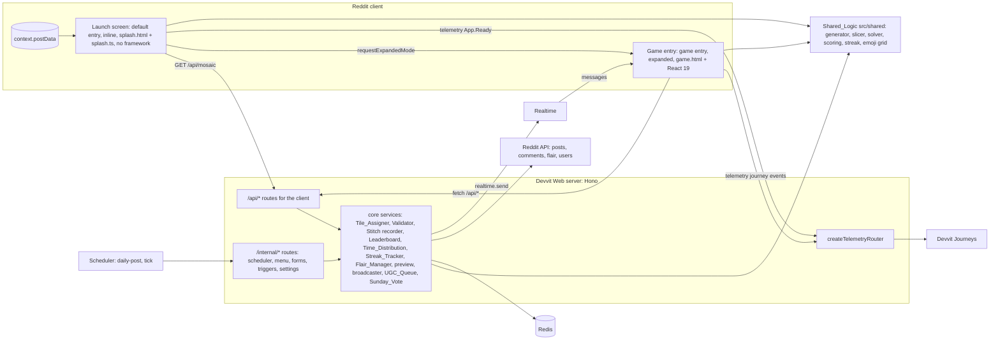

# Patchwork: Plan

Status: work step 1 of 8 (plan). **Waiting for the owner's approval.** No application code is written until the owner explicitly approves this plan (Req 1.9, Req 1.13).

Patchwork is a daily, asynchronous community nonogram game for Reddit's Game of the Day Hackathon, built as a Devvit Web Interactive Post from a fresh React-template project. Each UTC day the Scheduler posts one hidden Mosaic of 8×8 Tiles. A player who opens the post gets one Tile (the Scored_Attempt), fills Cells from the row and column Clues, and the Server checks the submitted fill grid against the stored Solution before it records a Stitch. The shared Mosaic fills in through the day. Once all 64 Tiles are stitched, later players reinforce Weak_Tiles, so a latecomer always gets a Tile whose Stitch counts.

Mosaic art is generated procedurally and deterministically from the Day_Key with a seeded integer PRNG. The one exception is a Sunday whose Sunday_Vote picked an approved, hand-drawn UGC_Mosaic. No AI-generated image or text is used anywhere, and no paid or LLM API is called at build time, at runtime or in a scheduled job (Req 1.8, Req 2.1).

- Target prize: Best Daily Game; an honourable mention is the fallback.
- Deadline: 8 Dec 2026, 6:00 PM PT (9 Dec 2026, 7:30 AM IST).

## How to read and approve this plan

- This file is the summary for review. The full specification is in the Kiro spec folder of the workspace: [requirements.md](../.kiro/specs/patchwork-daily-mosaic/requirements.md) (Requirements 1 to 31, Open Questions OQ-1 to OQ-14) and [design.md](../.kiro/specs/patchwork-daily-mosaic/design.md) (APIs, signatures, pseudocode, 67 correctness properties, error codes, tests). Where this plan and design.md differ, design.md is the detailed source and the difference is a mistake to fix.
- "Req 9.2" means Requirement 9, acceptance criterion 2. "F", "B" and "L" numbers are the doc facts and findings in design.md's Overview. "D" numbers are owner sign-off decisions (section 11).
- To approve: say "approved", or name the sections or decisions to change. Requested changes produce a revised PLAN.md and another stop (Req 1.13).
- Glossary terms (Day_Key, Tile_Size, Stitch, Solve_Count, First_Stitcher, Stitched_Total, Complete_Mosaic, Weak_Tile, Scored_Attempt, Extra_Tile, Help_Count, Mistake, Par, Grace_Rule and the rest) are used exactly as defined in requirements.md.

## What the Devvit docs changed

Every Devvit API in this plan was read in the Devvit documentation on 2026-11-15 (https://developers.reddit.com/docs and its `llms-full.txt` export). No Devvit MCP server is configured in this workspace, so the web docs are the source. Each API is confirmed again at first use in code, against the docs and the installed type definitions, and listed in that step's report (Req 1.1, Req 1.2). These doc facts change what the request asked for:

| ID | Doc fact | Effect on the plan |
|---|---|---|
| B1 | No API edits a post title ([Post class](https://developers.reddit.com/docs/api/redditapi/models/classes/Post)). | The title stays "Day N · <Motif name>". Live progress "Day N · S/64 stitched" is shown on the launch screen (from `postData`) and in the text fallback. After a regenerate or skip the title keeps the old Motif name (D8). |
| B2 | The cron time zone is not documented ([Scheduler](https://developers.reddit.com/docs/capabilities/server/scheduler)). | The `daily-post` cron stays `0 0 * * *`, and the 30 s `tick` task also runs the idempotent creation step from 00:00:00 to 00:04:59 UTC, so the post does not depend on the cron time zone (D21). |
| B3 | While the app is unapproved, `runAs: 'USER'` comments by anyone except the app owner post from the app account ([User Actions](https://developers.reddit.com/docs/capabilities/server/userActions)). | The share comment uses `runAs: 'USER'` and always includes the player's username in the text (D6). |
| B4 | Journeys exists but records nothing until the app is allowlisted in review; a view must never start a journey ([Devvit Journeys](https://developers.reddit.com/docs/capabilities/analytics/devvit-journeys)). | `track()` is backed by Journeys, not a stub. README.md will say that nothing is recorded while the app is unpublished (D7). |
| B10 | Realtime allows 100 messages per second per installation ([Realtime](https://developers.reddit.com/docs/capabilities/realtime/overview)). | Broadcasts are coalesced to at most 2 per second per Day_Key, with polling as a fallback (D9). |
| B11 | Inline (feed) mode allows only tap or click input ([Launch screen](https://developers.reddit.com/docs/capabilities/server/launch_screen_and_entry_points/launch_screen_customization)). | Long-press and drag need expanded mode, so the Play_Screen lives in the `game` entry. The inline launch screen renders the Mosaic and opens the game. |
| B12 | `localStorage` is cleared on every app version ([FAQ](https://developers.reddit.com/docs/guides/faq)). | The "Ghost_Hand already seen" flag is stored in Redis per account. |
| B15 | Score comments must reply to a single stickied comment ([User Actions](https://developers.reddit.com/docs/capabilities/server/userActions)). | The Scheduler posts one app comment per post and stickies it; share comments reply to it. |
| B19 | Sub-minute cron is experimental. | `tick` uses the six-part cron `*/30 * * * * *`, with `* * * * *` as the fallback (D28). |
| L1 | Logical: a uniquely solvable Tile has exactly one grid that satisfies its Clues, and the Client auto-submits only when every line matches. | Under OQ-2 an honest player always has 0 Mistakes; only a modified Client can make one. The End_Card still shows the allowance (D4). |
| L2 | Logical: stitched Tiles are public, so a reinforcement Tile can be seen in the Mosaic before it is solved. | The Server never sends pixels of unstitched Tiles and hides the Mosaic while a Tile is in play; copying a reinforcement Tile from the public image is accepted (D19). |

design.md lists all 35 doc facts (F1 to F35) with their URLs and all findings (B1 to B22, L1 to L8).

## 1. Architecture

### Project placement

The workspace root `/Users/himanshujha/.t3/projects/this` is another project (Foldline Daily), `app/` is a third project, and `.kiro/specs/daily-erosion-maze/` is a fourth spec. Patchwork never creates, edits, moves or stages any of them. Patchwork lives in `patchwork/` (OQ-11, D1):

| Path from the workspace root | Contents |
|---|---|
| `patchwork/` | The Patchwork_App root: this PLAN.md, AGENTS.md, `.kiro/steering/product.md` and `tech.md` now; from step 2 `devvit.json`, `package.json`, `src/`, `tools/`; in step 8 README.md, DEVPOST_STORY.md, VIDEO_SHOTLIST.md, SUBMISSION_CHECKLIST.md. |
| `.kiro/specs/patchwork-daily-mosaic/` | The Kiro spec (requirements.md, design.md, later tasks.md). |

Git: one repository at the workspace root on `main`, shared with other agents and without a remote. Patchwork commits stage named paths under `patchwork/` and `.kiro/specs/patchwork-daily-mosaic/` only (D2).

### Project creation (start of step 2, needs the owner)

1. Both documented creation methods, the wizard at developers.reddit.com/new (React template) and `npx devvit init`, need a Reddit sign-in in the browser ([quickstart](https://developers.reddit.com/docs/quickstart), [Devvit CLI](https://developers.reddit.com/docs/guides/tools/devvit_cli)). The owner runs the creation in a scratch directory **outside** the workspace, because `devvit init` inside an existing Devvit project initialises that project, and the workspace root is one (B9, D3). If the CLI asks for authentication, the owner runs `devvit login` in their own terminal (Req 1.7).
2. The agent moves the generated files into `patchwork/` without overwriting PLAN.md, AGENTS.md or `.kiro/`, and merges useful guidance from the template's own AGENTS.md. No source code is copied from Foldline or `app/` (Req 1.3).
3. The agent applies the template changes below, then runs `npm test` and `npm run build` on Node 24.18 or later (Req 1.4, Req 1.11).

| Template file | Change | Requirement |
|---|---|---|
| `package.json` | Delete the `launch` script (it runs `devvit publish`). Set `engines.node` to ">=24.18.0" (the template has ">=24.0.0"). `test` runs `vitest --run`. `build` runs `tsc --build`, `vite build` and `node tools/check-bundle.mjs`; there is no separate `size` script (D36). Add `vitest`, `@devvit/test`, `fast-check` and `@devvit/analytics`. Remove Tailwind (D24). Keep `dev`, `deploy`, `login`. | Req 1.4 to Req 1.6, Req 27.3, Req 28.10 |
| `.nvmrc` | Add, naming Node 24. | Req 1.4 |
| `public/snoo.png` | Delete, with every reference. | Req 2.8 |
| `src/client/splash.tsx` | Replace with framework-free `splash.ts`. | Req 25.5, Req 27.1 |
| `src/client/game.html`, `game.tsx`, `index.css` | Rewrite as the game shell; `tokens.css` replaces `index.css`. | Req 10, Req 16, Req 17, Req 25 |
| `src/server/*`, `src/shared/api.ts` | Replace with Patchwork routes and types, keeping the template's documented server bootstrap. | Req 7 to Req 24, Req 28.2 |
| `tools/tsconfig.*.json` | Keep `strict: true` in every config; add `noUncheckedIndexedAccess` and `exactOptionalPropertyTypes`. | Req 28.1 |
| `devvit.json` | Rewrite as in the plan below. | Req 7.5, Req 21, Req 22, Req 24.3 |
| `vitest.config.ts`, `tools/check-bundle.mjs` | New. | Req 27.3, Req 28.3 to Req 28.10 |

### Components



- **Launch screen** (inline `default` entry, the custom Splash_Screen): framework-free TypeScript and one canvas. It paints the Mosaic from `postData` with no server call, refreshes from `/api/mosaic`, and opens the `game` entry on a tap with `requestExpandedMode` (F17, B11, B14).
- **Game entry** (expanded `game` entry, React 19): Play_Screen, Stitch_Animation, End_Card, Mosaic_View, Credits_View, the weekly vote view, and the lazily loaded Pixel_Editor and moderator review panel.
- **Server** (Hono): owns every Redis and Reddit API call. `/api/*` serves the Client; `/internal/*` serves the Scheduler, Mod_Menu, forms, triggers and settings validation (F3).
- **Shared_Logic** (`src/shared/`): pure TypeScript used by Client and Server. No imports from `src/client/`, `src/server/`, Redis or the Reddit API, and no `Math.random`, `Date` or locale use, so results are identical everywhere (Req 3.2, Req 28.2).

Source layout inside `patchwork/src/`:

| Folder | Modules |
|---|---|
| `shared/` | `daykey`, `prng`, `palette`, `motifs`, `mosaic` (`generateMosaic`, `buildDay`), `clues`, `solver`, `difficulty`, `slicer` (`sliceToTiles`), `score`, `timedist`, `assignment` (`pickTile`), `streak`, `flair`, `heat`, `emoji`, `analytics`, `ugc`, `grid`, `play`, `ghost`, `wire`, `api` |
| `server/` | `index.ts`; `routes/`; `core/`: `keys`, `redisx`, `day`, `generation`, `assign`, `validate`, `stitch`, `leaderboard`, `timedist`, `streak`, `flair`, `preview`, `broadcast`, `daily`, `ugc`, `vote`, `mod`, `credits`, `share`, `endcard` |
| `client/` | `splash.html` + `splash.ts`; `game.html` + `game.tsx` + `app/`; `play/`, `stitch/`, `lib/` (`mosaic-canvas`, `sound`, `theme`, `live`, `api`, `track`); lazy `editor/PixelEditor.tsx` and `mod/ReviewPanel.tsx` |

### devvit.json plan

A configuration sketch for step 2, not final code. Keys come from the [Devvit Web configuration](https://developers.reddit.com/docs/capabilities/devvit-web/devvit_web_configuration) page.

| Key | Value |
|---|---|
| `post.entrypoints` | `default`: `splash.html`, inline, height `tall`. `game`: `game.html`. |
| `permissions` | `redis`, `realtime`, `journeys`; `reddit: { enable: true, scope: "moderator", asUser: ["SUBMIT_COMMENT"] }` (scope confirmed in playtest, D34). |
| `triggers` | `onAppInstall` and `onAppUpgrade` to `/internal/triggers/*` (install date, first post, D21). |
| `scheduler.tasks` | `daily-post`, cron `0 0 * * *` (Req 7.5). `tick`, cron `*/30 * * * * *` (preview updates, vote close, trailing realtime snapshots, completion repair, sticky-comment repair, next-day Tile pre-build, creation window). 2 of the 10 allowed recurring actions. |
| `menu.items` (moderators, subreddit) | "Regenerate today's mosaic", "Skip today's mosaic", "Review community mosaics". Each opens a confirm or review form; every handler re-checks moderator permission on the Server (Req 21.6, Req 22.5). |
| `forms` | `regenerateConfirm`, `skipConfirm`, `reviewUgc`. |
| `settings.subreddit.startDate` | String "Start date (UTC, yyyy-mm-dd)" with a validation endpoint; empty, invalid or future values fall back to the installation date (Req 22.6, Req 22.7). |

### Main flows

1. **Open the post.** The launch screen paints from `postData`, fetches `/api/mosaic` (5 s timeout) and shows "Day N · S/64 stitched". A tap opens the game, whose first module sends `POST /api/assign` before React loads. The Server returns Clues, Tile_Size, Tile_Index and the generation, never Solution data (Req 9.9). Section 3 has the algorithm.
2. **Submit.** When every line matches its Clues, the Client sends the fill grid once (Req 10.9). The Server checks login, Day_Key, generation, Tile_Index and grid shape, compares filled Cells with the stored Solution, and on a match commits the Stitch in one transaction. The Client plays the Stitch_Animation while it loads `/api/endcard`.
3. **Daily post.** `daily-post` at 00:00 UTC and `tick` until 00:04:59 UTC run `ensureDailyPost`: skip if a post exists or the Day_Key is before the effective Start_Date; take a 45 s claim with `set nx`; at most 3 attempts; store all 64 Tiles before `submitCustomPost` with the title "Day N · <Motif name>"; write the Day_Key mappings; post and sticky the app comment. A failed attempt deletes the post (if created) and the Tile data, so nothing partial is left (Req 7.1 to Req 7.8). `tick` pre-builds the next day's Tiles after 12:00 UTC (D32).
4. **Regenerate or skip.** A moderator confirms in a form; the Server re-checks permission, allocates generation n, builds all 64 unique Tiles, stores them, and only then switches `activeGen` to n with one write. The new generation starts with an empty counter, Solve_Counts and First_Stitchers; scores, Leaderboard entries, streaks and Help_Counts stay (Req 22.1 to Req 22.10, D5, D22).
5. **UGC and Sunday_Vote.** A player with a streak of 7 or more submits art; the Server checks it, fits it to 56×56, slices it without the fallback pattern, and queues it. A moderator approves or rejects. Players upvote approved entries from Monday 00:00 to Saturday 12:00 UTC. The first `tick` at or after Saturday 12:00 ranks them; Sunday creation uses the first ranked entry that slices cleanly, else the procedural Mosaic (Req 20, Req 21, D27).

### Platform limits

| Limit (doc source) | How the plan stays within it |
|---|---|
| 30 s per server request ([Devvit Web overview](https://developers.reddit.com/docs/capabilities/devvit-web/devvit_web_overview)) | `buildDay` tries at most 3 candidates of at most 5 s each (Req 4.10), and the next day's Tiles are pre-built the day before (D32). |
| 20 concurrent transactions, 5 s timeout ([Redis](https://developers.reddit.com/docs/capabilities/server/redis)) | Only an accepted Stitch or an upvote opens a transaction; each watches one per-user key. At 5,000 Stitches in 60 s (about 83 per second) the open blocks stay under 20 while each block lasts under 0.24 s; step 4 measures it. |
| 40,000 Redis commands per second ([Redis](https://developers.reddit.com/docs/capabilities/server/redis)) | About 10 commands per new assignment and about 23 per scored Stitch (up to 26 with a realtime window and a flair call): at most 83 × 36 = 2,988 per second at that load, about 7.5% of the limit. |
| 100 realtime messages per second ([Realtime](https://developers.reddit.com/docs/capabilities/realtime/overview)) | At most 2 messages per second per Day_Key channel, plus one trailing snapshot per `tick`. |
| 2 KB `postData` ([Post data](https://developers.reddit.com/docs/capabilities/server/post-data)) | The largest snapshot (a complete 56×56 Mosaic) is 1,186 bytes as computed in design.md Data Models (h). |
| 100 MB Redis storage for unpublished apps ([Redis](https://developers.reddit.com/docs/capabilities/server/redis)) | Per-user-day data expires after 14 days; the estimate is in section 2 (D12). |
| 10 recurring scheduler actions ([Scheduler](https://developers.reddit.com/docs/capabilities/server/scheduler)) | 2 used. |

## 2. Redis data model

Rules for every key (Req 9.7, Req 27.4):

- Keys are built from values the code already knows: Day_Key `{d}`, generation `{g}`, Tile_Index `{t}`, user ID `{u}`, vote Monday `{m}`, Sunday `{s}`. No key scans; collections are hashes or sorted sets.
- No plain sets or lists, and no `hMGet` (the docs say it may be disabled for an app).
- Shared values change only through single atomic commands (`incrBy`, `hIncrBy`, `zIncrBy`, `hSetNX`, `zAdd` of the caller's own member) or inside a transaction. Nothing shared is read and then written outside a transaction.
- Transactions WATCH only per-user keys (`pw:d:{d}:u:{u}`, `pw:vote:{m}:u:{u}`), so two different users never conflict.
- A "generation" is one stored Mosaic variant of a Day_Key. Generation 0 uses the default Regeneration_Seed; regenerate and skip create a new one.

| Key | Type | Contents | Written with | Retention |
|---|---|---|---|---|
| `pw:install` | hash | `date`: installation Day_Key | `hSetNX` (install, upgrade, first Scheduler run) | kept |
| `pw:days` / `pw:posts` | hash | Day_Key to postId / postId to Day_Key | `hSet` after post creation | kept |
| `pw:claim:post:{d}`, `pw:claim:gen:{d}:{g}` | string | claim token | `set` with `nx` and a 45 s expiration | 45 s |
| `pw:post:attempts` | hash | Day_Key to attempt count | `hIncrBy` | kept |
| `pw:d:{d}:meta` | hash | `postId`, `dayNumber`, `tileSize`, `startDate`, `activeGen`, `genSeq`, per generation `g{n}:seed`, `g{n}:motifIndex`, `g{n}:variant`, `g{n}:motif`, `g{n}:source`, `g{n}:done` (completion ms), `sticky`, `previewS` | `hSet`; `hIncrBy genSeq`; `hSetNX g{n}:done` | kept |
| `pw:d:{d}:g:{g}:tiles` | hash | `0` to `63`: Tile record JSON (Clues, Solution, pixels, Difficulty_Score, Par, perturbation record) | one `hSet` of all 64 fields before the generation becomes active | kept |
| `pw:d:{d}:g:{g}:ctr` | string | Assignment_Counter | `incrBy(key, 1)` | kept |
| `pw:d:{d}:g:{g}:solves` | hash | Tile_Index to Solve_Count | `hIncrBy` in the Stitch transaction | kept |
| `pw:d:{d}:g:{g}:first` | hash | Tile_Index to First_Stitcher; `hLen` is Stitched_Total | `hSetNX` in the Stitch transaction | kept |
| `pw:d:{d}:u:{u}` | hash | the user-day record (table below) | the user's own requests | 14 days (D12) |
| `pw:d:{d}:lb` | sorted set | Leaderboard: user ID, score | `zAdd` of the caller's own member | 14 days |
| `pw:d:{d}:helpers` | sorted set | user ID, Help_Count × 1,000,000 + tie part (earlier first Stitch ranks higher) | `zIncrBy` | 14 days |
| `pw:timedist` | hash | Time_Distribution: bucket `0` to `50` to count, global | `hIncrBy` | kept |
| `pw:u:{u}` | hash | `flair` opt-in, `ft` last tier applied, `fe` last flair call failed, `ghost` Ghost_Hand seen | `hSet` by the user's own requests | kept |
| `pw:u:{u}:days` | sorted set | Day_Keys with a recorded score, score = day ordinal (streak source) | `zAdd` in the Stitch transaction | kept |
| `pw:dirty` | hash | Day_Key to last Stitch ms (preview and trailing snapshot work for `tick`) | `hSet`, `hDel` | until processed |
| `pw:rt:{d}:{w}` | string | Stitches in 500 ms window `w` (realtime coalescing) | `incrBy`, 5 s expire | 5 s |
| `pw:ugc:seq`, `pw:ugc` | string, hash | last UGC id; UGC id to record JSON | `incrBy`; `hSet` of a new id | kept |
| `pw:ugc:review` | hash | UGC id to review decision | `hSetNX` (first review wins) | kept |
| `pw:ugc:pending` | sorted set | pending UGC ids by submission ms | `zAdd`, `zRem` | until reviewed |
| `pw:vote:{m}` | sorted set | approved UGC id, upvotes | `zIncrBy` 0 on approval, 1 per upvote | kept |
| `pw:vote:{m}:u:{u}` | hash | UGC ids this user upvoted | `hSet` under WATCH | 14 days |
| `pw:sunday` | hash | Sunday Day_Key to ranked UGC ids (`[]` means procedural) | `hSetNX` at vote close | kept |

User-day hash `pw:d:{d}:u:{u}`:

| Field | Meaning |
|---|---|
| `s:{g}` | Scored_Attempt Tile of generation g and its Server assignment time (`hSetNX`) |
| `x:{g}` | current Extra_Tile or late Tile of generation g |
| `st:{g}:{t}` | this user stitched Tile t of generation g |
| `sd` | the Scored_Attempt Tile has been stitched |
| `m:{g}` | Mistakes on the Scored_Attempt Tile (Server-counted) |
| `r` | the one recorded score of the Day_Key |
| `h` | Help_Count for the Day_Key, across generations (D22) |
| `f` | time of the user's first Stitch on the Day_Key |
| `fi` | `first_interaction` dedupe (`hSetNX`) |
| `sh:{nonce}` | one share comment per tap (`hSetNX`) |

Storage estimate against the 100 MB cap (an estimate, not a measurement; raw sizes from the wire formats with a ×2 overhead factor): `storage ≈ 28,000 × D + 600 × P × min(D, 14) + 50 × P × D + 120 × P` bytes for P players a day over D days. That gives about 17.9 MB for P = 1,000 and D = 120, and about 76 MB for P = 5,000 and D = 120. Without the 14-day expiry the second case would need about 318 MB more. Step 4 replaces the assumptions with sizes measured in playtest.

## 3. Tile-assignment algorithm

### The Tile choice rule

`pickTile` is a pure function in `src/shared/assignment.ts`. One rule covers Req 9.2, Req 9.3 and Req 9.5: the lowest Solve_Count wins, and among equal counts the first Tile met when counting up from the candidate (wrapping from 63 to 0) wins.

```
pickTile(solves[0..63], candidate, excluded):
  best := null, bestCount := +infinity
  for i in 0..63:
    t := (candidate + i) mod 64
    if excluded(t): continue
    if solves[t] < bestCount: best := t, bestCount := solves[t]     // strict, so the first tie wins
  return best                                                        // null only when every Tile is excluded
```

- While Stitched_Total is below 64 some Tile has Solve_Count 0, so the result is the first unstitched Tile from the candidate (Req 9.2).
- On a Complete_Mosaic the result is the first Weak_Tile from the candidate (Req 9.3).
- With `excluded` = "already stitched by this user" it is the Extra_Tile rule (Req 9.5).

### Opening the post (`POST /api/assign`)

Numbers in brackets are Redis commands. Every command runs under a 2 s timeout (Req 9.12).

```
assignForOpen(u, d, now):
  0. d := hGet pw:posts postId                                    [1]  Day_Key of this post, never from the client
  1. meta := hGetAll pw:d:{d}:meta                                [1]  no meta or activeGen: DAY_NOT_READY
     g := meta.activeGen
  2. logged out: read the counter without incrementing, hGetAll solves, pickTile,
     return a read-only practice Tile; nothing is written (D11)   [3]
  3. ud := hGetAll pw:d:{d}:u:{u}; ghostSeen := hGet pw:u:{u} ghost              [2]
  4. if ud.fi is absent: firstInteraction := (hSetNX ud fi 1 = 1)                [1]
  5. if ud.sd is present: return scored-done with the stitched Tile_Index        (Req 9.4)
  6. if ud["s:" + g] is present: return the same Tile, no increment              [1]  (Req 9.4)
  7. isPast := now >= end of Day_Key d
     if isPast and an unstitched late Tile is recorded: return it                [1]
  8. c := incrBy pw:d:{d}:g:{g}:ctr 1; candidate := (c - 1) mod 64               [1]  (Req 9.1)
  9. solves := hGetAll pw:d:{d}:g:{g}:solves                                     [1]
 10. t := pickTile(solves, candidate, none)
 11. if not isPast:                                               // the Scored_Attempt
       won := hSetNX ud "s:" + g {t, at: now}                    [1]
       if won = 0: use the value a parallel request of the same user wrote       [1]
       else: expire ud 14 days                                   [1]
     else:                                                        // past Day_Key: no Scored_Attempt (Req 31.6)
       hSet ud "x:" + g {t, at: now, k: "late"}; expire ud 14 days               [2]
 12. rec := hGet pw:d:{d}:g:{g}:tiles t                           [1]
 13. return Clues, Tile_Size, Tile_Index, generation, assignedAtMs, serverNowMs,
     firstInteraction, showGhost                                  // no Solution data (Req 9.9)
```

### "Help another tile" (`POST /api/extra`)

1. Read the post's Day_Key, `meta` and the user-day hash (3 commands).
2. Before the Day_Key ends, an unstitched Scored_Attempt Tile is required first: return `SCORED_FIRST` with that Tile_Index (Req 9.13).
3. If the user has stitched all 64 Tiles of the active generation, return the completion state with no Tile and no writes (Req 9.6).
4. `incrBy` the counter, read `solves`, `pickTile` excluding the user's stitched Tiles, record `x:{g}` and return the Tile (Req 9.5).

### Special cases

- **Reopen**: the same Tile, with no counter increment, whether or not it was stitched (Req 9.4).
- **Past Day_Key** (Req 31.6): the same rules hand out a Tile, but no Scored_Attempt is recorded; its Stitch counts toward Solve_Count and Help_Count only. A Scored_Attempt assigned at 23:59 and solved after midnight is also not scored (D17).
- **Regenerated generation**: `g` is always the active generation. A user who already stitched keeps their score and gets Extra_Tiles from the new generation. A user with an unstitched Scored_Attempt from the old generation gets a fresh Scored_Attempt Tile in the new one, timed from the new assignment (D5).
- **Abandoned Tiles**: no reservation and no timeout; the Tile keeps its Solve_Count and stays eligible (Req 9.10, OQ-10).
- **Redis failure or timeout**: the response is `ASSIGN_FAILED` with a retry. Assignment never writes Solve_Count, First_Stitcher, Stitched_Total, the Leaderboard or Help_Count. Two residual windows are accepted: an `incrBy` followed by a failed command skips one counter value (D18), and a failure after the `hSetNX` keeps the Scored_Attempt, so the retry returns the same Tile (D41).

### Command counts and concurrency

- Commands per request: a new Scored_Attempt 10; a reopen 5; a practice open 5; an Extra_Tile 7; the completion state 3. Logged-in opens add one cached read of the moderator list for the Review hint (D16). No transaction runs on any of these paths.
- Req 9.7 and Req 27.4: the only shared write is the atomic `incrBy`; every other write targets the caller's own user-day hash, and `solves` is only read.
- Req 9.8: a Scored_Attempt exists only where `hSetNX s:{g}` returned 1, once per user and generation. The first 64 `incrBy` results are 1 to 64, so the candidates are 0 to 63; with no Stitch between them every Solve_Count is 0 and `pickTile` returns the candidate itself, giving 64 distinct Tiles.
- Req 27.5: every assignment other than a reopen or the completion state calls `incrBy` exactly once, and Redis returns a distinct value to each caller.
- Req 9.11: 10 sequential single commands with no locks; a local test measures the 95th percentile of 1,000 concurrent calls (section 8).

### Validation and the Stitch commit (`POST /api/submit`)

Validator checks, in order, before any transaction (each rejection records zero Stitches):

| Check | Failure |
|---|---|
| A logged-in user (`context.userId`) | `AUTH_REQUIRED`, zero Stitches and zero Mistakes (Req 11.11) |
| The submitted Day_Key equals the post's Day_Key | `DAY_MISMATCH` (Req 11.12) |
| The submitted generation is the active one | `MOSAIC_CHANGED`, with an offer of a new Tile (Req 22.10) |
| Tile_Index is 0 to 63 and is the user's Scored_Attempt, Extra_Tile or late Tile, or a Tile the user already stitched | `TILE_NOT_ASSIGNED` (Req 11.5) |
| The grid is Tile_Size × Tile_Size Cells of filled, marked-X or empty | `INVALID_GRID` (Req 11.6) |
| The filled Cells equal the stored Solution (marked-X counts as empty) | `rejected` with no detail about which or how many Cells are wrong; one Mistake is added only for the unstitched Scored_Attempt Tile (Req 11.1, Req 11.3, Req 11.4, Req 11.7) |

On a match, one transaction commits the Stitch:

```
C1. watch pw:d:{d}:u:{u}; ud := hGetAll of it
C2. if ud has st:{g}:{t}: return the recorded result (idempotent, Req 11.10)
C3. scoreable := Scored_Attempt Tile, no score recorded yet, before the end of the Day_Key,
                 assignment time and Par present
    if scoreable: solveMs, Mistakes, score and Time_Distribution bucket from Server data only (Req 13.7)
C4. multi
      hSet ud: st:{g}:{t}, sd (Scored_Attempt Tile), f (first Stitch of the day), r (score, if scoreable)
      hIncrBy ud h 1                                   Help_Count (Req 12.3)
      hIncrBy solves t 1                               Solve_Count (Req 12.1)
      hSetNX first t u                                 First_Stitcher (Req 12.2)
      zIncrBy helpers u (1,000,000, plus the tie part on the first Stitch of the day)
      if scoreable: zAdd lb {u, score}; hIncrBy pw:timedist bucket 1; zAdd pw:u:{u}:days {d}
    exec
C5. exec returned null (the same user's parallel request): retry once, then STITCH_NOT_SAVED
    exec failed or timed out: STITCH_NOT_SAVED with retry; nothing was applied (Req 12.8)
C6. after exec: Stitched_Total := hLen first; at 64, hSetNX meta g{g}:done now (Req 12.5, Req 12.6);
    mark the Day_Key dirty for the preview; realtime broadcast (coalesced);
    if scored: replay the streak and apply flair (failures logged only)
```

- Stitched_Total is never stored on its own: it is `hLen` of the First_Stitcher hash, which gains a field exactly when a Tile's Solve_Count goes from 0 to 1, because both writes are in the same transaction (Req 12.4, Req 27.5).
- Concurrent Stitches of one Tile by different users watch different keys, never abort each other, and each adds exactly 1, so Solve_Count equals the accepted Stitches and `hSetNX` keeps exactly one First_Stitcher (Req 12.7).
- The score, the Leaderboard entry, the Time_Distribution increment and the streak day are written only when `r` is absent under the watch, so at most once per user and Day_Key (Req 13.4, Req 13.5, Req 14.3, Req 15.8).
- The response adds the Tile's pixels and Solution mask for the stitching user only (Req 11.8).
- About 23 Redis commands per scored Stitch, plus 2 when it opens a realtime window and 1 for a flair call; about 16 to 18 for an Extra_Tile.

## 4. Mosaic_Generator

`generateMosaic(dayKey)` and `sliceToTiles(mosaic, dayKey)` are deterministic pure functions in `src/shared/` (Req 2.2, Req 3.2, Req 4.2). `buildDay(dayKey)` returns the Mosaic and its accepted slice together, so the Server stores one result and never slices twice.

### Seeding and size

- PRNG: mulberry32 (32-bit integer state, `Math.imul` only), seeded with FNV-1a 32-bit over `'pw' | dayKey | seed | motifIndex | variant`. No `Math.random`, no `Date`, no locale, no floating point in pixel decisions.
- Tile_Size comes from the UTC weekday of the Day_Key only: 5 Monday to Wednesday, 6 Thursday and Friday, 7 Saturday and Sunday. The Mosaic side is 8 × Tile_Size: 40, 48 or 56 pixels (Req 3.1, Req 6.1, Req 6.2).
- Invalid Day_Keys (`2026-02-30`, `2026-1-5`, the empty string) are rejected with an invalid Day_Key error (Req 3.9).
- Generation 0 uses Regeneration_Seed 0 and motif index 0. Regenerate uses seed n with the same Motif; skip uses the next Motif in the Day_Key's seeded Motif order. Both values are stored, so a rerun reproduces the same Mosaic, Tiles, Clues and Solutions (Req 22.1, Req 22.2).
- The paper (background) colour is `dayOrdinal mod 4`, and every Motif keeps pixel (0, 0) at the paper colour, so consecutive procedural days always differ (Req 3.3). The Motif order starts from a different family each day.

### Motifs and the Palette

| Family | Initial Motifs | Construction |
|---|---|---|
| quilt | pinwheel, nine-patch, Ohio star, log cabin, flying geese, churn dash | 8 × 8 pixel blocks (8 divides 40, 48 and 56) with 2 or 3 Palette colours plus paper, placed in the fundamental region and mirrored |
| tessellation | chevron, herringbone, interlocking L, offset bricks, basketweave | repeating stripes or bricks whose width comes from the weekday density |
| glyph | mirrored pixel glyph | seeded strokes and blobs in one quarter, mirrored into 2-fold or 4-fold symmetry |

- Every Motif is drawn only over its fundamental region and mirrored, so it is symmetric about at least one vertical, horizontal or diagonal centre axis (Req 3.4). A test checks the declared axes.
- Every pixel is one of the 4 Palette colours (Req 3.5). Each Palette entry has a pattern (solid, diagonal, dots, cross) and a light and a dark value (D31). The hex values are chosen in step 2 and must pass `checkPalette` (pairwise contrast of at least 1.5:1 under protanopia, deuteranopia and tritanopia simulation, at least 3:1 against the empty Cell) and `checkTextContrast` (text at least 4.5:1, focus ring at least 3:1) in both modes (Req 25.7, Req 26.1, Req 26.2, Req 26.6).
- Motif names are "<Adjective> <Noun>" from fixed word lists, ASCII letters, digits, spaces and hyphens, 1 to 40 characters (Req 3.6). The post title is "Day N · <Motif name>" (Req 7.2).

### Weekly difficulty curve

- Density rises from 1 on Monday to 7 on Sunday (Req 6.6). Higher density gives narrower features and more detail pixels, which means shorter runs and harder Tiles. The density constants are initial values (D29).
- `buildDay` tries up to 3 variants and keeps the first whose total Difficulty_Score lies inside the weekday's band, else the closest one (D29). The band table must satisfy, in integer form, that each day's lower bound is at least 95% of the previous day's upper bound within the week, that Thursday's lower bound is above Wednesday's upper bound, and that Sunday's lower bound is above Monday's upper bound. If every day lands in its band this gives Req 6.4 and Req 6.5 directly.
- Step 2 calibrates the bands, density and Difficulty_Score coefficients on measured data so every procedural day of the 120-day test window lands in its band, then freezes them (D13, D30). The 120-day test guards the result.

### Slicer

- Tile i covers rows `floor(i / 8) × n` to `floor(i / 8) × n + n - 1` and columns `(i mod 8) × n` to `(i mod 8) × n + n - 1`, Tiles 0 to 63 in row-major order (Req 4.1).
- Each Tile is a binary nonogram (OQ-6). The Slicer chooses which Palette colours count as filled per Tile, from at most 2 candidate splits, before changing any pixel (D14). Most Tiles therefore keep the art exactly; colour is revealed on Stitch.
- Uniform Tiles (all filled or all empty) and non-unique Tiles get a targeted Perturbation: up to 8 attempts, each seeded only by Day_Key, Tile_Index and the attempt number, each flipping 1 to 3 Cells, preferring Cells where the Solver's two witness solutions differ (Req 4.5, Req 4.9, D15).
- After 8 failed attempts the Tile is replaced by a hand-authored fallback pattern picked from Day_Key and Tile_Index; each fallback is proven unique by a unit test (Req 4.6).
- Each Tile records whether it was unchanged, perturbed or replaced, and keeps its final pixels, so the Mosaic_View draws exactly the final Solution (Req 4.7).
- A Mosaic with the wrong side or a pixel outside the Palette is rejected (Req 4.8). A 7×7 Mosaic must slice in under 5 s (Req 4.10).

### Solver, Difficulty_Score and Par

- `solveNonogram(clues)` returns `unique` (with the Solution and Difficulty_Score), `multiple` (with two witnesses), `unsolvable`, or `invalid` for malformed Clues. It never throws (Req 5.1, Req 5.2, Req 5.8).
- Algorithm: precomputed line-mask tables for sizes 5, 6 and 7 (32, 64 and 128 masks), line-by-line propagation until nothing changes, then a bounded search that branches on the line with the fewest candidates and stops as soon as 2 full solutions exist. Every iteration order is fixed, so identical Clues give an identical result (Req 5.6). A uniqueness check must take under 50 ms per 7×7 Tile (Req 4.4, Req 5.5).
- Difficulty_Score, an integer from 1 to 100 built from the solve trace: `10 × (n - 4)` for the Tile_Size, up to 40 for the share of Cells not resolved in the first propagation round, 6 per extra round, and `5 × branch nodes` capped at 20 (initial coefficients, D30).
- Par: `parSeconds = clamp(10, 600, BASE[n] + 2 × difficulty)` with BASE 20, 35 and 50 for sizes 5, 6 and 7, and `mistakeAllowance = clamp(0, 5, floor(difficulty / 25) + (n - 5))` (initial values, D30). A higher Difficulty_Score or a larger Tile_Size never lowers Par (Req 5.4, Req 5.7).

### UGC Sunday path

- A UGC_Mosaic of side 56 is used as drawn. Every other side from 32 to 55 is centred on a 56×56 canvas at offset `floor((56 - side) / 2)`, filled with the most frequent border colour of the art. 56 is the only side from 32 to 56 that divides 56, so the nearest-neighbour upscale of OQ-4 is never more than the identity (B7, Req 20.8).
- The Motif name is "Community Mosaic {id}", Tile_Size stays 7, and the Day_Key is left out of the curve checks (Req 6.7).
- Slicing runs without the fallback pattern, because a fallback would replace the creator's art, and Perturbation is seeded by the Sunday Day_Key it will be played on (D27). Art that cannot be made unique is rejected with "This art cannot be made into solvable puzzles. Try changing a few pixels." (Req 20.10).

## 5. Scoring, Leaderboard, Time_Distribution, streaks and flair

These rules are not one of the eight required sections, but the screens and tests depend on them.

- **Score** (OQ-13, Req 13.1, Req 13.2): `solveMs = max(1,000, acceptedAtMs - assignedAtMs)` from Server times at 1 ms resolution, idle time included (OQ-3); `score = max(0, floor(1,000 × parSeconds × 1,000 / solveMs) - 100 × Mistakes)`. Higher is better. Equal solve-time-to-Par ratios give equal scores on every Tile_Size (Req 13.11). Client-supplied times, Mistakes or scores are ignored (Req 13.7). One score per user per Day_Key (Req 13.4).
- **Mistake** (OQ-2, D4): a Server-rejected submission for the user's Scored_Attempt Tile. Honest Clients never submit a wrong grid (L1).
- **Leaderboard** (Req 14.1, Req 14.5): sorted set per Day_Key holding the score. The shared 1-based rank uses 4 commands (`zScore`, a reversed `zRange` by score with limit 1, `zRank`, `zCard`); ties share a position, for example scores 900, 850, 850 and 700 give positions 1, 2, 2 and 4.
- **Time_Distribution** (Req 14.2, Req 14.4): one global hash of 51 buckets, `bucket = min(50, floor(solveMs / (parSeconds × 100)))`, so buckets 0 to 49 are 0.1 Par wide and bucket 50 holds 5.0 Par or more. The percentile is the share of entries in slower buckets plus half of the other entries in the user's own bucket, rounded to the nearest integer. Below 10 entries no percentile is shown (OQ-14, Req 2.7, Req 14.6).
- **Streaks** (Req 15, OQ-1): `pw:u:{u}:days` holds every Day_Key with a recorded score. Current streak, best streak and Grace_Uses are recomputed from it on every read, so concurrent requests cannot double-count. A gap of 1 day continues the streak. A gap of 2 days continues it and records a Grace_Use, provided no Grace_Use falls on the 6 Day_Keys before the current one, so at most one Grace_Use in any 7 consecutive Day_Keys; the missed day adds nothing. Any other gap resets the streak to 1. The streak shown is the value after the latest Scored_Attempt (D25).
- **Worked examples** (README.md will repeat them, Req 15.4): scores on 2026-11-30, 12-01, 12-03 and 12-04 give streaks 1, 2, 3 (Grace_Use on 12-03) and 4. The same player then scores on 12-06: the gap is 2 but 12-03 is within the previous 6 Day_Keys, so the streak resets to 1 (best stays 4); 12-07 gives 2; 12-10 (gap 3) resets to 1.
- **Flair** (Req 23): opt-in, off by default, kept across days. Thread for a streak of 3 to 6, Quilter for 7 to 29, Weaver for 30 or more; below 3, Patchwork removes only the flair it set. Uses `reddit.setUserFlair` and `reddit.removeUserFlair` ([RedditClient](https://developers.reddit.com/docs/api/redditapi/RedditClient/classes/RedditClient)), at most 1 call per streak update, called again only when the tier changed or the last call failed. Failures, including flair disabled in the subreddit, are logged and never shown to the player.
- **Return next day** (Req 15.5): true when the previous UTC Day_Key is in the list, returned only by the response that recorded today's score.

## 6. Screens

Every empty state shows its invitation text and no placeholder rows, sample names or zero-filled entries (Req 2.6). A statistic whose data cannot be read shows "Unavailable" in its place and the rest of the screen stays usable (Req 2.4). Exact texts below are the ones the code will use.

| Screen | Purpose and elements | Empty state | Error states | Requirements |
|---|---|---|---|---|
| Splash_Screen (inline launch screen) | Mosaic canvas: stitched Tiles in their art, others as one uniform placeholder; "Day N · S/64 stitched"; Motif name; a Play button. Complete: the full image and "Day N · 64/64 stitched". | Stitched_Total 0: 64 placeholders, "Day N · 0/64 stitched" and "Be the first stitch today". | Live fetch fails: the `postData` snapshot stays (D20). No snapshot either: an all-blank grid and "Day N", Play still active (Req 8.7). | Req 8.1 to Req 8.4, Req 8.7, Req 19.1, Req 25.5, Req 25.8 |
| Play_Screen | Row Clues left, column Clues above, the grid, mark-X toggle, sound toggle, solve timer, Ghost_Hand on the first view per account (a static hand under reduced motion). No instructional text. Satisfied Clues change style by more than colour. | None. | "Could not get a tile." with "Retry". "Your solve did not go through." with "Retry", Cells unchanged. "Today's mosaic changed." with "Get a new tile". Rejected grid: a short shake (none under reduced motion) and "Not the stored answer yet.", Cells unchanged. Logged out after a practice solve: "Log in to stitch this tile." with "Log in". | Req 10, Req 11.3, Req 16.6 to Req 16.8, Req 22.10, Req 26.3 to Req 26.8 |
| Stitch_Animation | The solved Tile image flies from the grid to its slot in the Mosaic in 800 ms (the allowed range is 400 to 1,200 ms); under reduced motion a fade of 200 ms or less with no movement. Sound only when the player enabled it. | None. | None. | Req 16.1 to Req 16.5, Req 16.9, Req 26.9 |
| End_Card | Score; solve time next to Par; Mistakes next to the allowance; percentile chart of the 51 buckets with the player's bucket marked and the percentile number; rank "#position of total"; the Mosaic with the player's Tile outlined and notched; Help_Count; current streak; "Share as comment"; countdown HH:MM:SS to 00:00 UTC; "Help another tile"; flair opt-in toggle; "Draw a mosaic" at a streak of 7 or more; "Credits" when complete; "Vote" while a Sunday_Vote is open. | Fewer than 10 Scored_Attempts: "Not enough solves yet to compare. Check back later." and no percentile number. | "Percentile not available yet." "Ranking is temporarily unavailable." (with the player's own score and time). "No extra tile could be assigned. Try again." Share: disabled while pending, "Comment posted." on success, "Comment not posted. Try again." on failure. "Score could not be computed for this solve." "This day ended before your solve, so it was not scored." At zero the countdown becomes "A new puzzle is ready." | Req 14, Req 17, Req 20.1, Req 20.2, Req 23.4, Req 23.5 |
| Mosaic_View with Heat_Overlay | Canvas Mosaic, "S/64", heat toggle, legend "0", "1", "2 to 3", "4 to 7", "8 or more" (each band has a shade and a pattern). Live through realtime with polling as a fallback. Hidden while a Tile is in play. | Stitched_Total 0: placeholders and "Be the first stitch today". | After 3 failed refreshes: a non-blocking "Mosaic may be out of date" until the next success. | Req 18.1 to Req 18.8 |
| Credits_View (Complete_Mosaic only) | 64 rows of Tile_Index and First_Stitcher; up to 10 top helpers with Help_Count, ties to the earlier first Stitch; "Mosaic art by" the UGC creator. The finished Mosaic stays above the list. | Helper data older than 14 days: "Helper ranking has expired for this day." (D12). | "Unavailable user" for a missing account. "Credits could not be loaded." with "Retry". | Req 19.2 to Req 19.7 |
| Weekly vote view | Approved UGC_Mosaics as canvases with upvote counts, one upvote button each, and the closing time. | "No community mosaics in this week's vote yet." | "Upvote not counted." with "You already upvoted this mosaic.", "Voting is closed." or "This mosaic is not in this week's vote." "Votes could not be loaded." with "Retry". | Req 21.3, Req 21.7 |
| Pixel_Editor (lazy chunk) | Side stepper 32 to 56, the 4 Palette swatches with patterns, tap to set, drag to paint a path, zoom toggle, arrow-key cursor with Space or Enter to paint, Submit. | A blank canvas in Palette entry 0. | "The image must be square." "The side must be 32 to 56 pixels." "Use only the 4 palette colours." "This art cannot be made into solvable puzzles. Try changing a few pixels." "A 7-day streak is needed to submit a mosaic." The drawing stays after every error. "Submitted for review." on success. "Could not open the editor." with "Retry". | Req 20.1 to Req 20.12 |
| Moderator review panel (lazy chunk) | Pending UGC_Mosaics as canvases with Approve and Reject. | "No mosaics waiting for review." | "Moderator permission is required." "Could not check moderator permission. Try again." "This mosaic has already been reviewed." "This mosaic could not be found." "Review not saved. Try again." | Req 21.1, Req 21.2, Req 21.6, Req 21.8, Req 21.9 |
| Mod_Menu forms and toasts | Confirm forms for regenerate and skip; a review form with a pending-entry select and a decision; toasts naming the action, the Day_Key and the new Motif name. | "No mosaics waiting for review." | "Moderator permission is required." "Regenerate failed. Today's mosaic is unchanged." | Req 21, Req 22 |
| Error screen | Shown for a post that is not Patchwork's and for unexpected exceptions. | None. | "This post is not a Patchwork puzzle." "Something went wrong." with "Reload". | Req 25.4 |

### Play_Screen input

| Input | Rule | Requirement |
|---|---|---|
| Tap (under 400 ms, no move off the Cell) | Empty becomes filled (marked-X while the mark-X toggle is on); filled and marked-X become empty; applied within 100 ms. | Req 10.2, Req 10.3, Req 10.5, Req 10.12 |
| Long-press (400 ms on one Cell) | The Cell becomes marked-X; the release applies no tap rule. | Req 10.4 |
| Drag along a row or column | The start Cell's resulting state is painted on every Cell between the start and the pointer on that line; Cells left behind return to their earlier state; Cells off the line are ignored. | Req 10.6 |
| Arrow keys | Focus moves one Cell and stays at the edge. | Req 26.3 |
| Space, X, Backspace or Delete | Filled, marked-X or empty; focus does not move. | Req 26.4 |
| Tab, Shift+Tab, Enter | The grid is one tab stop; then the toggles and controls in a fixed order; Enter activates. | Req 26.5 |
| Any input during the Ghost_Hand | Stops it within 100 ms, removes the states it showed, then applies normally. | Req 10.11 |
| Input while submitting or during the Stitch_Animation | Ignored. | Req 10.9, Req 16.4 |

Layout: at a 360 CSS px viewport a 7×7 grid of 44 px Cells takes 308 px, leaving 52 px for row Clues and margins, so row Clues use the smallest type step. This is the tightest layout and is checked in step 3 (Req 10.7, Req 26.7).

### Look, feel and accessibility rules

- One `tokens.css` defines the Palette, theme tokens and one type scale of at most 5 sizes and at most 2 font families for every screen (Req 25.1, Req 25.2). No Snoo imagery and no karma wording or visuals anywhere (Req 2.8).
- Light and dark follow `prefers-color-scheme` and switch live within 1 s without a reload, keeping Cell states and the timer (Req 25.3, Req 25.6).
- Every Palette colour has its own pattern on every canvas, so a greyscale render still separates the 4 entries (Req 26.1).
- Focus rings are at least 2 px with at least 3:1 contrast; every control is at least 44×44 CSS px (Req 26.6, Req 26.7).
- Reduced motion: no animation longer than 200 ms, the Stitch_Animation becomes a fade, the Ghost_Hand becomes a static image, and game state is the same (Req 26.8, Req 26.9).
- Sound is off at every open, the toggle shows its state, and sound mutes when the page is hidden; sounds are synthesised with WebAudio, so there are no audio files (Req 16.7 to Req 16.9).
- First input within 3 s (Req 10.1, Req 27.2): the game's first module requests the Tile before React is evaluated, and the Play_Screen is the first screen React renders.
- Bundle budget: 130 KB gzipped for all Client JavaScript, lazy chunks included, plus a 15 KB gzipped ceiling for the launch screen's JavaScript (Req 27.3, D10). The build fails above either.

## 7. Analytics events

`track(eventName, properties)` in `src/client/lib/track.ts` is the only analytics call site (Req 24.1). It validates the event against the allowlist, maps it to Devvit Journeys, races the call against a 2 s timer and swallows every error, so gameplay never waits on analytics (Req 24.5). Events with an unknown name, more than 10 properties, a string longer than 64 characters or any key outside the allowed list are dropped (Req 24.7). Usernames, user IDs, comment text, Solutions and fill grids have no property to travel in (Req 24.6).

| Event | Trigger point | Journeys call | Allowed properties |
|---|---|---|---|
| `post_view` | The launch screen's first render in a page load. | App.Ready (never a journey start, B4) | `dayKey`, `dayNumber` |
| `first_interaction` | The open tap; the Server dedupes it once per user per Day_Key with `hSetNX`. | `startJourney()` | `dayKey`, `dayNumber` |
| `tile_assigned` | `/api/assign` or `/api/extra` returns a Tile. | `interaction({ action: 'tile_assigned', actionDetails })` | `dayKey`, `dayNumber`, `tileIndex`, `tileSize`, `isExtra` |
| `tile_solved` | `/api/submit` accepts the Scored_Attempt. | `endJourney({ complete: true, game: { win: true } })` | `dayKey`, `dayNumber`, `tileIndex`, `tileSize`, `solveSeconds`, `mistakes` |
| `extra_tile_solved` | `/api/submit` accepts an Extra_Tile or a late Tile (D26). | `interaction({ action: 'extra_tile_solved', actionDetails })` | `dayKey`, `dayNumber`, `tileIndex`, `tileSize`, `solveSeconds`, `isExtra` |
| `share_comment` | `/api/share` succeeded. | `interaction({ action: 'share_comment', actionDetails })` | `dayKey`, `dayNumber` |
| `return_next_day` | `/api/submit` returns `returnNextDay: true`, sent before `tile_solved`. | `interaction({ action: 'return_next_day', actionDetails })` | `dayKey`, `dayNumber` |

- Each event fires at most once per trigger, because the Server returns each flag exactly once and the Client sends on that response only (Req 24.2).
- The client `telemetry` object comes from `@devvit/analytics/client/reddit` and the Server mounts `createTelemetryRouter()` from `@devvit/analytics/server/reddit` ([Devvit Journeys](https://developers.reddit.com/docs/capabilities/analytics/devvit-journeys)). The docs do not show the client method name for App.Ready, so it is read from the installed package types in step 2 (F27).
- While the app is unpublished every call returns a "not allowlisted" receipt and nothing is recorded ([Journeys receipts](https://developers.reddit.com/docs/capabilities/analytics/journeys-receipts)). README.md will say so, and no document will quote analytics numbers (D7).

## 8. Test plan

### Tools and commands

- Vitest runs every automated test; step 2 adds it because the template's unit-test script uses `node --test`. `npm test` runs `vitest --run`, so everything finishes in one non-watch run (Req 28.10).
- `@devvit/test` (`createDevvitTest` from `@devvit/test/server/vitest`) gives Server tests an in-memory Redis with transactions plus Scheduler, Settings and Realtime mocks ([devvit test](https://developers.reddit.com/docs/guides/tools/devvit_test)). It is the "Redis test double with atomic semantics" of Req 28.5 and Req 28.6. Reddit API calls the harness does not support, including Flair, are mocked.
- fast-check runs the property tests, at least 100 cases each (shared constant `PBT_RUNS = 100`), each tagged `// Feature: patchwork-daily-mosaic, Property N: <name>` with the name from design.md. Concurrency properties run their Redis calls through `fc.scheduler()` so each case explores a different interleaving.
- Only five commands deploy, upload or test the app (Req 1.5): `npm run dev`, `npm run deploy`, `devvit upload` (private), `npm test` and `npm run build`. So `npm run build` runs `tsc --build`, `vite build` and `tools/check-bundle.mjs` (strict type check and bundle budget), the repository checks run inside `npm test`, and Lighthouse and timing are measured by hand in Chrome DevTools (L8, D35, D36).

### Automated tests (all in `npm test`)

| Area | Tests | Requirements |
|---|---|---|
| Determinism | `generateMosaic` and `sliceToTiles` give identical output for identical input, 100 or more generated cases each (Properties 3, 9). | Req 2.2, Req 3.2, Req 4.2, Req 28.8 |
| 120-day window | `src/shared/day120.test.ts`: 120 Day_Keys from 2026-11-30 (a UTC Monday) to 2027-03-29 (a UTC Monday), 17 full weeks plus 1 Monday (D44). For each Day_Key `buildDay` runs once, then a fresh `solveNonogram` call on each of the 64 stored Clues must return unique and equal the stored Solution: 7,680 Tiles. It fails if any Tile has 0 or 2 or more Solutions. | Req 6.3, Req 28.3 |
| Weekly curve | The same test asserts, for each full week, that each day's mean Difficulty_Score is at least 95% of the previous day's, Sunday's mean is above Monday's, and Thursday's is above Wednesday's (Property 18). | Req 6.4, Req 6.5, Req 28.4 |
| Timing | The same test records the longest `solveNonogram` call and the longest `sliceToTiles` call per day and fails above 50 ms or 5 s; one untimed Day_Key is built first. | Req 4.4, Req 4.10, Req 5.5 |
| Clue round-trip and Emoji_Grid | Clues derived from a Solution equal the stored Clues and the Solver returns that Solution (Property 10); no Emoji_Grid output carries any Solution Cell (Property 44); 100 or more cases each. | Req 4.3, Req 17.14, Req 28.9 |
| Concurrent assignment | `src/server/core/assign.test.ts`: concurrent requests from N distinct simulated users, always including N = 100 and N = 1,000; each user gets exactly one Scored_Attempt Tile and the first 64 assignments cover 64 distinct Tile_Indexes (Property 20). N = 1, 63, 64 and 65 examples; a practice open writes nothing. | Req 9.8, Req 27.5, Req 28.5 |
| Concurrent Stitches | Two or more simultaneous Stitches of one Tile (up to 100): Solve_Count equals the accepted Stitches, Stitched_Total rises by exactly 1, one First_Stitcher (Property 26); repeated submissions by one user record one Stitch (Property 25). | Req 11.10, Req 12.7, Req 28.6 |
| Validator | Exact match accepted; a single-Cell mismatch rejected; a 6×6 grid on a 5×5 Day_Key rejected; a Tile_Index not assigned to the user rejected; no rejected case raises Solve_Count or records a Stitch (Properties 23, 24 plus examples). | Req 11, Req 28.7 |
| Scoring | Score bounds, monotonicity in time and Mistakes, cross-size comparability, one score per Day_Key, nothing scored after the Day_Key ends (Properties 31 to 35). | Req 13 |
| Streaks and flair | Both worked examples row by row; `best >= current >= 1`; the Grace_Rule over generated play histories; flair tiers; flair failures leave the Stitch unchanged (Properties 39 to 43). | Req 15, Req 23 |
| Everything else | 67 properties in total, each mapped to one test file in design.md "Test layout": Day_Key validation, Tile geometry, Perturbation bounds, rank, percentile, `postData` size (under 2,000 bytes) and round-trip, analytics allowlist, input rules, Ghost_Hand, heat bands, live updates never going backwards, UGC checks, upvotes, vote winner, review decisions, generation switch, Start_Date, one daily post with clean failure, preview failures, Palette accessibility, and "viewing changes nothing". | Req 1 to Req 31 (coverage table in design.md) |
| Repository checks | `tools/repo.test.ts`: `strict: true` in every tsconfig; no forbidden imports in `src/shared/`; `engines.node` ">=24.18.0" and `.nvmrc`; no `launch` script and no `devvit publish` in any script; a dependency allowlist with no paid or LLM SDK and no outside endpoints in Server or shared code; no `snoo` file and no "snoo" or "karma" text; at most 5 font sizes and 2 families; no colour literal outside `tokens.css`; only `track.ts` imports the Journeys client; the `daily-post` cron and `/internal/` endpoints in `devvit.json`. | Req 1.4, Req 1.5, Req 1.8, Req 2.8, Req 7.5, Req 24.1, Req 25.1, Req 25.2, Req 28.1, Req 28.2 |
| Local latency | 1,000 concurrent `assignForOpen` calls against the test Redis; the 95th percentile must be under 500 ms. This measures the code path, not production Redis, and reports say so (D37). | Req 9.11 |

### Manual checks in playtest (steps 3 to 7)

Run in the owner's test subreddit with `npm run dev`; each result is written to `patchwork/docs/verification.md` with the date, device or browser, commit and outcome:

- Ghost_Hand once per account with no text, stopping on touch; tap, long-press, mark-X and drag on a real phone; 44 px targets with no horizontal scroll at 360 px for Tile_Sizes 5, 6 and 7.
- Stitch_Animation timing, the reduced-motion fade, and the End_Card appearing within 500 ms after it (DevTools Performance recording).
- Sound off at every open; light and dark modes and a live scheme switch; greyscale and colour-blindness emulation; keyboard-only play and Tab order.
- Launch screen states at 0, partial and 64 stitched; the feed preview updating within 60 s; a Stitch on one device visible on a second within 30 s; no requests from a hidden page.
- The share comment as a reply to the stickied comment with the username; flair with flair enabled and disabled; Mod_Menu actions as a moderator and as a non-moderator; the next Day_Key's post by 00:05:00 UTC and the cron time zone in the logs; a logged-out practice Tile.
- Credits_View on a Day_Key completed by real Stitches (D39), and one full Sunday_Vote week if the calendar allows before the deadline.

### Console-error runs (Req 25.4)

Desktop Chrome with DevTools open before the post loads, "Preserve log" on, errors only. Run in order: open post, solve Tile, view End_Card, share comment, help another Tile, open Credits_View, once in light mode and once in dark mode, with two accounts because the End_Card follows a Scored_Attempt only. The run passes with 0 console errors and 0 unhandled promise rejections from Patchwork's frames; errors from Reddit's own page are listed separately (D40).

### Performance (Req 27.1, Req 27.2, Req 10.1)

- Lighthouse in the Chrome DevTools panel, mobile mode, 5 runs per entry, median first contentful paint, target 1.5 s; a run counts only if its footer shows a Moto G Power class device with 4G-class throttling.
- Open-to-input: DevTools Performance recording from the Play tap to the `pw:play-ready` mark, same throttling, median of 5, target 3 s.
- Real phone (at least 4 GB RAM, released within 4 years, 4G of at least 9 Mbps): screen recording of 5 opens. If no such phone is available, the report says Req 10.1 was not measured.
- Bundle: `tools/check-bundle.mjs` prints both sizes at the end of every build; README.md records the measured total with the date and commit (Req 27.3).

## 9. Risks

| # | Risk | Mitigation |
|---|---|---|
| R1 | Solver or Slicer slower than 50 ms per 7×7 call or 5 s per Mosaic. | Bit-mask line tables, fixed order, timing checks in the 120-day test, density calibration, next-day pre-build (D32). |
| R2 | Calibration cannot put every procedural day inside its band. | More candidates, retuned bands, density and coefficients (D29, D30); the band-table inequalities are unit-tested. |
| R3 | Stitch transactions hit the 20-block limit at peak. | One watched per-user key, at most 10 queued commands, a measured block duration, safe retry. |
| R4 | The six-part cron for `tick` does not run. | Fall back to `* * * * *` (D28); preview updates may then take longer than 60 s. |
| R5 | The cron time zone is not UTC. | The `tick` creation window 00:00:00 to 00:04:59 UTC (D21); checked in playtest logs. |
| R6 | Journeys records nothing while unpublished. | Stated in README.md and DEVPOST_STORY.md (D7). |
| R7 | `runAs: 'USER'` posts from the app account for players other than the owner. | The username is always in the comment text (D6). |
| R8 | `scope: "moderator"` is not enough, or not allowed, for stickying and flair. | Playtest check (D34); flair failures are non-blocking; sharing waits for the stickied comment. |
| R9 | `@devvit/test` lacks some Reddit API calls. | Mocks plus manual playtest checks. |
| R10 | The web view URL cannot be audited on its own. | DevTools Performance fallback, with the method recorded (D35). |
| R11 | Req 1.5 rules out extra test commands. | Checks chained into `npm run build` and `npm test`; manual DevTools measurement (D35, D36). |
| R12 | Storage reaches the 100 MB unpublished cap. | 14-day expiry and measured sizes in step 4 (D12). |
| R13 | A reinforcement Tile is copied from the public image. | The Mosaic is hidden while a Tile is in play; accepted (D19). |
| R14 | Automated solvers or modified Clients. | Server timing and Server validation; no anti-cheat claim beyond that. |
| R15 | A Complete_Mosaic needs 64 real Stitches for the Credits_View check, the console-error run and the video. | Plan a Monday (5×5) Day_Key with the owner and testers; there is no seeding tool (D39, Req 2.3). |
| R16 | The deadline arrives before all 8 steps are done. | Keep the work order; anything not built is labelled "planned, not built" in DEVPOST_STORY.md (Req 30.4). |
| R17 | A full Sunday_Vote week does not fit before the deadline. | Start the playtest vote week as soon as step 6 is done; report what was observed. |
| R18 | Devvit 0.15 docs change during the build. | Re-confirm each API at first use and report disagreements (Req 1.1, Req 1.2). |
| R19 | Other agents edit the shared workspace root at the same time. | Patchwork stays in `patchwork/`; commits stage named paths only (D1, D2). |
| R20 | The data volume runs out of space (an ENOSPC write failure happened while the design was written). | Check free space before installs and builds; ask the owner to free space when it is low. |
| R21 | Both the mapping write and the post delete fail during creation. | The game says the post is not a Patchwork puzzle; a moderator removes it (D45). |
| R22 | The `getModerators` options or the Devvit Web export path of `showLoginPrompt` differ from the docs page. | Both are checked against the installed types in step 2; the Review hint is never a security check. |

## 10. Work order and step reports

| Step | Content | Owner action | Exit checks |
|---|---|---|---|
| 1 | This PLAN.md, AGENTS.md, `.kiro/steering/product.md` and `tech.md`, committed together (Req 1.9, Req 29.1 to Req 29.6). | **Approve PLAN.md** or request changes. | Secret scan before the commit (Req 29.8). `npm test` and `npm run build` cannot run yet because no `package.json` exists until the owner creates the project (D3). |
| 2 | Shared_Logic: dates, PRNG, Palette, Motifs, generator, Slicer, Solver, Difficulty_Score, Par, score, Time_Distribution, streak, wire formats and their tests. | Create the project (browser sign-in) and run `devvit login` when the CLI asks (D3, Req 1.7). | 120-day window and timing pass; constants frozen (D13, D29, D30); Palette passes its checks (D31). |
| 3 | Play_Screen, Stitch_Animation, End_Card. | none | First bundle measurement; the 360 px layout for Tile_Size 7. |
| 4 | Scheduler, Tile_Assigner, Validator, Leaderboard, Streak_Tracker, Flair_Manager. | First playtest with `npm run dev`. | Cron time zone, `scope: "moderator"` and six-part cron confirmed (D28, D34); storage sizes and Server timing observed. |
| 5 | Mosaic_View, Credits_View, completed state. | none | Live update and preview checks. |
| 6 | Pixel_Editor, UGC_Queue, Sunday_Vote. | none | One vote cycle in playtest if the calendar allows. |
| 7 | Polish, accessibility, performance. | Provide the phone for Req 10.1 and run or watch the DevTools measurements (D35). | Manual checks, console-error runs and performance records done. |
| 8 | README.md, DEVPOST_STORY.md, VIDEO_SHOTLIST.md, SUBMISSION_CHECKLIST.md. | Supply the unknown URLs. | Every number in the 4 documents traced to a source (Req 2.5, Req 30). |

- Each step starts only after the previous step's report says "complete". A step is complete only when `npm test` and `npm run build` both pass at its end; otherwise the report includes the failure output and the next step waits (Req 1.10 to Req 1.12).
- Every report names the step, lists the files changed, gives the tests passed and failed and the build result, lists each API used for the first time with its docs URL, notes any docs-versus-memory disagreement, and lists any API that was not found with the documented alternative or stub chosen (Req 1.1, Req 1.2, Req 1.11, Req 1.14). design.md "Step Reporting" has the template.
- A task that needs `npm run launch`, `devvit publish` or any other submit or publish command is left unrun and reported (Req 1.6). A step that needs `devvit login` stops until the owner confirms the login (Req 1.7).
- A rule added, changed or removed later is copied into the steering files and committed before the next step (Req 29.7).
- Deliverables: every number traces to code, configuration, `patchwork/docs/verification.md`, requirements.md or a cited doc page; no invented players, numbers or testimonials (Req 2.5, Req 30.3). SUBMISSION_CHECKLIST.md marks every unknown value with the exact text `[OWNER INPUT NEEDED]` (Req 30.8, D43). The video shot list ends by 0:59 and uses only the real demo post (Req 30.5, Req 30.6).

## 11. Decisions to sign off

Each item is the default the plan uses until the owner says otherwise. Approving this plan approves the list; to change an item, name it. Full wording is in design.md "Owner Sign-off Decisions".

Product decisions that change what players see:

- **D4** Mistakes are Server-rejected submissions only, so honest players always show 0 Mistakes (OQ-2, L1).
- **D5** After regenerate or skip, a player with an unstitched Scored_Attempt gets a fresh Scored_Attempt from the new Mosaic; players who already stitched keep their score.
- **D6** Share comments always include the username, because non-owner comments post from the app account while the app is unapproved (B3).
- **D7** Analytics uses Journeys and records nothing while unpublished (B4).
- **D8** The post title keeps the original Motif name after a regenerate or skip; progress appears on the launch screen and in the text fallback (B1).
- **D11** Logged-out visitors get a read-only practice Tile; a Stitch needs login.
- **D12** Per-player day data expires after 14 days; older credits show "Helper ranking has expired for this day."
- **D17** A Scored_Attempt submitted after its Day_Key ends is not scored; it still counts as help.
- **D19** A reinforcement Tile can be copied from the public image; accepted.
- **D25** The streak shown does not decay on missed days until the next Scored_Attempt.
- **D33** Regenerate or skip on a UGC Sunday produces a procedural Mosaic and drops the creator credit for that day.

Process and engineering decisions:

- **D1, D2** Patchwork lives in `patchwork/` in the shared repository; commits stage named Patchwork paths only.
- **D3** The owner creates the project outside the workspace; the agent moves it in.
- **D9** Realtime coalescing plus polling after 15 s without a message.
- **D10** Bundle budget 130 KB gzipped, launch screen 15 KB gzipped.
- **D13, D29, D30** Difficulty bands, density and formula constants are initial values calibrated in step 2 and then frozen.
- **D14, D15, D27** Per-Tile binary split; only uniform Tiles and non-unique Tiles are perturbed; UGC slicing has no fallback.
- **D16, D23** Moderator review through a Mod_Menu form plus an in-post panel; "moderator" means the 'all' or 'posts' permission.
- **D18, D41, D45** Accepted residual failure windows (a skipped counter value; a kept Scored_Attempt after a later failure; a post left without data if Redis and the Reddit API fail together).
- **D20** The launch screen keeps the `postData` snapshot when the live fetch fails.
- **D21, D28, D32** Post creation also inside the `tick` window; six-part cron with a one-minute fallback; next-day pre-build.
- **D22, D26** Help_Count survives a regenerate; late Stitches emit `extra_tile_solved`.
- **D24, D31** No Tailwind; one Palette with light and dark values chosen in step 2.
- **D34** `permissions.reddit.scope` "moderator", confirmed in playtest.
- **D35, D36, D37** Manual DevTools measurements, checks chained into build and test, no load generator against Reddit.
- **D38, D40, D42** Client timeouts and one automatic assign retry; `console.warn` for handled failures; one share comment per tap.
- **D39** Completed-Mosaic checks and the video use real Stitches from the owner and testers.
- **D43, D44** The `[OWNER INPUT NEEDED]` marker; the 120-day window starting 2026-11-30.

## 12. Before step 2: what the owner needs to do

1. **Review and approve this PLAN.md** and the decisions in section 11, or name the changes (Req 1.9, Req 1.13).
2. **Create the Devvit project** from the React template in a scratch directory outside `/Users/himanshujha/.t3/projects/this`, with the wizard at developers.reddit.com/new or `npx devvit init`. Both need a browser sign-in. Choose the app name there (D3).
3. **Run `devvit login` in your own terminal** if the CLI asks for authentication; the agent never runs it (Req 1.7).
4. **Tell the agent** the scratch directory path and the app name, so it can move the files into `patchwork/` and continue step 2.
5. **Have a test subreddit ready** for playtest from step 4 on, and plan testers for one Day_Key that reaches 64/64 stitched (D39).
6. Keep a few GB of disk free for `npm install` and builds (R20).
